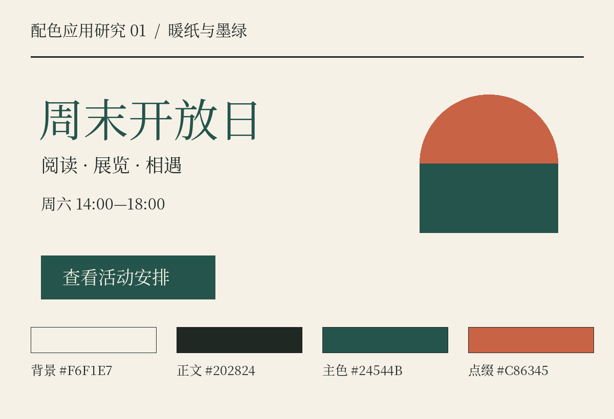
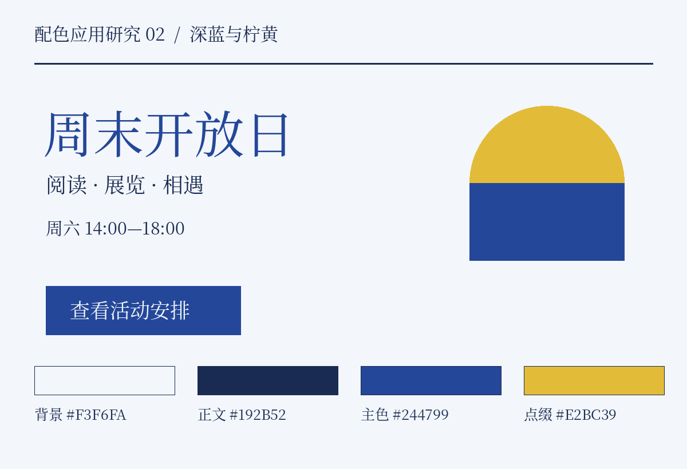
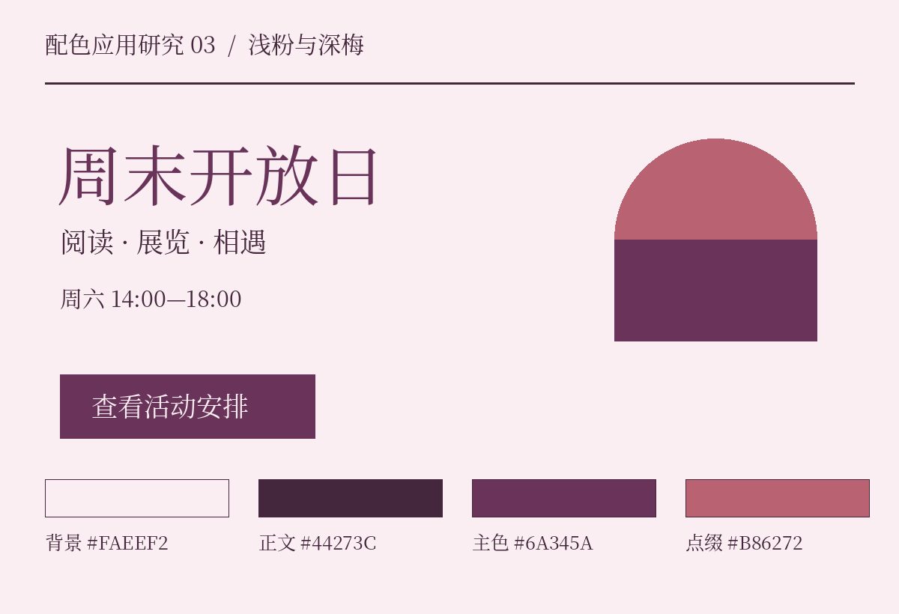
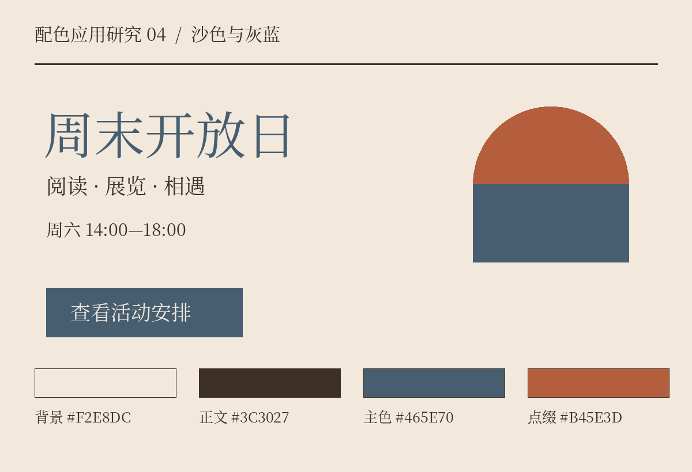
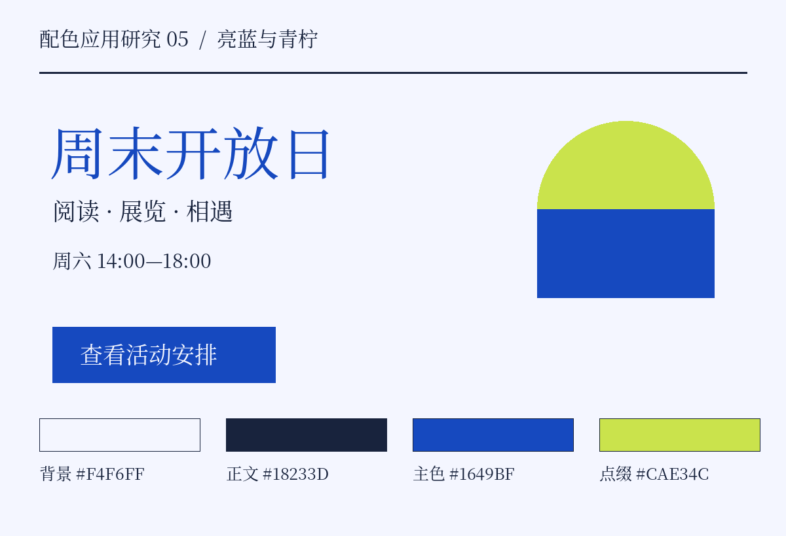
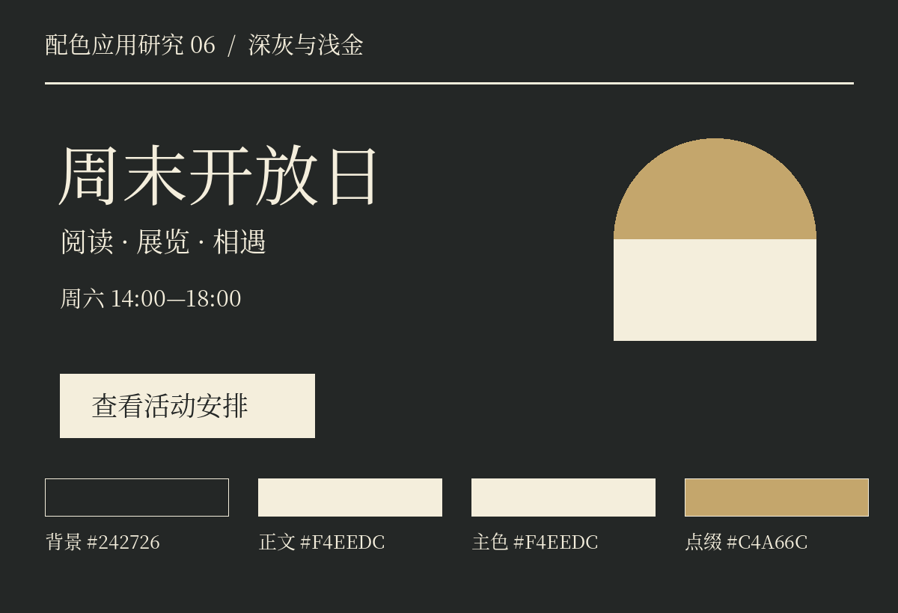
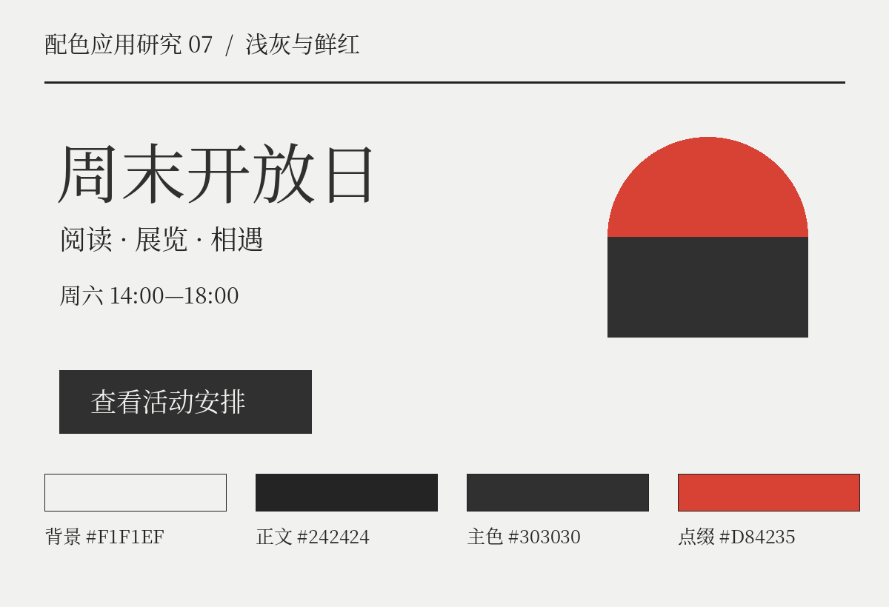
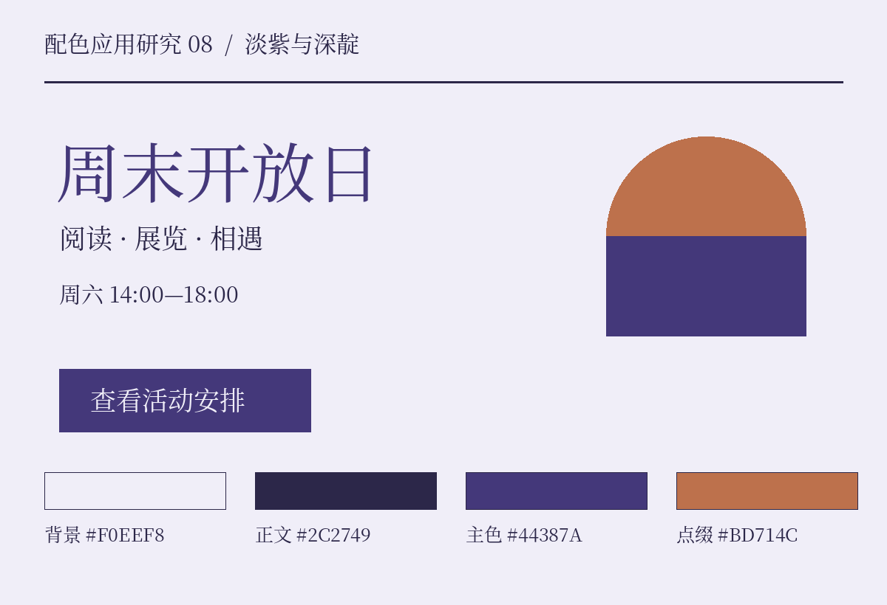

# 附录C 八组配色，放进同一张海报

这组图把标题、文字、形状、位置与字号固定下来，仅更换颜色。它补充贯穿全书的墨绿案例，让你比较不同颜色关系，而不是误以为所有设计都应该采用同一套颜色。八组均为原创教学方案，不代表真实品牌、流行趋势或固定的情绪类型。

观察时先遮住下方色卡：看哪块先被注意、文字是否容易找到、深浅秩序是否改变。再看色卡，就能意识到面积和所在位置比色卡本身提供了更多信息。标题与主按钮共用主色，点缀色只用于几何装饰；点缀色没有作为小字使用，不能从这张图推断其文字对比达标。

以下数值按sRGB及WCAG相对亮度公式计算，背景为不透明纯色。这里只检查指定颜色配对；色块中的细描边用于让边界可辨，并不是额外的品牌色。

## 1. 暖纸与墨绿

正文与背景对比度 **13.42∶1**；主色与背景 **7.63∶1**。这两组配对在本例均超过普通文字AA的4.5∶1阈值（按未四舍五入值判断）。按钮反向使用同一配对。

## 2. 深蓝与柠黄

正文与背景对比度 **12.84∶1**；主色与背景 **7.95∶1**。这两组配对在本例均超过普通文字AA的4.5∶1阈值（按未四舍五入值判断）。按钮反向使用同一配对。

## 3. 浅粉与深梅

正文与背景对比度 **11.60∶1**；主色与背景 **8.25∶1**。这两组配对在本例均超过普通文字AA的4.5∶1阈值（按未四舍五入值判断）。按钮反向使用同一配对。

## 4. 沙色与灰蓝

正文与背景对比度 **10.55∶1**；主色与背景 **5.61∶1**。这两组配对在本例均超过普通文字AA的4.5∶1阈值（按未四舍五入值判断）。按钮反向使用同一配对。

## 5. 亮蓝与青柠

正文与背景对比度 **14.46∶1**；主色与背景 **7.11∶1**。这两组配对在本例均超过普通文字AA的4.5∶1阈值（按未四舍五入值判断）。按钮反向使用同一配对。

## 6. 深灰与浅金

正文与背景对比度 **13.00∶1**；主色与背景 **13.00∶1**。这两组配对在本例均超过普通文字AA的4.5∶1阈值（按未四舍五入值判断）。按钮反向使用同一配对。

## 7. 浅灰与鲜红

正文与背景对比度 **13.73∶1**；主色与背景 **11.67∶1**。这两组配对在本例均超过普通文字AA的4.5∶1阈值（按未四舍五入值判断）。按钮反向使用同一配对。

## 8. 淡紫与深靛

正文与背景对比度 **12.25∶1**；主色与背景 **8.74∶1**。这两组配对在本例均超过普通文字AA的4.5∶1阈值（按未四舍五入值判断）。按钮反向使用同一配对。

## 把这八组变成自己的练习

任选两组，先只交换点缀色，观察它是否改变重心；再交换背景与正文，检查原来的图形层级是否仍成立；最后把海报缩到手机宽度，确认你仍能迅速找到时间和行动入口。颜色交换后应重新计算配对，不能沿用原来的通过结论。

这些图只证明所展示的组合在这一套固定版式里怎样呈现，不证明它们适用于任何行业，也不保证印在不同纸张上保持相同外观。如果改变文字大小、透明度、背景图或材料，就已经进入新的使用条件。

### 计算依据

- [W3C：Contrast (Minimum)](https://www.w3.org/WAI/WCAG22/Understanding/contrast-minimum.html)。配色、海报与计算脚本均为本书原创。
