# 视觉案例索引：从实物到配色判断

本页把真实作品和生成的完整应用放在一起，方便先看，再进入对应章节读分析。真实案例保留原项目的摄影与设计；AI 教学示意用于探索虚构方案，不能当作真实作品、生产样或精确色彩测量。基础色块实验仍用于解释关系，完整案例则帮助观察字体、摄影、材料和环境怎样参与配色。

## 按章节寻找直观案例

每章都将案例放回概念附近。先看完整画面，再用精确图解分析其中的明暗、面积或角色；同一物料在不同章节出现时，观察任务也随之改变。

| 章节 | 直观案例 |
| --- | --- |
| [第1章 从生活中观察颜色](../chapters/01-observe.md) | 花店工作台：环境、骨架与焦点 |
| [第2章 光、物体与眼睛](../chapters/02-light.md) | 涂层、陶器、玻璃与织物 |
| [第3章 色相、明度与彩度](../chapters/03-dimensions.md) | 同款椅子的色相、明暗与鲜灰 |
| [第4章 背景与环境如何改变颜色](../chapters/04-context.md) | 花器与两种墙面背景 |
| [第5章 色轮与配色关系](../chapters/05-wheel.md) | 相近色与冷暖对置花艺 |
| [第6章 明度结构与可读性](../chapters/06-value.md) | 完整海报低／高对比 |
| [第7章 彩度、面积与视觉重心](../chapters/07-area.md) | 护肤包装点缀与主体交换 |
| [第8章 冷暖、中性色与颜色节奏](../chapters/08-rhythm.md) | 外套与围巾的相对冷暖 |
| [第9章 情绪与气氛](../chapters/09-mood.md) | 阅读角的日间与夜间 |
| [第10章 文化、习惯与语境](../chapters/10-culture.md) | Ibadan dun靛蓝织物 |
| [第11章 色彩历史与材料变化](../chapters/11-history.md) | 《神奈川冲浪里》及材料证据 |
| [第12章 风格、趋势与当代审美](../chapters/12-style.md) | Spotify Wrapped历年视觉 |
| [第13章 从自然、摄影和作品中取色](../chapters/13-extract.md) | 建筑图片实际采样与角色选择 |
| [第14章 从色卡到完整画面](../chapters/14-composition.md) | 茶包装的三种主导关系 |
| [第15章 为文字、图形与图像分配颜色](../chapters/15-roles.md) | 完整刊物中排印与摄影 |
| [第16章 诊断与修正失败的配色](../chapters/16-repair.md) | 同一完整海报的四步修正 |
| [第17章 品牌、海报与出版](../chapters/17-identity.md) | Spotify产品与Penguin书脊 |
| [第18章 网页、App与数据图表](../chapters/18-interface.md) | Duolingo界面的探索与改版 |
| [第19章 服饰、产品与包装](../chapters/19-products.md) | iMac、键盘、服装与材料 |
| [第20章 室内、建筑与环境](../chapters/20-space.md) | 阅读空间与LEGO House |
| [第21章 主色、辅助色与语义角色](../chapters/21-semantics.md) | 活动预约与取消确认完整界面 |
| [第22章 色阶、深浅主题与状态](../chapters/22-themes.md) | Carbon仪表盘与Firefox主题 |
| [第23章 色域、印刷与颜色交付](../chapters/23-management.md) | 屏幕交付与纸张样张记录 |
| [第24章 从设计任务到完整色彩方案](../chapters/24-project.md) | 间色全套文化空间物料 |

## 真实项目：从已完成的设计学习

### Spotify Wrapped 历年视觉

历年活动视觉如何扩大色彩范围，并借字体与内容维持识别。 [进入对应章节](../chapters/12-style.md)。

*真实案例 R01｜Spotify 及相关作品权利人。来源：[Spotify Wrapped 历年视觉](https://newsroom.spotify.com/2026-04-23/spotify-design-history/)。查阅于2026-10-23；图片供就近评论，权利归原作者及机构。*

### Spotify 移动产品界面回顾

产品界面把内容封面放在前面，品牌色承担有限角色。 [进入对应章节](../chapters/17-identity.md)。

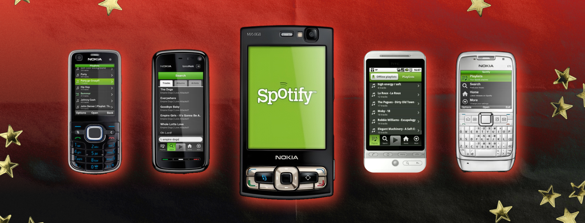

*真实案例 R02｜Spotify 及相关内容权利人。来源：[Spotify 移动产品界面回顾](https://newsroom.spotify.com/2026-04-23/spotify-design-history/)。查阅于2026-10-23；图片供就近评论，权利归原作者及机构。*

### Penguin 实体系列书脊

从实体书脊观察系列的统一、变化与货架辨识。 [进入对应章节](../chapters/17-identity.md)。

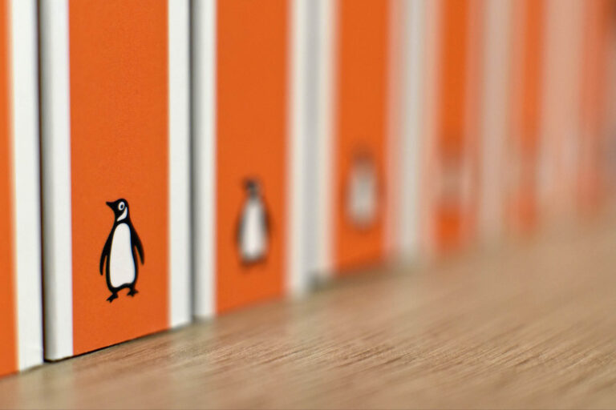

*真实案例 R03｜Penguin Random House 及摄影权利人。来源：[Penguin 实体系列书脊](https://www.penguin.co.uk/about/history)。查阅于2026-10-23；图片供就近评论，权利归原作者及机构。*

### Duolingo 核心标签栏改版研究

比较强色、柔色探索与最终界面，理解颜色怎样适应信息。 [进入对应章节](../chapters/18-interface.md)。

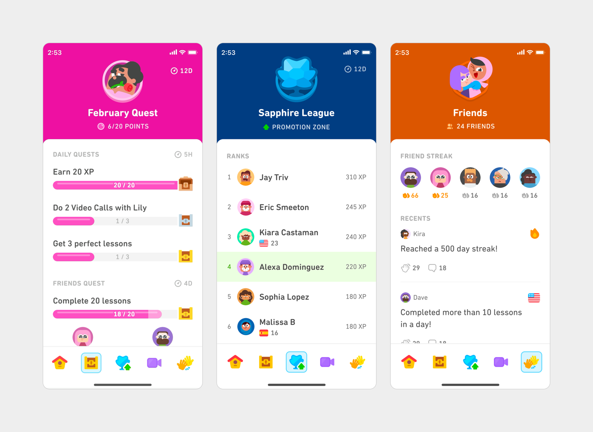

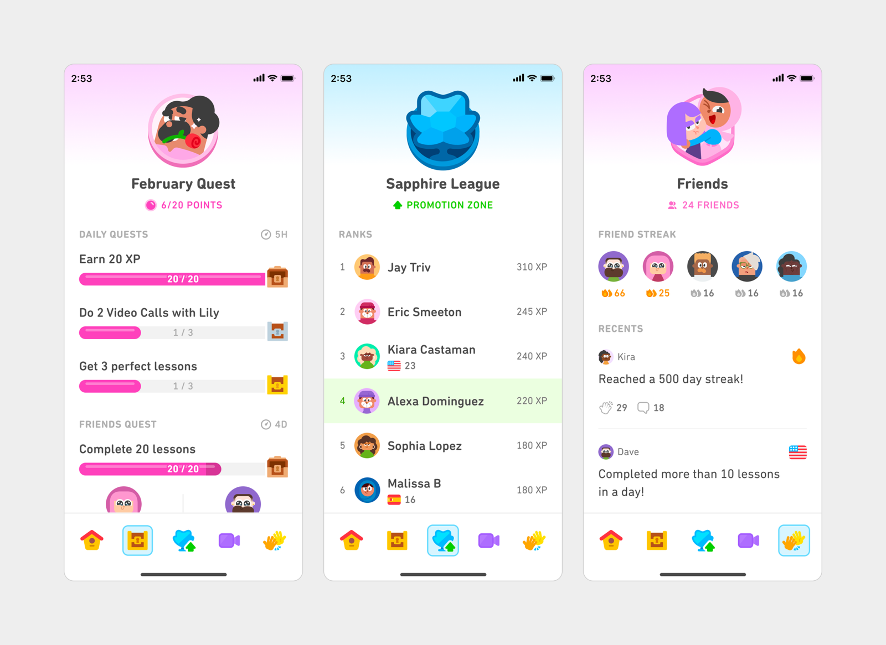

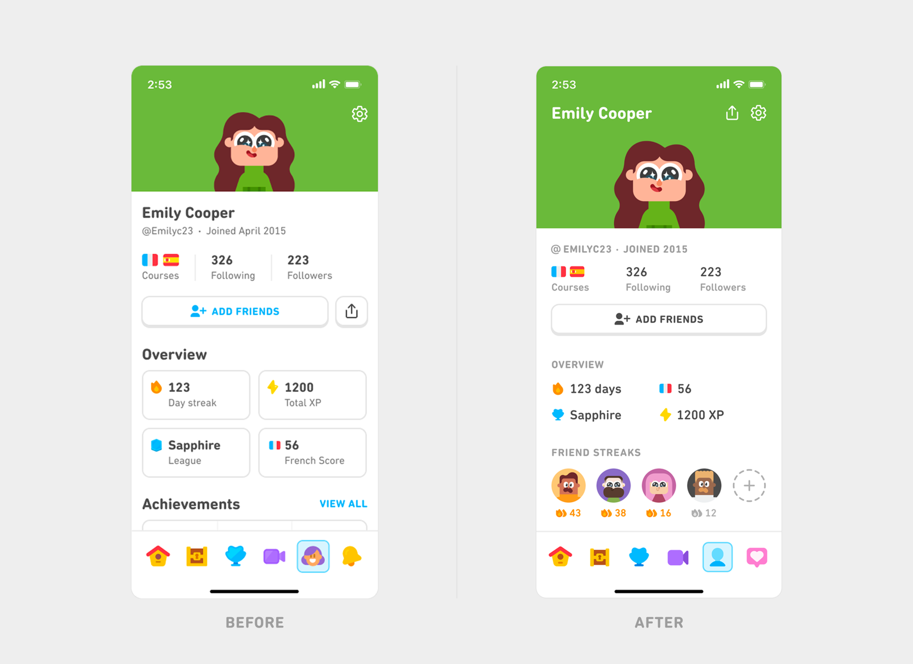

*真实案例 R04｜Duolingo。来源：[Duolingo 核心标签栏改版研究](https://blog.duolingo.com/core-tabs-redesign/)。查阅于2026-10-23；图片供就近评论，权利归原作者及机构。*

### 2024 iMac 与键盘配色

产品正面、背面与操作部件的颜色需要不同分工。 [进入对应章节](../chapters/19-products.md)。

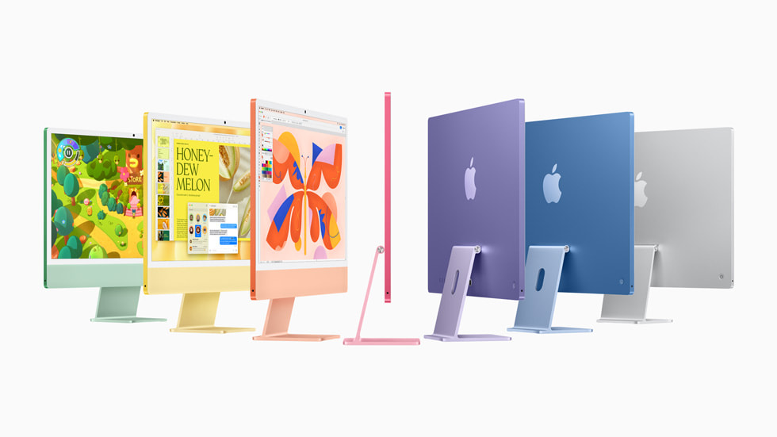

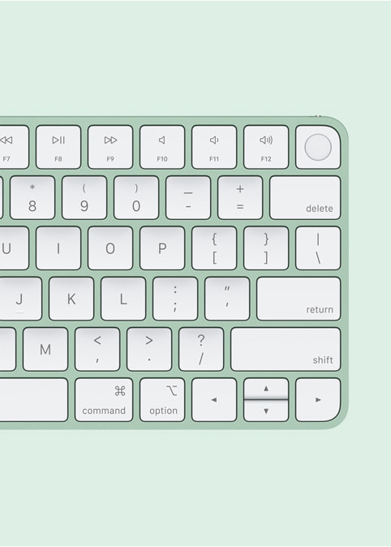

*真实案例 R05｜Apple。来源：[2024 iMac 与键盘配色](https://www.apple.com/newsroom/2024/10/apple-introduces-new-imac-supercharged-by-m4-and-apple-intelligence/)。查阅于2026-10-23；图片供就近评论，权利归原作者及机构。*

### LEGO House 建筑

建筑体量、白色背景与局部彩色区域一起工作。 [进入对应章节](../chapters/20-space.md)。

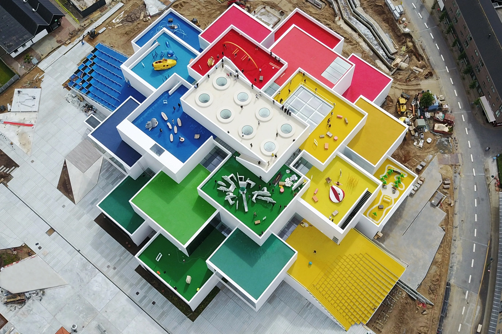

*真实案例 R06｜摄影 Kim Christensen / DAC 项目页面。来源：[LEGO House 建筑](https://dac.dk/en/magazine/places/lego-house-playful-building-design-385)。查阅于2026-10-23；图片供就近评论，权利归原作者及机构。*

### Carbon 完整明暗主题仪表盘

同一仪表盘转入深色主题，需要重新组织表面与状态。 [进入对应章节](../chapters/22-themes.md)。

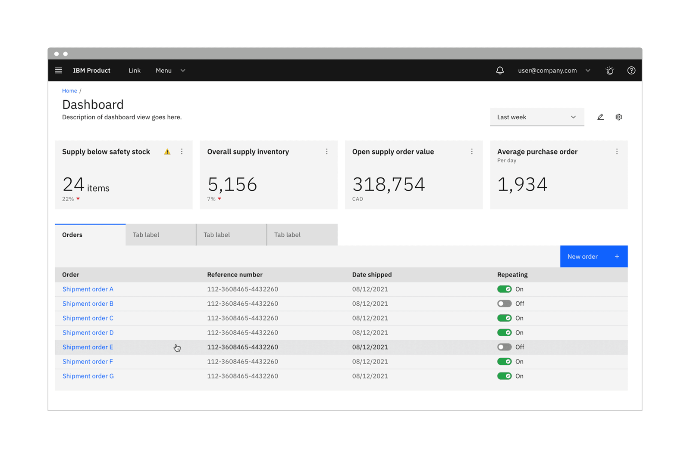

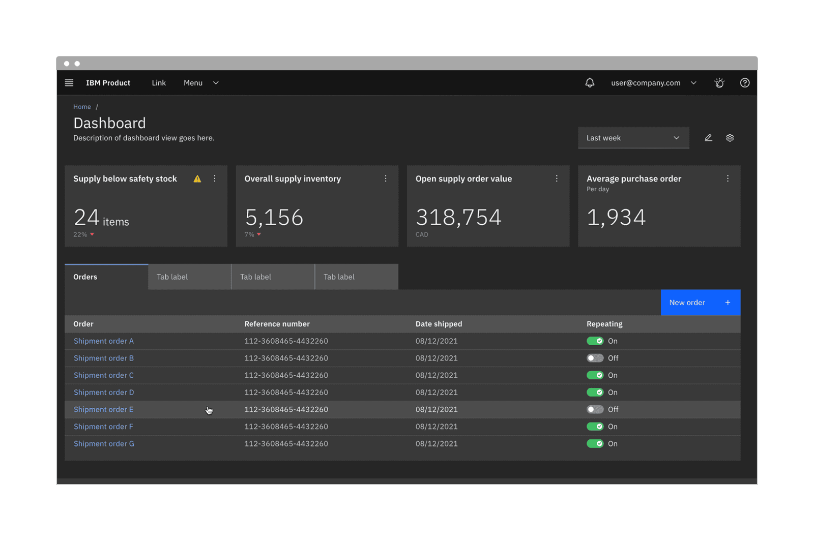

*真实案例 R07｜IBM。来源：[Carbon 完整明暗主题仪表盘](https://www.carbondesignsystem.com/building-blocks/foundations/color/overview)。查阅于2026-10-23；图片供就近评论，权利归原作者及机构。*

### Firefox 外观与主题选择

浏览器主题和网页内容怎样形成不同层次。 [进入对应章节](../chapters/22-themes.md)。

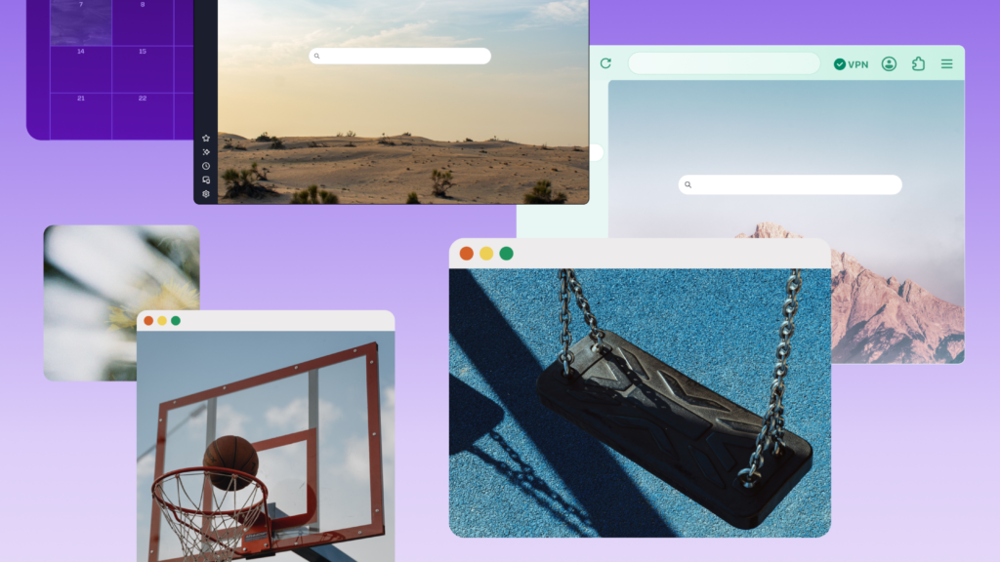

*真实案例 R08｜Mozilla 及相关权利人。来源：[Firefox 外观与主题选择](https://blog.mozilla.org/en/firefox/new-firefox-design-is-here/)。查阅于2026-10-23；图片供就近评论，权利归原作者及机构。*

## 生成的完整应用：把判断放进具体场景

### 间色：海报、折页与日用品

同一套颜色怎样随纸张、布袋和杯面改变角色。 [阅读拆解](../chapters/24-project.md)。

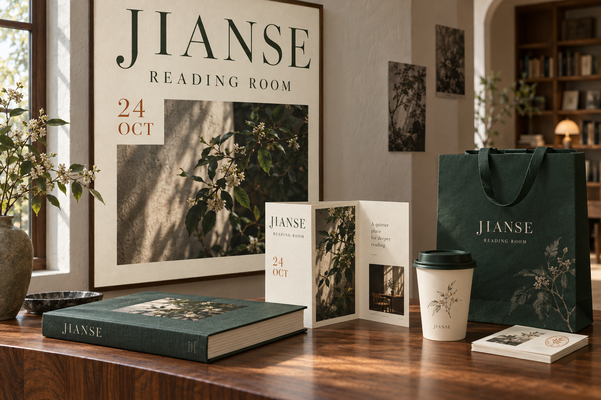

*AI 教学示意 G01｜虚构方案，采用内置生图工具制作；细节以章节中说明的观察范围为准。*

### INTERVAL：摄影进入完整书刊

钴蓝排印、陶红摄影与米白纸面共同形成阅读层级。 [阅读拆解](../chapters/15-roles.md)。

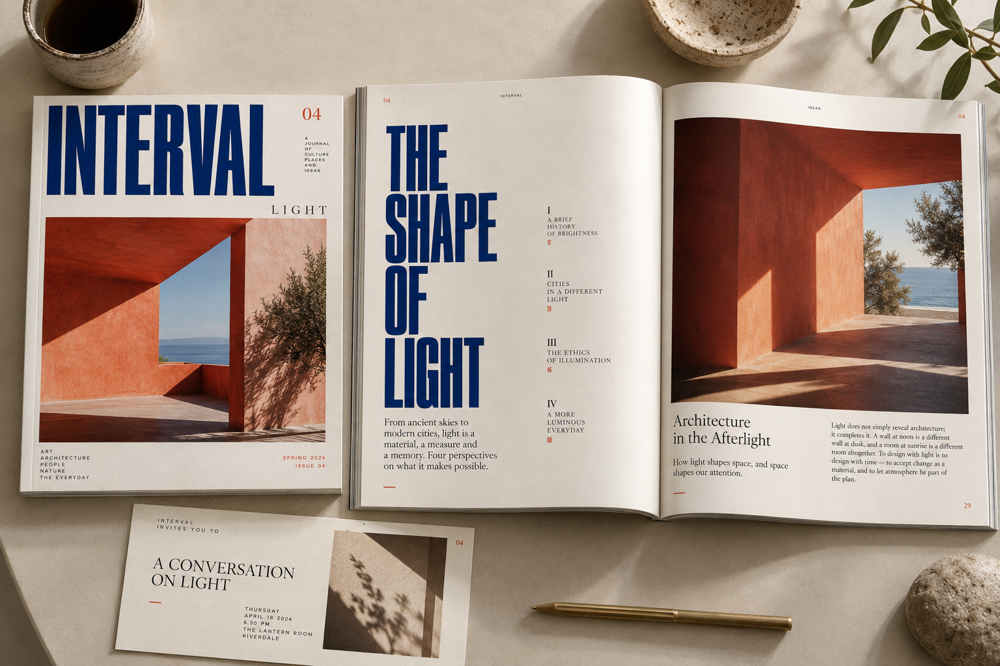

*AI 教学示意 G02｜虚构方案，采用内置生图工具制作；细节以章节中说明的观察范围为准。*

### 茶包装：三种颜色轮流主导

方盒、圆罐和纸袋换底色时，文字与插画也要适配。 [阅读拆解](../chapters/14-composition.md)。

*AI 教学示意 G03｜虚构方案，采用内置生图工具制作；细节以章节中说明的观察范围为准。*

### 阅读角：日间与夜间的整体方案

从墙面、照明和窗外环境，看气氛怎样共同形成。 [阅读拆解](../chapters/09-mood.md)。

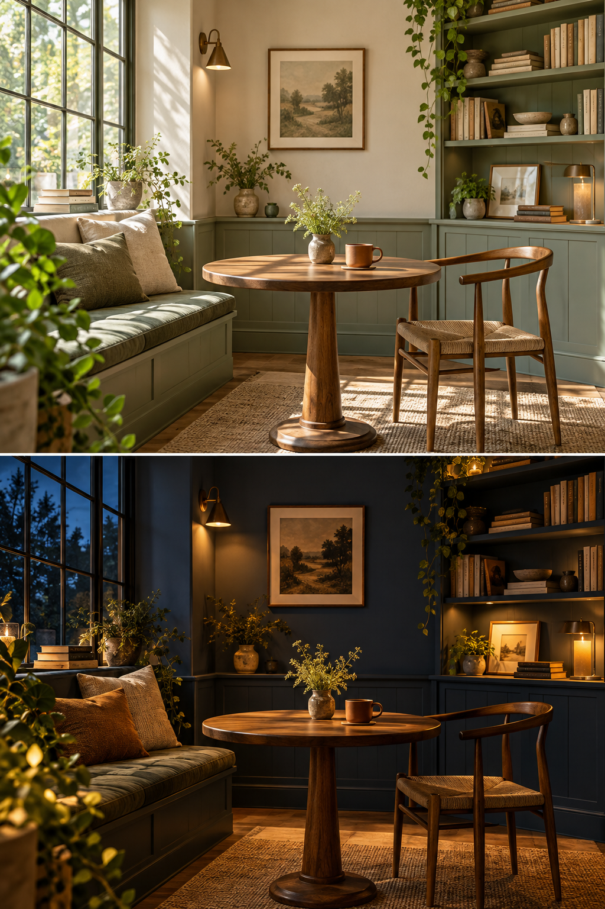

*AI 教学示意 G04｜虚构方案，采用内置生图工具制作；细节以章节中说明的观察范围为准。*

### 蓝色进入涂层、陶器、玻璃与织物

高光、透射、褶皱和灯光让相近的蓝产生不同外观。 [阅读拆解](../chapters/02-light.md)。

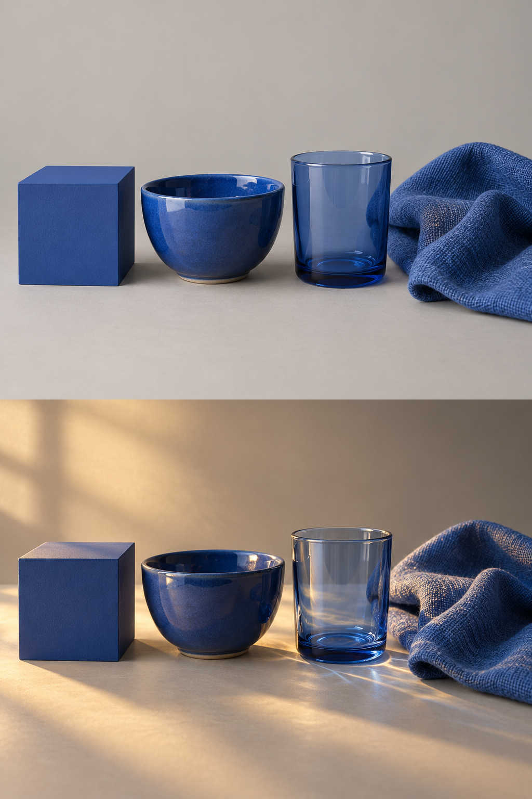

*AI 教学示意 G05｜虚构方案，采用内置生图工具制作；细节以章节中说明的观察范围为准。*

### 穿搭：驼色与蓝色的面积交换

保留服装轮廓，比较外套与围巾的冷暖分工。 [阅读拆解](../chapters/19-products.md)。

*AI 教学示意 G06｜虚构方案，采用内置生图工具制作；细节以章节中说明的观察范围为准。*

## 用同一张摄影校验八组配色

[八组配色海报](03-palette-studies.md)保留同一版式、摄影与文字位置，只改变周边颜色，帮助把完整场景的判断再拆回可比较的颜色关系。
