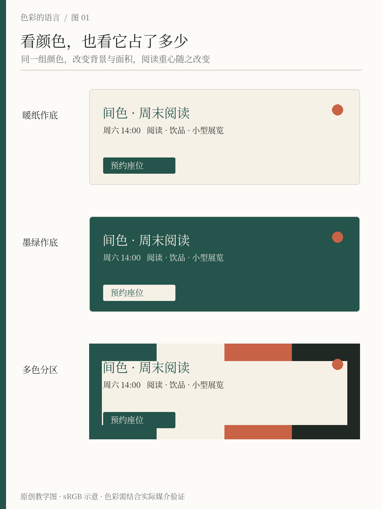

# 第1章 从生活中观察颜色

走进一家小店，你未必先看清招牌，却可能已经知道自己想不想进去。大片墙面的颜色、门口的一点亮色、灯光下的木头和纸张，共同形成了第一眼。学习配色可以从这里开始：暂时放下“这是什么色号”，先看颜色在什么地方、占多少面积、正在帮助谁被看见。

本书会逐步设计一个原创文化空间「间色」：这里可以阅读、喝饮品，也举办小型展览。它的初始颜色是墨绿 `#24544B`、暖纸 `#F6F1E7`、陶橘 `#C86345` 和深墨 `#202824`。这些是书中的教学选择，不是经过市场验证的品牌规范。随着任务变化，我们会修改它们。

## 先看一张完整画面：花店工作台

*图1-2｜AI 教学示意，虚构花店场景。这里先练习观察关系，图中花材不是实物验色样本。*

先别急着给所有花命名，试着把画面分成三层。后方墙面、桌面与包装纸构成较连续的浅色环境；叶片和阴影建立深色的骨架；红橙、粉色、蓝紫色花朵则分布在这个骨架之间。它们并不是整整齐齐、等面积地排成一张色卡，颜色的面积和位置一直在参与结果。

再找第一眼落到的地方。你可能先看到一枝较亮的花，也可能先看到一簇较深的花头。把视线落点与它周围的颜色一起记录：是明暗差、鲜灰差、较大的面积，还是枝条的方向让你注意它？这一步不需要与别人得出完全相同的答案，需要的是能在图中指给别人看。

最后才挑颜色。若只取最鲜的红橙和蓝紫，再让它们在海报上各占一半，可能丢掉照片里大量浅色环境带来的舒展感。若把所有深绿都删掉，花朵间的连接也会变化。从这个例子迁移到室内、服装或网页时，可以先问：谁提供环境，谁连接局部，谁负责出现变化？

## 先看整体，再找局部

一张配色卡把颜色放在相近大小的方块里，方便比较，却拿走了真实画面的许多条件。海报上，底色可能覆盖大半页，强调色只是一条细线；房间里，墙面包围着人，靠垫只占视野一角。挑出颜色相同，不等于恢复了相同的视觉效果。

观察「间色」的活动海报时，先不管文字内容，退远一些，看它像一块深色画面，还是一张明亮纸页。接着靠近，找出第一眼看到的位置。最后才记录局部颜色。这样的顺序能避免被一个漂亮小色块吸引，却忽略整张画面的组织。

*图1-1 原创教学图。三版分别采用暖纸作底、墨绿作底与多色分区，使用同一组基础色与相同内容，改变背景和强调区域的面积。先比较整张画面的轻重，再比较最先进入视线的位置；这不是哪版必然更好的投票。*

可以把一次观察写成三个层次。第一层是可指认的事实：“暖纸底占了大部分”“墨绿用于标题和大块图形”“陶橘只有日期旁的一小块”。第二层是自己的观看结果：“我先看到日期，再读标题”。第三层才是解释：“陶橘与周围颜色的差异和它所在的位置，共同帮助日期突出”。把三层分开，会让交流更准确，也给解释留下修正的余地。

## 给颜色一个角色

初学者常用颜色名称组织判断：绿配橘、蓝配黄、粉配灰。实际设计还需要另一套语言：背景色、内容色、强调色、分隔色。颜色名称告诉我们它大致长什么样，角色告诉我们它为什么出现在这里。

在阅读海报上，暖纸可以承担背景，深墨承担细小文字，墨绿建立识别，陶橘引导读者找到活动入口。同一个陶橘到了饮品包装上，可能成为大面积包装色。颜色没有变，职责变了。后面有关系统的章节，会把这种职责整理成可以重复使用的规则。

| 观察对象 | 先记录什么 | 暂缓下结论 |
| --- | --- | --- |
| 一张海报 | 大面积底色、阅读顺序、最突出的区域 | “这个橘色天然吸引所有人” |
| 一件衣服 | 主体面积、领口和配件、肤色与环境 | “这套颜色一定显白” |
| 一个房间 | 主要照明、墙地顶、家具和材质 | “照片里的色号刷出来必然一样” |
| 一个界面 | 正文、背景、操作入口和提示 | “品牌色就适合所有按钮文字” |

这些暂缓并不是要消除直觉，而是把直觉变成可以检查的问题。背景会影响我们感受到的局部颜色，Exploratorium 的色彩对比实验可以直接展示这一点。因此，颜色观察应保留周围环境，不能只留下裁出来的孤立色块。[资料：Color Contrast](https://www.exploratorium.edu/snacks/color-contrast)

## 做一份小型观察记录

找一件手边物品，最好具有两三种主要颜色。先在正常观看距离记录三句话：大面积是什么，小面积是什么，视线停在哪里。然后把它移到另一种背景前，再记录一次。你可以选择一本封面有图形的书，先放在白桌面，再放在深色布面上。

接着画一个不求精致的小缩略图。只用几块色面标出比例，不描摹细节。这个步骤帮助我们把“颜色很多”拆成“哪些颜色真的占据画面”。如果希望保留照片，把拍摄光线和背景也记下来；照片是一次观察记录，不能充当物品在所有环境中的标准颜色。

一个合格的结果不必写出专业词汇。例如：“封面大部分是浅米色，深绿标题集中在上半部，橘色贴纸很小但靠近标题；在深色背景上，整本书的轮廓更清楚。”这比单独记下“米、绿、橘，好看”更接近可复用的知识。

## 从喜欢走向判断

你可以喜欢高彩度撞色，也可以喜欢低彩度的安静画面。偏好值得保留，但“我喜欢”与“适合这次任务”需要分别记录。若「间色」要发布闭店维护通知，读者能快速确认日期，比海报是否像艺术展更紧迫；若是展览主视觉，气氛和辨识度的权重可能增加。

还有一种差异来自观看者。色觉缺陷并不等于所有颜色都变成灰色，不同类型会影响不同的辨色能力。观察练习帮助认识自己的观看经验，却不能证明所有人都能读懂同一套颜色。[资料：National Eye Institute，Types of Color Vision Deficiency](https://www.nei.nih.gov/eye-health-information/eye-conditions-and-diseases/color-blindness/types-color-vision-deficiency)

本书接下来会解释光、材料与视觉，再学习如何改变颜色关系。带着本章的记录继续读，你会逐渐为原本模糊的感觉找到更精确的描述，也会发现：配色能力的一大部分，是知道还需要观察什么。

## 本章资料

- Exploratorium Teacher Institute， [Color Contrast](https://www.exploratorium.edu/snacks/color-contrast)：背景影响颜色外观的观察活动。
- National Eye Institute， [Types of Color Vision Deficiency](https://www.nei.nih.gov/eye-health-information/eye-conditions-and-diseases/color-blindness/types-color-vision-deficiency)：色觉差异的基本类型。
