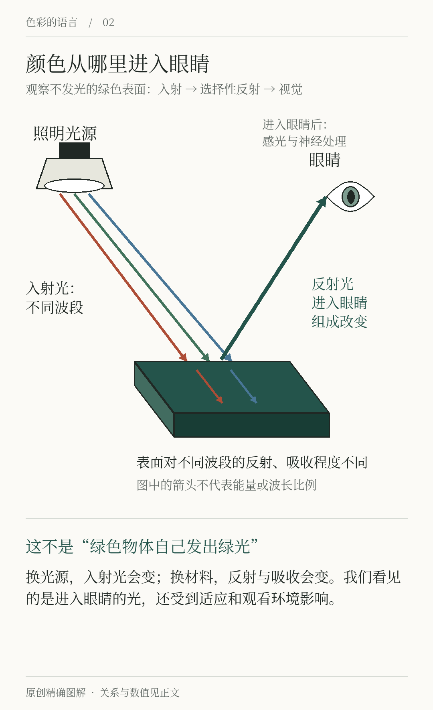
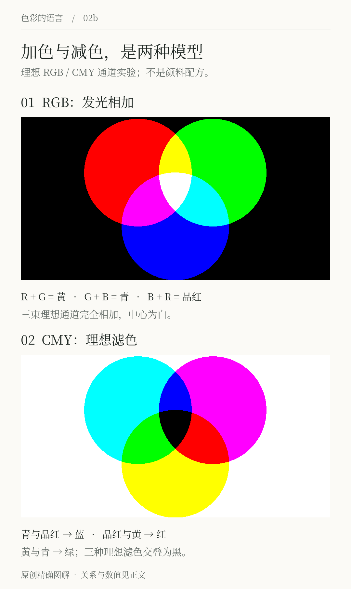

# 第2章 光、物体与眼睛

把一张白纸从窗边拿到暖色台灯下，它的外观会发生变化；把手机里的白色页面带进同一个房间，又会得到另一种观看经验。纸张主要把照到它的光反射给我们，屏幕则在工作时向外发光。两者可以被我们都叫作“白”，形成颜色的路径却不同。

理解这条路径，可以解释许多配色之外的问题：为什么店里的衣服回家后看着不一样，为什么同一个绿色在屏幕和纸上难以对齐，为什么换一盏灯可能比换一个色号更有效。

## 从光源走到视觉

观察一件不发光的物体，可以先把过程拆成三个环节。光源提供入射光，材料对不同波段的光产生不同程度的反射、吸收或透射，最终进入眼睛的光形成视觉刺激。表面纹理和观看方向也会影响到达眼睛的光。这里讲的是理解问题的简化链路，真实空间通常还有多次反射。

眼睛把光转化为神经信号，大脑参与形成我们看见的图像。美国国家眼科研究所对视觉过程的介绍强调，光先经过眼部的光学结构，在视网膜被感光细胞转为电信号，再传向大脑。这说明“看见”包含感知过程，不能把眼睛简单当成一台读取色号的仪器。[资料：How the Eyes Work](https://www.nei.nih.gov/eye-health-information/healthy-vision/how-eyes-work)

*图2-1 原创原理示意，按光源、物体与眼睛三个阶段向下阅读。箭头表示作用关系，不表示某种材料的实测光谱，也不按波长或能量比例绘制。*

「间色」计划做一块墨绿门牌。屏幕中的 `#24544B` 是数字设计的起点。制作时还要决定基材、表面处理和照明：印在无涂布纸上的墨绿，与涂在亮面金属上的墨绿，不应只凭一个 HEX 数值验收。后者可能出现明显高光，前者可能呈现纸张纤维与吸收带来的外观变化。先明确最终看到的是什么物件，才知道应当怎样比较。

## 混光与混颜料是两件事

若在同一块白色幕布上叠加不同颜色的灯光，到达那一区域的光来自多个光源。这属于加色混合。屏幕以不同强度的红、绿、蓝通道组合颜色，也是常见的加色应用；具体能产生哪些颜色，取决于设备原色和其他条件。[资料：UW–Madison，Additive Color Mixing](https://www.physics.wisc.edu/ingersollmuseum/exhibits/opticscolor/color-mixing/)

把颜料混在一起时，参与变化的是材料对光的吸收和散射。青、品红、黄是常用的减色原色模型，印刷还通常使用黑色墨。透明滤色片的叠放可以较直观地演示减色作用；真实颜料因性质不同，混合结果不能只靠理想色块相叠来预测。[资料：UW–Madison，Subtractive Color Mixing](https://www.physics.wisc.edu/ingersollmuseum/exhibits/opticscolor/subcolormix/)

*图2-2 原创通道模型示意。上方为理想RGB加色，下方为理想CMY减色；重叠区用来解释光的叠加与通道吸收，不是实际颜料配方，真实材料混合不一定得到图中的颜色。*

所以，绘图软件里把半透明蓝层盖在黄层上，结果是否变绿，要看合成模式和色彩处理；拿两支颜料混合又是另一次实验。讨论“三原色”时，先问它在解决混光、印刷，还是某套绘画教学的问题。不同模型承担不同任务，不能只记三个名称。

## 三类视锥不等于三只颜色探测器

典型的人类色觉涉及三类视锥细胞，它们对不同波段具有重叠的敏感性，常以短、中、长波长的 S、M、L 命名。把它们简称为“蓝、绿、红视锥”虽然方便，但容易让人误以为每类细胞只对一种颜色响应。颜色判断依赖响应组合与后续处理，不是各自检测一个独立颜色。[资料：Neuroscience，Cones and Color Vision](https://www.ncbi.nlm.nih.gov/books/NBK11059/)

这一点也帮助理解屏幕为何可以用有限原色让我们看到许多颜色：它需要产生合适的视觉响应，而不是重新生成物体原来反射出的每一段光谱。视觉上相近，不一定意味着光谱相同。对于初学配色，暂时不必计算光谱；记住“数字相同、材料相同、看起来相同”是三个不同判断，就已经很有用。

## 用白纸做一次条件比较

准备一张白纸与一个有颜色的物品，依次放在窗边、日常照明下和另一盏灯下。让眼睛适应环境后，记录纸与物品的外观变化。每次保持观看角度相近，别把纸折出高光，也别让手机屏幕成为主要照明。

如果拍照记录，尽量固定手机的位置和拍摄设置。自动白平衡、曝光和后期处理可能改变照片，因此照片与肉眼记录不一致时，不要急着认定其中一方“坏了”。先确认比较的条件是否一致。这个练习的答案方向是找到变化发生在哪个环节，而不是宣布哪盏灯呈现了唯一真实颜色。

例如，你可能发现暖色照明下白纸仍被自己识别为白，但手机照片显得偏黄；也可能发现两种原本相近的绿色在换灯后差别更大。把这些现象记录下来，后面学习色彩管理时会更容易理解为什么需要约定观察条件。

## 把条件写进设计任务

为实物设计颜色时，最早的沟通单就可以加上三个问题：主要在哪里看，使用什么材料，在怎样的照明下看。「间色」的菜单可能在桌面近距离阅读，门牌可能在夜间远距离辨认，网站则由不同设备显示。它们分享品牌方向，却不能使用同一种验收方法。

小样、样板和实际环境测试之所以有价值，是因为它们把抽象颜色重新放回光与材料的链路。先做小样再扩大制作，不代表数字工具不可靠，而是承认它们描述的是流程中的特定部分。

## 本章资料

- National Eye Institute， [How the Eyes Work](https://www.nei.nih.gov/eye-health-information/healthy-vision/how-eyes-work)。
- UW–Madison， [Additive Color Mixing](https://www.physics.wisc.edu/ingersollmuseum/exhibits/opticscolor/color-mixing/) 与 [Subtractive Color Mixing](https://www.physics.wisc.edu/ingersollmuseum/exhibits/opticscolor/subcolormix/)。
- Purves 等，*Neuroscience*， [Cones and Color Vision](https://www.ncbi.nlm.nih.gov/books/NBK11059/)：视锥类型及响应组合。
