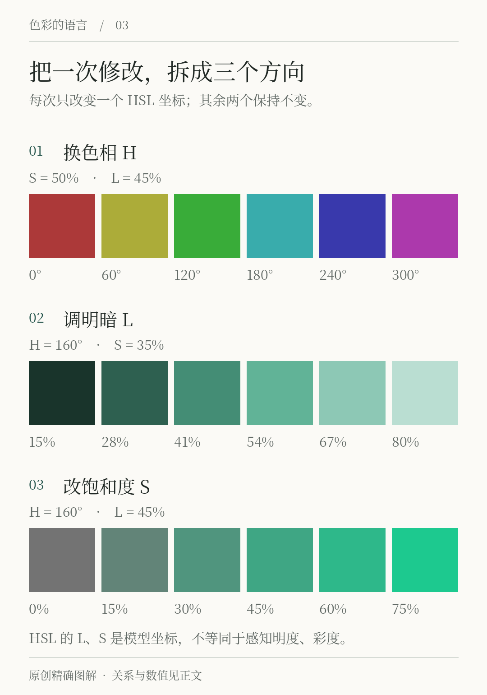
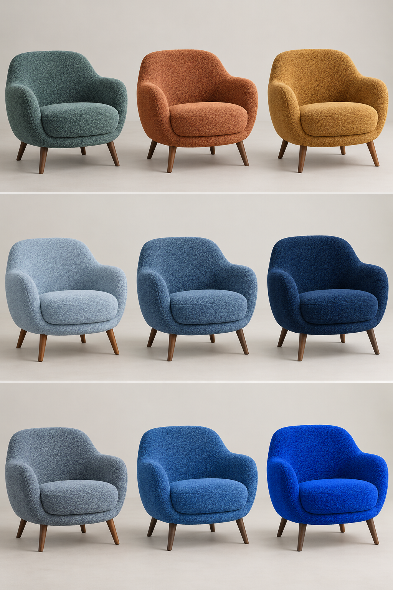

# 第3章 色相、明度与彩度

“这个绿太重了。”这句话可能指颜色太暗，也可能指它太鲜，或者只是绿色覆盖的面积太大。若没有进一步描述，修改者只能试着猜。学习颜色的几个基本维度，目的就是把这种模糊感觉拆成可操作的变化。

本章先用三条观察轴建立语言：偏什么颜色、有多明暗、离中性灰有多远。它们分别接近色相、明度和彩度的直观含义。先学会分别改变一项，再讨论软件中的数值，通常比从复杂拾色器开始更容易。

## 色相：在颜色家族中的位置

色相帮助我们区别红、黄、绿、蓝等颜色类别，也允许描述“更偏黄的绿”与“更偏蓝的绿”。这些名称的边界不是一圈自然存在的硬线。为了比较和计算，颜色模型会给色相安排位置或角度；角度只有放在指定模型里才有意义。

「间色」的墨绿略偏蓝绿。若修改任务是让它更接近植物叶片的黄绿色，应先尝试调整色相，而不是一边提亮一边提高彩度。否则即使新版本更符合感觉，也难以知道是哪项变化起了作用。

中性黑、白、灰没有明确的彩色色相。软件里某个灰色仍可能保存一个色相数字，这通常是表示法或编辑状态的需要，不能据此说它看起来具有强烈的红或蓝。W3C 的 CSS Color 文档将这种不影响结果的分量称为“无作用分量”，在无彩度颜色的色相讨论中尤其容易遇到。[资料：CSS Color 4，Powerless Color Components](https://www.w3.org/TR/css-color-4/#powerless)

## 明度：看起来有多明或多暗

明度使我们能够把暖纸、墨绿和深墨放在大致的浅深顺序中。它不仅影响气氛，也参与图形边界、文字和背景的分离。在很多任务中，先建立可靠的明暗结构，再细调色相，会比不断更换“主色”有效。

需要区分几个日常常被混用的词。发光强度、视觉亮度感、相对一个白色参照的明度，以及软件中名为“亮度”的滑杆，并不是同一个量。一般阅读可以暂时用“明暗”描述观察；当你需要交流数值，就必须连同模型一起说，比如 HSL 的 L，或者 OKLCH 的 L。它们不是可直接互换的百分数。

## 彩度：颜色离中性有多远

在相近明暗条件下，一种绿可以鲜明，也可以带灰。这里把颜色偏离相同明度中性色的程度，直观理解为彩度。提高彩度不等于加白，也不等于变亮。低彩度颜色同样可以很深或很浅。

孟塞尔体系以色相、明度和彩度组织物体颜色，是这套三维观察方法的重要参照。它使用具体体系中的标度，不能把软件里任意一个“饱和度”百分数直接当成孟塞尔彩度。[资料：Munsell，A Practical Description of the Munsell Color System](https://munsell.com/wp-content/uploads/2011/03/munsell-color-system-cleland.pdf)

日常说“饱和度”往往只是指鲜艳程度；严格讨论时，饱和度与彩度有各自的定义，软件算法也会不同。本书在讲视觉关系时尽量使用“彩度”，讲 HSL 操作时则使用该模型实际的“饱和度”名称。避免强行把两个词合并，可以减少很多沟通误差。

*图3-1 原创教学图。三行分别改变 HSL 的 H、L、S：上行 H 为0°至300°，S=50%、L=45%；中行 H=160°、S=35%，改变L；下行 H=160°、L=45%，改变S。它是屏幕中的概念对照，HSL的L和S不等同于感知明度和彩度，不是孟塞尔实体色样。*

## 看得见的修改：同一种椅子，三条不同的变化轴

*图3-2｜AI 教学示意。从上到下分别侧重色相、明暗、鲜灰变化。造型和照明尽量保持相近，未经过色度测量，不能把各排理解为其余分量严格相等。精确数值关系仍看图3-1。*

上排可以用“换一个颜色家族”来描述：蓝绿、陶红、赭黄改变了椅子在房间里与其他物品相处的方向。中排仍围绕蓝色展开，但浅色椅子更容易和浅背景连起来，深色椅子的轮廓则更集中。下排比较灰蓝到鲜蓝：鲜蓝更容易形成明显的彩色存在感，灰蓝则保留更多近中性的外观。它们是三种修改意图，不能统称为“把颜色调轻一点”。

也要看坐垫弧面、椅背边缘和织物纹理。同一张椅子自身就有亮部、暗部与许多细小颜色，所以现实产品无法像一个平涂色块那样只由三个数字解释。若想让深蓝椅子看起来没那么重，可以提亮本色，也可以增加周围留白、调整照明或缩小它的面积；这些动作的成本和作用并不相同。

和他人沟通时，先说清你想保留什么。例如“保留现在偏蓝的方向，试一个更浅的版本”，比“换成高级一点的蓝”更容易执行。随后回到实际面料样与房间里比较，避免用生成图替代采购和打样。

## 认识拾色器，但别被坐标误导

HEX 是表示 sRGB 通道值的常见写法；`#24544B` 可以准确传递一组数字，但它不能直接告诉我们“把这个颜色变得更安静”该改哪一位。HSL 把颜色重排为色相、饱和度与明度，操作直观，却并非感知均匀的体系。两个颜色即使 HSL 的 L 相同，也可能看起来明显不同亮。

Lab、LCH、Oklab、OKLCH 等表示法，提供了面向感知组织颜色的其他办法；它们也不是人眼在任何条件下都完全一致的精确复制。初学时可以先使用熟悉的工具，关键是知道坐标模型的限制。颜色空间和交付问题将在第23章继续展开。[资料：CSS Color 4，HSL 与设备无关颜色章节](https://www.w3.org/TR/css-color-4/)

## 三次修改，只动一个方向

用任意支持拾色的工具画三个同样大小的方块，底色固定为暖纸。将墨绿复制三份：第一份只往偏黄或偏蓝方向变化；第二份主要变浅或变深；第三份主要降低鲜艳程度。每次记录自己想改什么、实际改了什么，不必追求完全独立的物理量。

完成后，用一句具体语言评价每份。例如：“偏蓝版本与陶橘并置时差异更明显”“浅绿版本更适合大面积底，但不适合承载小号白字”“带灰版本不再成为最突出的色块”。这些都是针对当前画面的结果，不要升级成“偏蓝一定专业”或“低彩度一定高级”。

若你只看到了明暗变化，却没看出色相差别，可以扩大变化范围，再回到细微调整。若某项数值怎么拉都不能得到想要的颜色，也可能是模型和色域限制，而不是你的审美失灵。

三维语言最终服务于判断：颜色哪里不合适，准备沿哪个方向改变，改变后是否完成任务。面积、位置与材质会在后续加入；到那时，“太重”就可以被拆解成更准确的设计说明。

## 本章资料

- Munsell， [A Practical Description of the Munsell Color System](https://munsell.com/wp-content/uploads/2011/03/munsell-color-system-cleland.pdf)：色相、明度、彩度的体系介绍。
- W3C， [CSS Color Module Level 4](https://www.w3.org/TR/css-color-4/)：颜色表示、术语、HSL、Lab/LCH 与 Oklab/OKLCH。该文档为持续修订的标准草案，本书引用其概念与定义，不以其版本状态保证具体软件支持。
