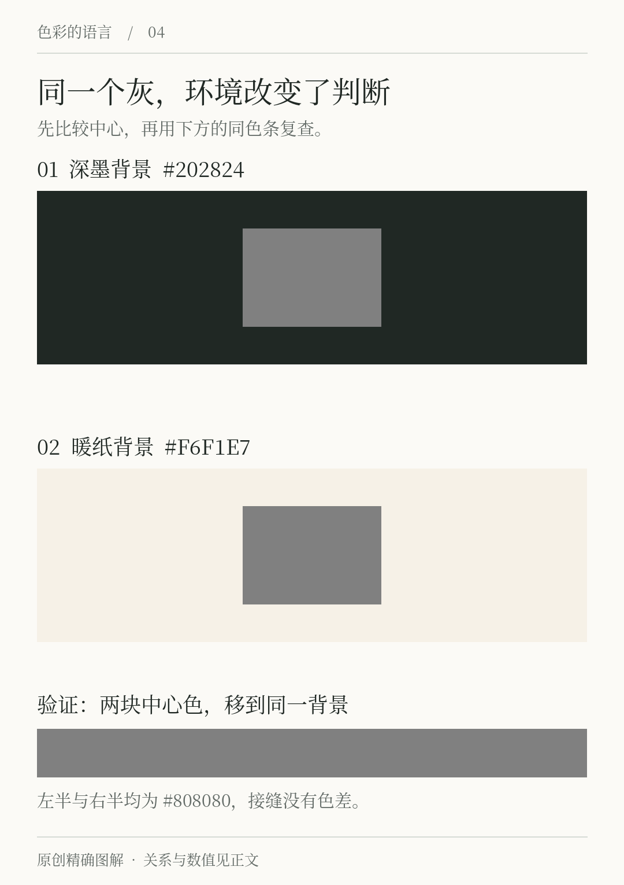
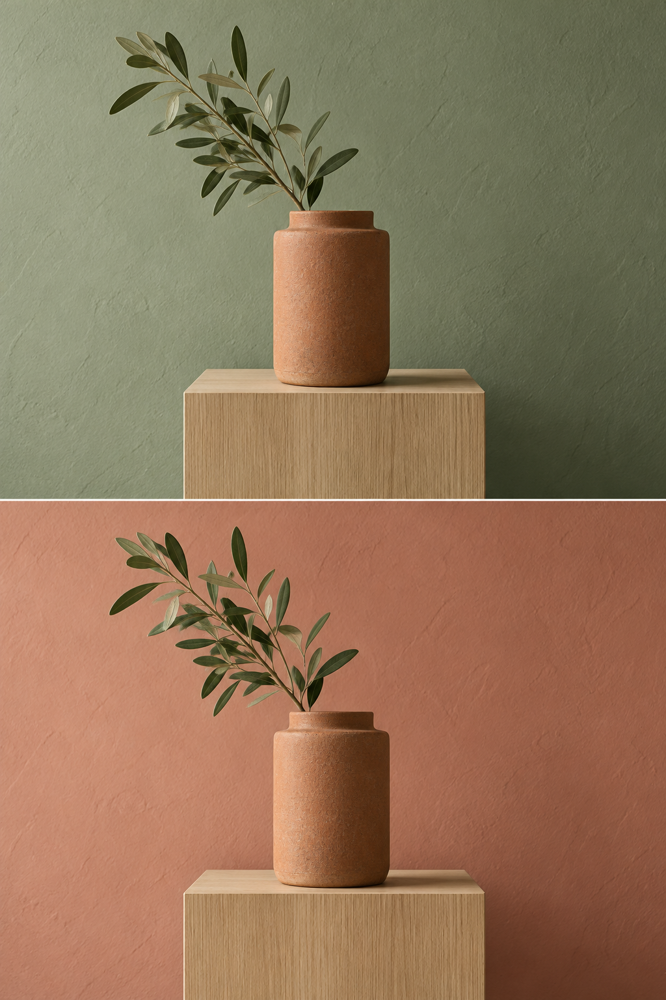

# 第4章 背景与环境如何改变颜色

把同一块灰色分别放在深色和浅色背景中，它们可能看起来不一样。用取色器检查，数字却完全相同。这不是文件出错，而是提示我们：视觉会在关系中判断颜色，局部色块的外观不能脱离周围条件。

在实际工作中，这类现象很常见。某个品牌色在白底上显得沉稳，铺满屏幕后却压迫；一块墙漆的小样在店里合适，刷上整面墙后感觉不同。这里可能同时包含背景、面积、光照和材料变化。本章先隔离背景与观看环境，不把所有差异都归给一种效应。

## 同色可以看起来不同

“同时对比”描述了相邻或周围颜色影响局部颜色外观的一类现象。Exploratorium 的教学实验让观察者把相同色纸放在不同背景中，再用同色比较条验证：看起来有差别的色块，材料实际上相同。我们可以把这种方法转为屏幕观察，不需要先接受复杂的解释。[资料：Color Contrast](https://www.exploratorium.edu/snacks/color-contrast)

*图4-1 原创观察图。中心均为 `#808080`，背景分别为深墨 `#202824` 与暖纸 `#F6F1E7`。用图中的同色验证条或遮住背景再次比较；感受强弱会因设备、显示大小和观看者不同而变化。*

观察时先看中心，再注意边界。你可能觉得深底上的灰更亮，浅底上的灰更暗；若第一眼不明显，短暂移开视线，再看整张图。不要把书上的描述当成必须看到的标准答案。这个实验验证的重点是环境可能影响判断，而不是测试你有没有“专业眼光”。

设计上最直接的启发是：审查一个按钮的颜色时，应把它放回实际页面。把按钮单独截在白底上，对比它在深色导航栏、照片背景、浅灰卡片里的效果，可能得到不同结论。软件中的独立色板有用，但它不是最终应用。

## 应用对照：同一陶色花器放进两种墙面

*图4-2｜AI 教学示意。上下保留相近物件与构图，比较灰绿和灰粉环境。生成图的花器像素与光照并不严格相同，因此只用于探索方案；图4-1才是同一像素颜色的验证实验。*

先看花器与墙面的边界，再看叶片。灰绿背景与叶片形成较接近的颜色家族，陶色花器提供偏暖的分离；灰粉背景与花器的暖色方向较近，叶片便可能成为更明显的冷暖停顿。即使花器本身没有打算换色，设计师仍会因为周围墙面改变而重新判断它是否合适。

这也解释了选墙漆时小色卡容易误导的原因之一：卡片旁边是店里的白纸、货架和灯光，最终墙面旁边却是木柜、窗帘、植物与大片地板。如果只把花器单独抠出来看，就会漏掉这些邻接关系。方案评审至少应保留物体周边的一部分环境。

接下来怎样做一次更可靠的试验？保留同一件实物、同一机位和尽量相同的光照，在背后分别立两张较大的色纸；拍摄时固定曝光与白平衡，现场也直接比较。照片提供记录，实物观察提供另一条证据。不要把本图里任何一处生成误差当成同时对比效应的证明。

## 对比与适应分开观察

背景关系可以在同一时刻发生；适应则强调视觉系统随观看条件而调整。长时间处在一种照明或色彩环境里，随后看另一种环境，感受可能暂时变化。颜色恒常性则描述我们在照明改变时仍能在一定程度上把物体识别为相对稳定的颜色。这些现象相关，却不是一个词的不同叫法。

我们在明亮室外和较暗室内之间移动时，看到的变化不只属于色彩。亮度、瞳孔反应与观看条件等都参与其中。这里不把所有现象简化成“眼睛自动白平衡”，也不把相机的白平衡等同于人的视觉过程。W3C 的颜色术语说明区分了刺激的色度描述、观看条件与颜色外观，帮助我们保留这几层区别。[资料：CSS Color 4，Color Terminology](https://www.w3.org/TR/css-color-4/#color-terminology)

对「间色」而言，一张陶橘色展览海报可能长时间占据整页，而菜单只用陶橘标出一行饮品。读者面对两者时，观看范围和任务都不同。把一个局部色块的感觉直接推广到整个空间，容易忽略这些条件。

## 透明并不是另一种固定颜色

半透明图形尤其容易制造误会。一个颜色加上透明度后，最终外观要与下方内容一起计算；下方是白、绿还是照片，结果会不同。把“50% 黑”当成一个不变的灰色，会使跨背景使用失去控制。CSS Color 对透明度与合成作了独立说明，正是因为颜色值与最终合成结果不是一回事。[资料：CSS Color 4，Simple Alpha Compositing](https://www.w3.org/TR/css-color-4/#simple-alpha-compositing)

如果「间色」在照片上放半透明深色遮罩与白字，检查时就不能只量遮罩的原始颜色。应看合成后的实际文字背景，尤其是照片最亮、纹理最密和文字最细的区域。均匀底上的成功，不保证照片上的成功。涉及对比测量的操作，下一章组会继续说明。

## 做一个可以复查的比较

选择一个你正在犹豫的颜色，把它分别放在三个背景上：浅底、深底和实际使用背景。三处保持色块数值、尺寸、形状一致，只有背景变化。先写下外观差异，再用取色器验证中心数值。

第二轮加入一条横跨色块的同色验证条，或者用纸遮住周围背景。若你使用实体材料，把同一张色纸裁成几块，避免换用不同批次的小样。此时你的结果应该包含两部分：“看起来怎样”和“已确认相同的是什么”。例如，确认的是屏幕像素值相同，而不是不同设备实际发出的光完全相同。

第三轮才尝试修正。若一个绿色在深底上显得太亮，可以做另一个应用版本，让它在那个背景里达到所需的外观或对比；但请给这个版本明确角色，不要悄悄覆盖基础色。否则项目中会出现很多名字相同、数值不同、用途不明的颜色。

## 环境影响不意味着无法建立规则

颜色依赖条件，并不使设计只能凭感觉。我们仍可以固定背景、记录数值、统一测试环境、制作实物小样，并且在最终场景验证。规则的价值是把重要条件写出来，让别人知道结果在哪里成立。

当有人说“这两个色号明明一样，为什么不像”，先不要争论感受是否正确。把背景、面积、透明度、材质、光照和显示设置逐项检查。许多所谓审美分歧，实际从比较条件不一致开始。

## 本章资料

- Exploratorium Teacher Institute， [Color Contrast](https://www.exploratorium.edu/snacks/color-contrast)：同色异貌及比较条验证方法。本章图形为重新绘制的独立教学设计，未复制其图片。
- W3C， [CSS Color Module Level 4：Color Terminology](https://www.w3.org/TR/css-color-4/#color-terminology) 与 [Simple Alpha Compositing](https://www.w3.org/TR/css-color-4/#simple-alpha-compositing)：颜色术语、观看条件与透明合成。
