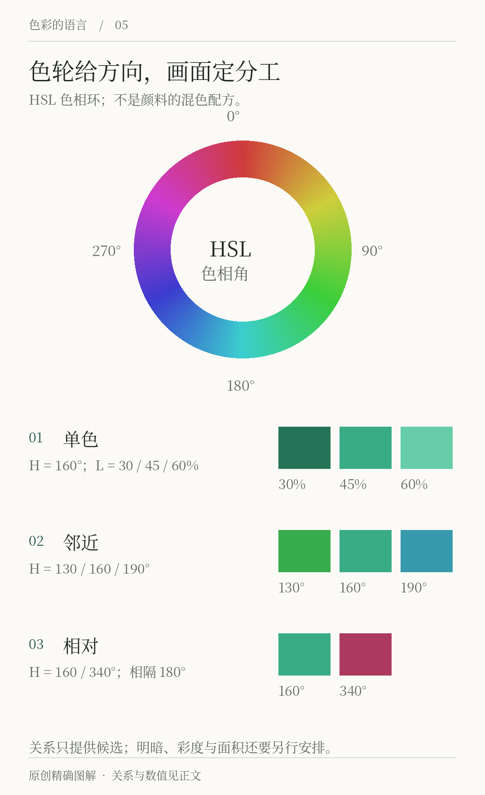
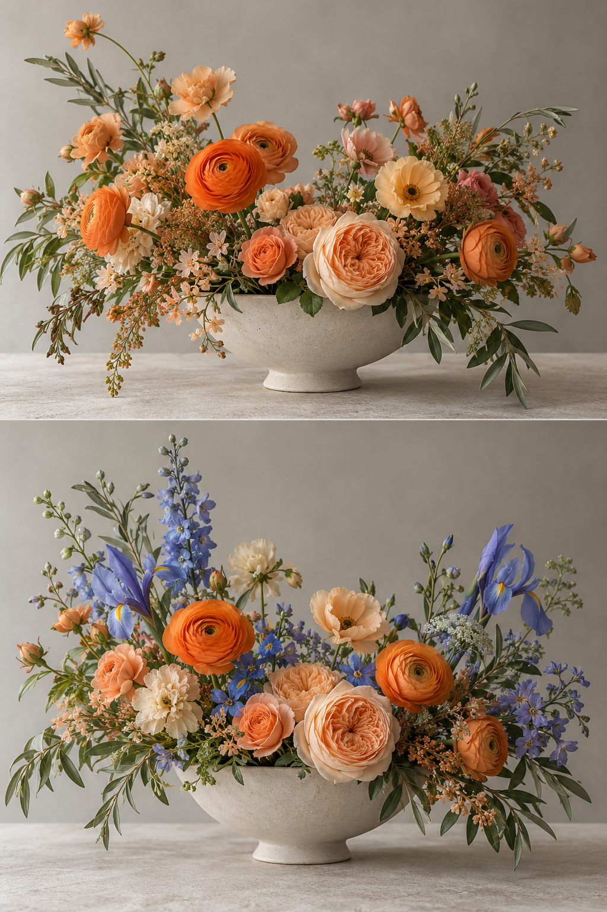

# 第5章 色轮与配色关系

色轮像一张把颜色排成圆圈的地图。沿圆周找相近颜色，跨到另一侧找差异，几条连线就能形成一套候选配色。这种工具适合开始探索，也容易让人误以为：只要连线形状正确，画面就会好看。

真正的配色还包含明度、彩度、面积、位置、材料与任务。色轮主要帮助观察色相关系；它只呈现了颜色问题的一部分。

## 先确认你在看哪一种色轮

色轮不是自然界唯一的一张圆图。历史上，人们因研究目的和材料经验不同，采用过不同的颜色排列。史密森学会的色彩展览资料把光学研究、艺术家的观看经验与材料颜色的讨论并置，提醒我们这些方法有各自背景。[资料：The Science of Color](https://library.si.edu/exhibition/color-in-a-new-light/science)

传统绘画教学常见以红、黄、蓝为基础的 RYB 色轮。屏幕设计则常遇到基于 RGB 的 HSL 色相环：红、黄、绿、青、蓝、品红按其模型位置排列。在 HSL 中相差半圈的红与青，不是传统绘画图中红与绿的那一组。没有说明模型就争论哪对是“真正互补”，往往是在回答不同问题。[资料：Adobe，The Color Wheel Explained](https://www.adobe.com/express/learn/blog/color-wheel-explained)

本章图示使用屏幕中的 HSL 色相关系地图。相差180°在这里表示坐标中的相对位置，不自动等于颜料混后中性，也不能保证等面积并置时感到平衡。若制作实物绘画，应使用所选颜料做混色小样。屏幕色相角不会替你测量颜料的吸收与散射。

*图5-1 原创教学图，使用 HSL 色相环组织关系示例。下方色组表示几种选色方向，不是颜料配方；色块的明暗与鲜艳程度还需要单独调整。*

## 单色：少换色相，多安排层次

单色方案围绕一个色相方向，用不同明暗与彩度组织画面。它不是把所有东西填成同一个值。若「间色」的展览册主要使用绿色，我们仍可以区分深绿标题、浅绿色面和接近中性的底色。

优点是容易建立共同气质，困难是边界可能不清楚。若卡片、背景和文字只有细微差别，读者会费力寻找层级。修正时通常先拉开必要的明暗距离，再决定是否需要另一个色相。为了“坚持单色”而牺牲阅读，并没有完成设计任务。

单色也不必排斥黑、白或带轻微色偏的中性色。描述一种方案时，说明“主视觉围绕绿色建立”，通常比给它贴上绝对纯粹的标签更有用。

## 邻近色：保留联系，建立区别

邻近色是色相位置相近的一组颜色，例如在绿附近向黄绿、蓝绿展开。它们的联系较容易被感知，但联系本身不等于信息层级。将几个同样深浅、同样鲜艳的邻近色铺成相同大小，仍可能让画面缺乏重点。

对「间色」的阅读活动，可以让墨绿承担标题，偏黄绿承担植物图案，较浅的蓝绿承担背景细节。这里真正组织画面的，是颜色之间的角色与差异；“邻近”只是候选范围。

如果活动变成紧急通知，原本安静的邻近色方案可能不够明确。你可以增加有区别的强调色，也可以保持色相范围，用更强的明暗和文字层级处理。选择应来自任务，而不是维护某种色轮名词。

## 花艺中的两种关系：相近色铺开，冷色插入

*图5-2｜AI 教学示意。上图围绕橙、桃、杏色展开，下图在暖花材中加入蓝紫。它们表现近似的相近与冷暖对置关系，不是按指定色轮角度测定的互补色样本。*

先看上图。几种花的色相相近，但仍有浅深、鲜灰和花瓣大小的变化；浅色花材提供亮部，较深的叶片把它们托起来。相近色并不意味着所有花必须涂成同一种橙，也不意味着不需要对比。若把浅花、暗叶都拿掉，相近色很可能变成缺少层次的一团。

下图加入蓝紫后，先前连续的暖色场中出现了较明显的另一种方向。它的作用不仅取决于是否与橙色接近互补，也取决于放了多少、枝条如何伸出、是否围绕主要花头。少量蓝紫可以形成转折，若占据一半以上，又会成为另一套主导关系。

因此，色轮更适合帮助你提出尝试方向：是让颜色集中在邻近范围，还是引入另一侧的区别？决定之后还要完成面积、深浅与结构。实际插花时可以先把几枝冷色拿在旁边，逐枝放入并观察，而不是根据“互补色协调”一次买齐等量花材。换到海报或服装，同样先确定主导，再安排打破主导的颜色。

## 对比色：把差异放在需要的位置

相隔较远的色相可以提供明显差别。常见互补、分裂互补和三角配色，都是组织这种距离的办法。互补在指定色轮中通常指相对位置；分裂互补用对侧附近的两个方向代替单一对侧；三角配色则选择圆周上分开的三个方向。[资料：Adobe，The Color Wheel Explained](https://www.adobe.com/express/learn/blog/color-wheel-explained)

这些关系适合生成选项，但没有自动分配主次。蓝与橘都用高彩度、相近面积，会与深蓝大底上一小点橘产生完全不同的效果。设计师需要决定谁支撑整体、谁负责提示、谁可以退出。配色方案是有分工的组合，不是把计算出的几个色号平等摆放。

本书的墨绿与陶橘可当作有明显色相差异的教学组合，不把它们称作某个模型中精确互补的一对。这样的表述既够日常使用，也避免为一个不必要的标签歪曲颜色值。

## 从关系模板走到应用

取同一份内容：“间色，周末阅读，14:00开始”。制作三个很小的草图，分别以单色、邻近和对比方向探索。每版只用三到四种颜色，先让日期和标题能读清，再比较气氛。

接着把最喜欢的一版复制两份。第一份把所有颜色面积拉得接近，第二份让背景占大部分，强调色只保留一点。比较后你通常会发现，面积分配对结果的影响并不比色相关系小。如果看不出区别，缩小草图、遮掉文字，只看整体色块。

这个练习的答案不是选出唯一赢家。合格的结论应能说明：“这版适合阅读活动，因为主信息清楚且大面积不抢读者注意；那版更像宣传展览，因为色相差异承担了更强的视觉表达。”如果无法说清，就回到任务，而不是继续寻找更复杂的几何关系。

色轮可以帮你开始，但完成方案需要离开色轮，到真实画面里工作。接下来我们先处理最容易被色相热闹掩盖的一件事：明暗结构。

## 本章资料

- Smithsonian Libraries and Archives， [The Science of Color](https://library.si.edu/exhibition/color-in-a-new-light/science)：光学、观看经验与材料颜色的历史线索。
- Adobe Express， [The Color Wheel Explained and How Colors Work Together](https://www.adobe.com/express/learn/blog/color-wheel-explained)：常见色轮与配色关系的工具说明。关系名称可用于构思，其美学效果仍需结合实际应用判断。
