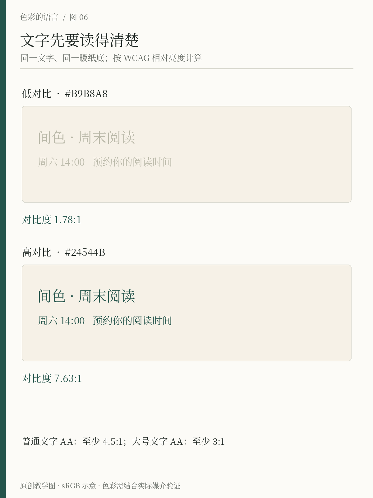
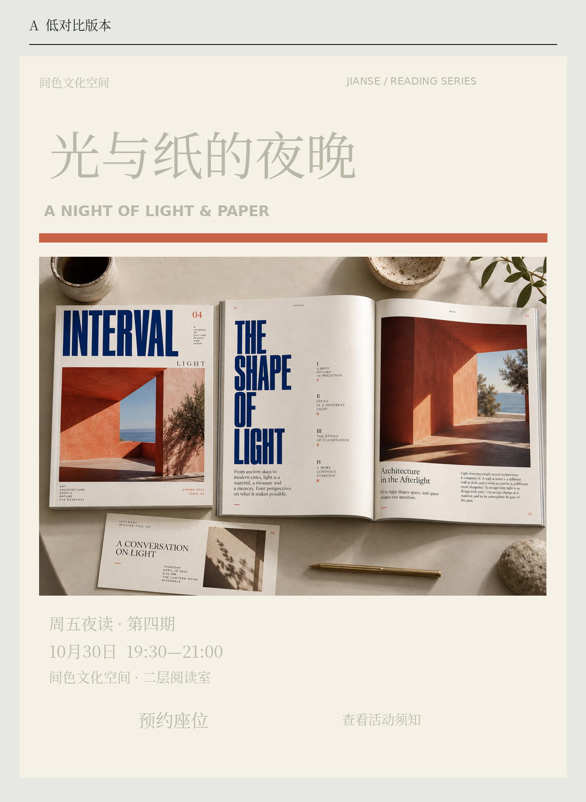
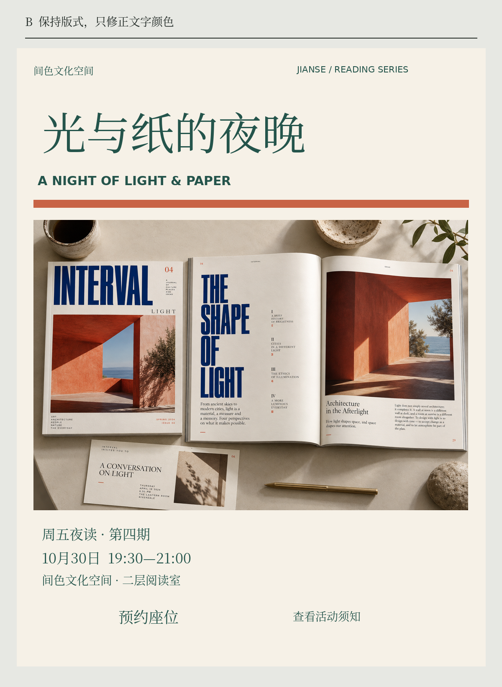

# 第6章 明度结构与可读性

有些海报颜色非常丰富，标题却找不到；有些页面只有黑白灰，阅读顺序仍然清楚。色相让画面具有区别和气质，明暗关系则常常承担另一种任务：让文字、边界和层次能够被辨认。

先把这件事处理好，配色会少走许多弯路。你不必牺牲喜欢的品牌颜色，而是给不同颜色安排适合的职责。

## 先建立大、中、小三个层级

「间色」有一张活动页：页首标题、活动说明和辅助备注。如果三者字号相近，颜色也都使用相近明暗的绿色，读者需要逐行阅读才能找到重点。可以先让标题明确，正文稳定，备注退后，再检查它们在暖纸底上是否清楚。

“退后”并不等于无限变浅。辅助说明依然是信息，尤其是时间、费用、限制条件。弱化信息可以使用较小面积、正常字重、位置或间距；不能仅靠把字变淡到难以辨认。层级与可读性应同时成立。

将画面转为灰度，是观察大致明暗组织的一种辅助办法。若所有重要区域变成接近的灰，说明需要进一步检查。但不同软件的灰度转换算法可能不同，灰度图也不能模拟所有人的视觉。因此它适合快速诊断，不应代替对比计算与实际测试。

*图6-1 原创教学图，固定背景 `#F6F1E7` 与相同文字版式，只更换文字颜色：浅灰褐 `#B9B8A8` 约1.78∶1，墨绿 `#24544B` 约7.63∶1。比值按 WCAG 的 sRGB 相对亮度方法计算，图中四舍五入仅用于显示，是否达标以未舍入值判定。*

## 一个可计算的底线

对于网页文字，WCAG 2.2 的最低对比要求提供了清楚的参照：一般文字与背景至少为4.5∶1，大号文字至少为3∶1；这里的大号通常指至少18磅常规字，或14磅粗体字。标准还规定了特定例外。它不是审美评分，也不是对所有观看条件的可读性保证。[资料：W3C，Understanding SC 1.4.3](https://www.w3.org/WAI/WCAG22/Understanding/contrast-minimum.html)

这些比值来自文字与背景的相对亮度关系，不是把 HSL 的两个 L 数值直接相除。黑与白在该计算中达到21∶1；数值越接近1∶1，差别越小。对初学者来说，使用实现正确的对比工具通常足够，先不必手算公式。

以下是「间色」基础色在暖纸底 `#F6F1E7` 上的计算示例，均假设颜色不透明且没有图像、渐变或混合模式参与。

| 文字色 | 对比度，约值 | 对一般文字的判断 |
| --- | --- | --- |
| 深墨 `#202824` | 13.42∶1 | 超过4.5∶1 |
| 墨绿 `#24544B` | 7.63∶1 | 超过4.5∶1 |
| 陶橘 `#C86345` | 3.50∶1 | 不满足4.5∶1 |
| 浅灰绿 `#A6AEA3` | 2.03∶1 | 不满足4.5∶1 |

陶橘不适合在这个底上承担一般小号文字，并不等于它不能进入方案。它可以用于大面积图形，或者经过调整后承担其他职责。具体元素是否适用3∶1或其他要求，要按元素性质判断，不能看到一个比值就替整页宣布“通过无障碍”。

## 把明度检查放回一张完整海报

*图6-2A｜程序精确排印＋AI虚构书刊摄影。图内浅灰褐文字 `#B9B8A8` 在暖纸 `#F6F1E7` 上约1.78∶1；摄影是固定图像，不参与这个纯色配对计算。*

这张海报已经有真实任务的基本内容：活动名称、摄影、英文副题、日期、地点与预约入口。先看上半部，再去找“19:30”。你会发现摄影的颜色和反差很充足，却不能帮助下方时间变得易读。问题不是整张图都“不够鲜艳”，而是承载必要信息的文字与纸色太接近。把橙色横线加粗、换一张更漂亮的照片，甚至把标题继续放大，都没有直接改变日期文字的前景与背景关系。

这里特意保留细则原有的字号与位置，是为了排除“换了布局才读得清”的解释。浅灰褐并没有被禁止使用：它可以进入非必要的装饰，但本例把它同时分配给标题、时间和预约文案，等于让所有文字一起退后。对低对比版本的正确诊断应当具体到“日期、地点与入口难读”，不能用一句“这套色卡不好”代替。若在自己的项目中复现这个问题，可以先截出日期所在区域，暂时排除照片的吸引力，再按实际发布尺寸观察。这样不会把摄影很出彩误认为信息也很清楚，也不会因大标题仍能认出，就忽略小字已经丢失。生成的杂志摄影提供复杂环境，精确排印的文字则让我们能核对到底改了哪一个条件。

*图6-2B｜摄影、文字内容、位置与字号不变；纯色文字改为墨绿 `#24544B`，与暖纸的对比约7.63∶1。这个结果只验证指定的文字配对，不是整张海报的合规证书。*

现在遮住摄影，只比较两版下半部：时间与地点的字并没有变大，读起来却更稳定。再放开摄影，标题仍然可以利用字号和位置先被看见，正文依靠可靠对比完成阅读，不必把每条信息都变成一个彩色标签。橙色横线没有承担普通小字，因此没有因为墨绿文字通过检查，就获得用于小字的许可。

这一版仍不是所有问题都解决了。底部“预约座位”虽然看得清，外观仍接近普通文字；读者是否知道它是入口，需要在第16章继续检查。这正好区分两个任务：本章先处理“能否读出内容”，后续再处理“能否理解操作”。实际项目若把时间压到极小、使用极细字体，或把墨绿文字改叠到照片上，就必须重新检查，不能照搬7.63∶1。把纯色底面、摄影区域与行动区域分开观察，才知道数字能够支持哪一部分结论。最后请另一位读者只回答开始时间和所在楼层，不先告诉他哪版是改进版。若两版的回答速度没有明显差异，也应如实记录，再检查尺寸与观看条件；对比计算是一个检查依据，不能代替具体任务中的阅读观察。

## 看得见与分得清是两次检查

一份表单里，“成功”和“失败”即使各自对背景都很清楚，若只用绿色与红色区分状态，仍可能让某些读者困惑。给它们加上明确文字、图标或其他视觉提示，才能使信息不依赖辨认某一种色相。W3C 的“颜色使用”条款专门处理这种信息问题。[资料：Understanding SC 1.4.1](https://www.w3.org/WAI/WCAG22/Understanding/use-of-color.html)

界面中有意义的图形、必要的控件识别线索与状态，还有相应的非文本对比要求。不能把一般文字的4.5∶1机械套到所有装饰线条，也不能因为某条线不是文字，就忽略它是否承担了关键信息。[资料：Understanding SC 1.4.11](https://www.w3.org/WAI/WCAG22/Understanding/non-text-contrast.html)

「间色」的活动日历可以用陶橘突出当天，但也应写出“今天”或使用清楚的边框。预约满额不能只把日期变红，最好直接标“已满”。颜色帮助快速扫视，文字给出确定含义。

## 对比通过后，还要看实际字形

一个名义上达标的颜色组合，配上非常细的字、很小的字号或复杂背景，实际仍可能难读。字体边缘的抗锯齿、屏幕条件与观看距离也会影响经验。WCAG 的解释文档特别提醒了细字与抗锯齿问题，因此设计时不宜把每个数值都贴着最低门槛。[资料：Understanding SC 1.4.3](https://www.w3.org/WAI/WCAG22/Understanding/contrast-minimum.html)

照片上叠字需要检查文字实际覆盖的区域。不能只取整张照片的平均颜色，也不能只量某个刚好很暗的位置。若照片不断变化，加入足够稳定的承载面、遮罩或独立文字区，通常比为每张照片猜一种文字色更容易维护。

## 修好一条活动说明

用浅灰绿在暖纸上写：“本周六14:00，入场请预约”。先保持字体不变，把文字改为墨绿，确认能否更快读清。然后把日期与正文分层：日期可以使用较大字号，正文保持稳健对比；陶橘只用于一个标记。

最后退远一点看，或在手机上按实际大小阅读。答案方向是同时得到清楚的文字和明确的阅读顺序。如果只是整页全部变黑，虽然读得清，也可能失去重点；如果重点明显但细则消失，则仍需调整。

也可以请另一位读者用自己的设备查看这条说明，不先告诉对方哪里是重点，让他直接说出时间与预约要求。如果读者误读，先找字号、位置和信息组织的问题，再决定是否更换颜色。一次测试不能覆盖所有人，却能暴露设计者自己已经看习惯的盲点。

配色的自由来自可靠的结构。明确哪些部分必须读清以后，你反而能放心地把更多变化留给图像、背景和表达。

## 本章资料

- W3C， [Understanding SC 1.4.3：Contrast (Minimum)](https://www.w3.org/WAI/WCAG22/Understanding/contrast-minimum.html)。
- W3C， [Understanding SC 1.4.1：Use of Color](https://www.w3.org/WAI/WCAG22/Understanding/use-of-color.html)。
- W3C， [Understanding SC 1.4.11：Non-text Contrast](https://www.w3.org/WAI/WCAG22/Understanding/non-text-contrast.html)。
- 本章颜色比值为依标准公式计算的原创示例，非真实品牌验收报告。
