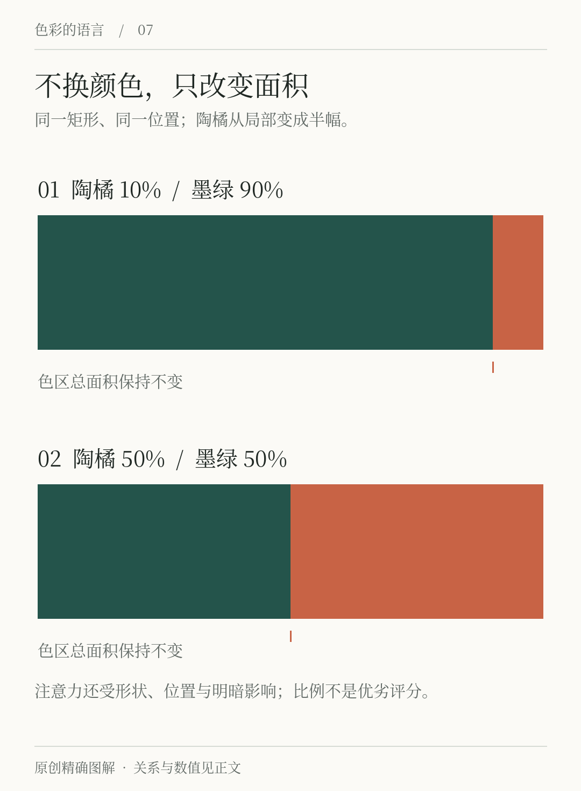
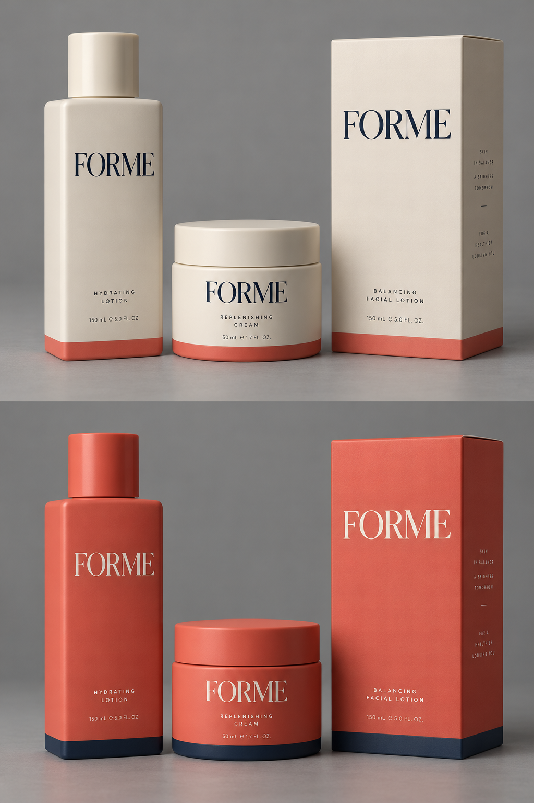

# 第7章 彩度、面积与视觉重心

一张由墨绿、陶橘和暖纸色组成的色卡，看起来可能很安静。把陶橘铺满整张海报，再把墨绿缩成一行小字，效果便不同了。色号没有改变，改变的是各色在画面中的处境。配色需要处理的对象因此不只是颜色清单，还包括颜色的面积、位置、形状，以及它与邻近部分形成的差异。

## 色卡没有告诉你的事

初学时常把每种颜色画成同样大小的小方块。这有助于清点颜色，却隐去了实际使用比例。菜单上的背景可能占据整页，文字虽然多，实际覆盖的面积却很小；海报中一个十厘米的圆，与散布在各处的许多橘色小点，面积相近，组织方式也不相同。

我们把“第一眼最想看哪里”称为视觉重心的一种直观判断。它不一定是几何中心，也不必只有一个。标题、人物面孔、强烈的明暗边缘都可能争夺注意。因此，不能把一个颜色的吸引力排成固定名次，说橘色永远胜过绿色。先看具体画面，再描述哪个部分突出，判断会可靠得多。

阿尔伯斯的色彩教学强调通过具体组合观察颜色行为，而不把色彩系统直接当成应用答案。本章延续这种实验思路：一次只改变面积或布局，观察结果，而不是从一种配色公式推导所有画面。[资料：阿尔伯斯基金会《Interaction of Color》](https://www.albersfoundation.org/alberses/teaching/interaction-of-color)

*图7-1｜原创教学图。两组使用相同墨绿与陶橘，陶橘面积分别约占10%和50%。比较的是面积分配，不是为某一比例评出优劣；读者的观看路径还会受到形状、位置及显示条件影响。*

## 彩度与面积要一起调整

彩度描述颜色偏离无彩色的程度。这里最实用的观察是：一个孤立的小色块可以很鲜明，扩大后是否仍适合，必须放入应用画面检查。为整面墙选择颜色时，只看一小张色样不够；为按钮选色时，只看铺满屏幕的大色块也不够。两种检查恰好对应不同的使用尺度。

假设「间色」的阅读活动海报采用暖纸背景、墨绿标题和陶橘报名入口。第一版把大标题、插画、日期框和报名入口全部设为陶橘。问题不一定是陶橘“太艳”，而是它承担了四个同样醒目的任务。此时把所有橘色统一调灰，可能只会得到一张整体发闷、仍没有主次的海报。

更有用的改法是先重新分工：大标题用墨绿；普通日期用深墨；报名入口保留陶橘；插画里的陶橘只留下少量呼应。若入口仍过强，再减小色块面积或调整彩度。这种顺序保留了颜色的辨识度，也让每次修改对应一个具体问题。

## 包装里的面积变化：珊瑚色从细带变成外壳

*图7-2｜AI 教学示意，虚构品牌 FORME。上下保持相近的瓶、罐、纸盒组合，比较背景与强调角色的交换；没有把画面面积计算成固定百分比。*

上图让暖白占据包装大部分表面，深色名称负责阅读，珊瑚色只在局部出现。远看时，这套物件首先形成明亮的一组；靠近之后，细色带才帮助识别。下图把珊瑚色扩大成主体，包装在环境中的存在感随之改变，名称则需要调整成适合深浅关系的字色。

这不是“同一组色号换了位置”这么简单。瓶子的弧面、罐盖边缘、纸盒接缝会制造阴影；很窄的色带在曲面上还可能绕到背后。真正决定读者能否辨认品名的，是可见正面、字形、字号、字色与底色的组合。小面积强调如果细到看不见，就没有完成它的任务。

如果要把上图改得更容易在货架上发现，不必立刻把整件包装染成珊瑚色。可以先扩大一处分类带、增加不同物件之间的呼应，再比较。每次修改只解决一个问题：识别不足、信息不清、或整组太分散。图7-1帮助拆解面积，本图帮助看清面积变化发生在有形状、有材质、有文字的物体上时还需要处理什么。

## “少量点缀”不等于到处撒一点

点缀色常被理解为面积小，但分布同样重要。一个橘色圆集中在页面下方，可能形成明确的停顿；十几个橘色小圆散落在四角，会产生另一种遍布全页的节奏。它们即使面积总和一样，也不能当作同一种方案。

在文字密集的页面中，反复出现的强调色还可能让人误以为每处都同样重要。只有真正需要寻找的内容才用强调色，其余地方利用字号、间距和字重区分，颜色的任务会清楚得多。把点缀理解为“有目的地出现”，比理解为“用量永远很少”更灵活。

留白也是面积分配的一部分。空白并不是画面里没有参与配色的区域；暖纸色、白色或深色背景都在影响其他颜色被看见的方式。设计时应把背景计入画面，而不是只计算几个有名称的品牌色。

## 比例是试验起点

你可能见过“60∶30∶10”的配色建议。可以把它当成迅速尝试主次关系的起点：一种颜色做大面积，另一种支持结构，第三种强调。但这不是测量好设计的标准。摄影海报、数据图表、双色书籍和花纹织物，并不需要服从同一个比例。

更直接的检查方法，是将成品缩到手机缩略图大小，确认第一眼读到的内容是否符合任务。再恢复正常大小，检查说明文字是否清楚。缩略图帮助观察整体组织，正常尺寸帮助检查实际阅读；它们回答的问题不同，不能互相替代。

## 练习：只改面积，不换颜色

画三张同样尺寸的活动卡，文字和位置固定，只允许调整背景色块的面积。第一张陶橘约占10%，第二张约占30%，第三张约占50%，其余部分用同一种墨绿。每张都标出你希望读者首先注意的内容。

先自己判断，再请一位朋友看三秒，说明他先看到了什么。若结果与设想不符，不急着争论“哪个高级”，先指出差异来自哪里：色块是否盖过标题？边缘是否把目光带离内容？小面积是否因位置突出而仍很醒目？答案方向是建立可描述的关系，而不是找出唯一正确比例。

本章要练出的能力，是在颜色不变时也能修改画面。下一章将进一步把这些面积组织成连续的节奏。

## 本章资料

- Josef & Anni Albers Foundation：[Interaction of Color](https://www.albersfoundation.org/alberses/teaching/interaction-of-color)，用于了解基于具体组合与观察的色彩教学方法。
- 本章「间色」方案、比例练习与图示均为原创教学案例，不代表实验测得的普遍注意规律。
