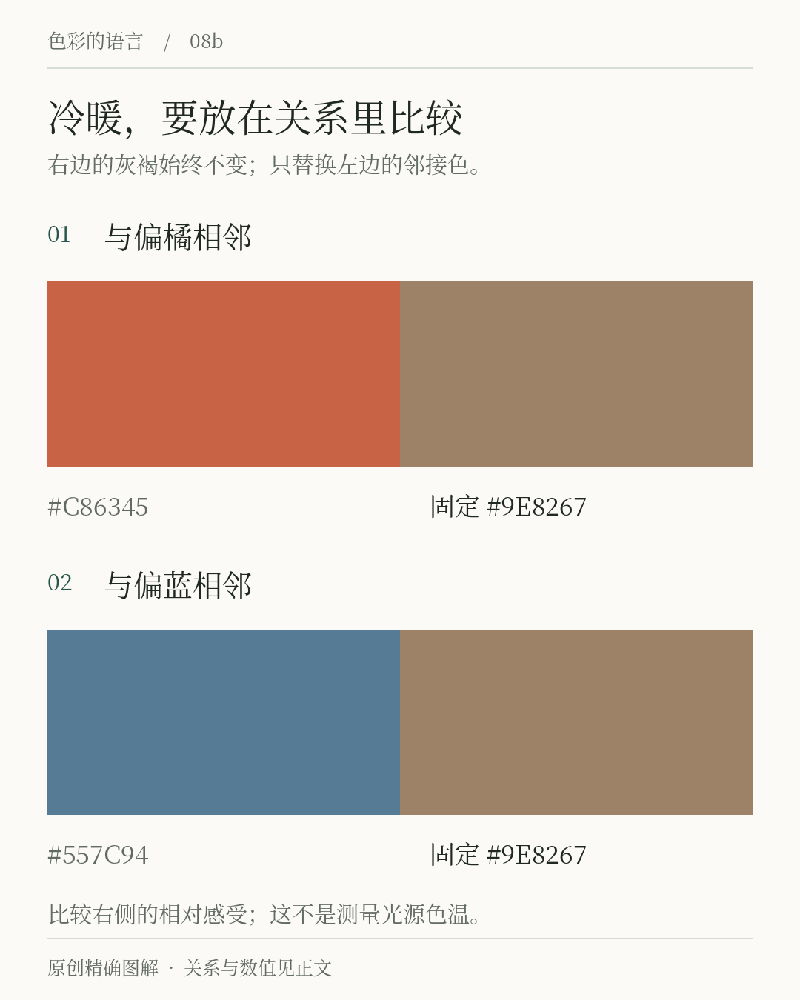
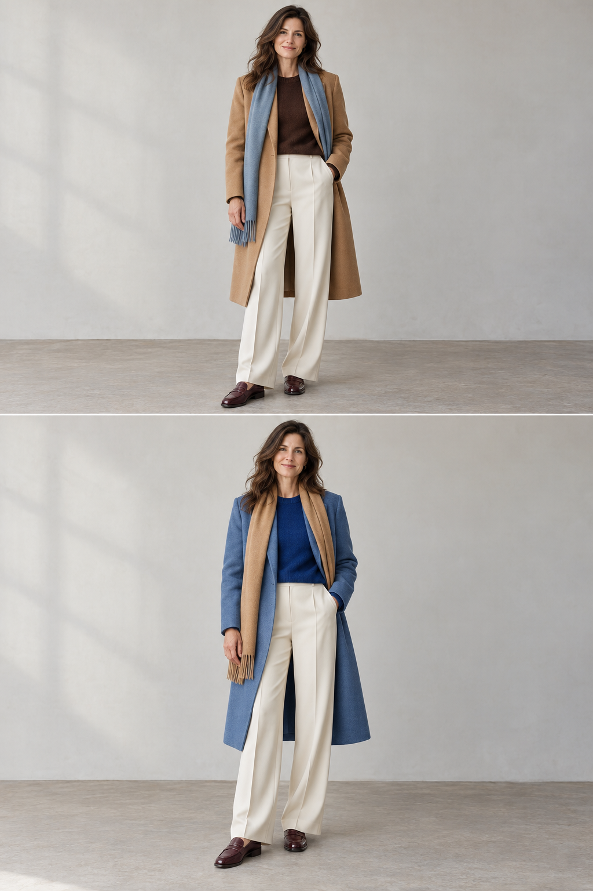
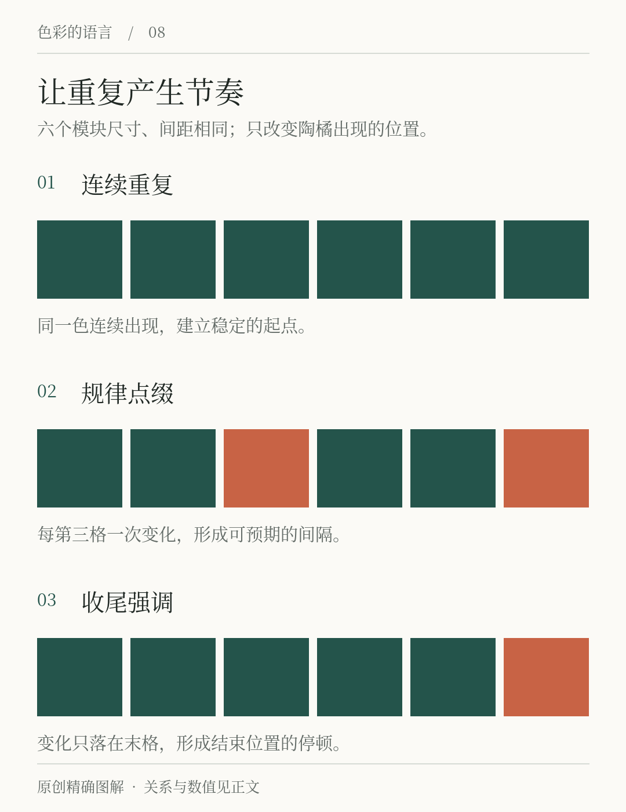

# 第8章 冷暖、中性色与颜色节奏

沿着街道走过去，几家店的招牌连续出现：深绿、深绿、橘色，然后又回到深绿。即使不细读文字，你也可能感觉到重复与变化。颜色不只在一个画面里相互比较，也会随着页面、物件和行走路线形成节奏。

## 冷暖是一种比较方式

谈论颜色时，人们常把偏红、偏橘的一侧称为暖，把偏蓝的一侧称为冷。这是描述视觉关系的常用语言，适合讨论一张画面里哪些部分显得偏暖、哪些部分显得偏冷。但不要把它当成物体的实际温度，也不要把每个色号永久放进一个互不往来的抽屉。

一个灰褐色与橘色并排时，可能显得较冷；换到蓝色旁边，又可能显得偏暖。具体感受会受到背景和适应状态影响，所以更好的说法是“这块灰褐比旁边的蓝色暖”，而不是“灰褐是一种绝对暖色”。阿尔伯斯的色彩练习以改变周围关系来观察颜色，这也提示我们把判断放回上下文。[资料：阿尔伯斯基金会](https://www.albersfoundation.org/alberses/teaching/interaction-of-color)

*图8-1｜原创相对关系示意。中间色块都为 #9E8267，邻接色分别偏橘与偏蓝。请比较其相对冷暖感，不把图示解读为所有人必然看到同一种错觉。这里的冷暖也不等于光源的相关色温。*

光源色温是另一件事：日常所谓暖白灯和冷白灯，通常涉及光源白光外观的描述。相关色温的正式定义涉及光源色度与普朗克辐射体的比较，以开尔文表示。[资料：CIE，相关色温](https://www.cie.co.at/eilvterm/17-23-068)

它与“这张海报里的绿偏暖”不在同一个层次。设计房间时，两者会发生联系，却不能用一个橘色屏幕色块替代实际灯光测试。

## 中性色并非没有性格

白、灰、黑常被称为中性色，实际设计里也会把低彩度的米色、灰绿、灰蓝当作近中性色使用。“近中性”是应用上的角色描述，并不意味着它在色度学上就是无彩色。暖纸色与纯白的差别，在一张小卡上不大，铺满一页书或一面墙时就值得认真比较。

为「间色」做菜单时，暖纸底色能把绿与橘连接起来；换成清冷的灰白，整体关系便不同。但纸张是否带黄、灯光是否偏暖、照片中是否有木桌，都会参与结果。不要仅凭色名“米白”就认定它温柔，也不要因“灰色”听起来中性，就以为它不会改变气氛。

选择近中性色可以先问三个具体问题：它放在白纸旁偏向哪里？它与主色相邻是否出现不想要的色偏？用于大面积时，文字能否读清？这样比在几十个“高级灰”名称中寻找答案更有效。

## 服装中的相对冷暖：一条围巾改变大面积外套的关系

*图8-3｜AI 教学示意，与第19章共用同一组穿搭。这里先看冷暖与中性色的组织，第19章再讨论面料和物件角色。人物、衣物细节有生成误差。*

先把注意力放在驼色上。上图让它占据外套的大面积，与较小的灰蓝围巾相邻；下图则把它收缩到围巾，用蓝色外套包围。相近的驼色因为面积与邻接关系不同，在两套衣服里承担的作用也不同。讨论“驼色配蓝是否好看”时，应把这些条件说出来。

浅色裤子与酒红鞋为两版提供相近的下半身参照。灰蓝并不等于没有颜色，米白也不等于完全中性；它们和驼色、肤色、织物阴影共同建立关系。若把下装也改成强蓝，或把鞋改成鲜红，就不能继续只把变化归给围巾。

这个例子可以直接用现有衣物试：先确定面积最大的外套，再在领口附近试一件偏冷、一件偏暖的配件，退到全身距离看。记录哪一件形成明显停顿、哪一件与外套更连贯。这里不需要先给人贴上固定的冷暖肤色标签，重点是观察当次搭配的整体关系。

## 颜色节奏来自有规则的重复

节奏可以由规律间隔形成，也可以由一次有意打破规律的变化形成。一本书每章以墨绿标题开场，是稳定重复；每隔几页出现陶橘边注，是支持阅读的标点；在关键转折页让陶橘占据整面，则是一次明显的变化。三者都使用同一套颜色，却有不同作用。

*图8-2｜原创教学图。三排模块的尺寸与数量一致，只改变陶橘出现的位置：全绿、每第三格出现陶橘、仅末格出现陶橘。观察重复、间隔与收尾，不能据此认定某种排列适合所有内容。*

颜色的节奏应该服务内容结构。如果每一个“注意”都用橘色，读者会逐渐学会寻找橘色；如果今天橘色代表注释、下一页代表正文、再下一页代表错误，外观虽然多变，阅读规则却不稳定。变化可以发生在装饰层，重要信息的含义仍需清楚。

## 从单页扩展到一组页面

为一组四张活动海报配色，可以保持标题和正文颜色不变，变化背景面积；也可以保持背景不变，轮换一个小的主题色。前者更容易看出系列关系，后者更容易区分具体活动。选择哪种方法，取决于任务是让人认出“同一家”，还是迅速找到“这一场”。

若「间色」同时举办阅读会、摄影展与饮品工作坊，不必为每类活动发明一整套互不相干的色卡。可以先保留共同底色与标题系统，再给活动名称设置有限变化。品牌关系由共用部分维持，区分由变化部分承担。到第21章，我们会把这些分工变成明确的颜色角色。

系列设计还要检查连续阅读。四张图单独看都舒服，排在一起可能全部抢眼；网页每屏都以强烈色面开场，向下滚动时也可能缺少停顿。审查时同时看单页与总览，才能发现节奏是否符合阅读过程。

## 一次能做完的练习

剪出六张相同大小的纸卡，五张涂墨绿，一张涂陶橘。先把橘色放在开头，再放在中间，最后放在末尾。每次用一句话描述这组卡的结构，例如“开场提示”“中途转折”“收尾强调”。这是对排列的解释，不是对所有观看者心理的预测。

再增加一张橘色卡，尝试等间隔与相邻两种排法。你应该能发现：只增加一种重复方式，整组关系就发生了变化。若想让实际内容更清楚，接下来要问每张卡装的是什么，而不只是继续移动颜色。好的节奏有可辨认的规则，也给真正需要强调的内容留下位置。

## 本章资料

- Josef & Anni Albers Foundation：[Interaction of Color](https://www.albersfoundation.org/alberses/teaching/interaction-of-color)，关于通过具体色彩关系进行观察。
- CIE：[correlated colour temperature](https://www.cie.co.at/eilvterm/17-23-068)，光源相关色温的正式术语。
- 本章近中性色的使用、系列设计和卡片练习是原创设计方法示例，不构成固定配色标准。
