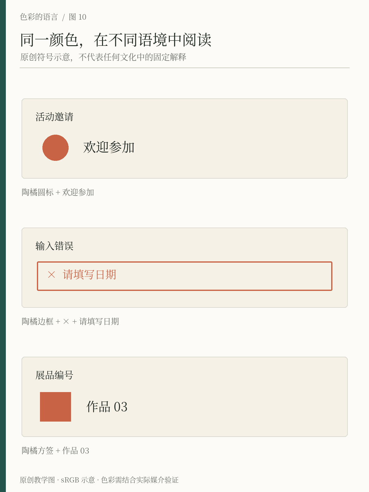
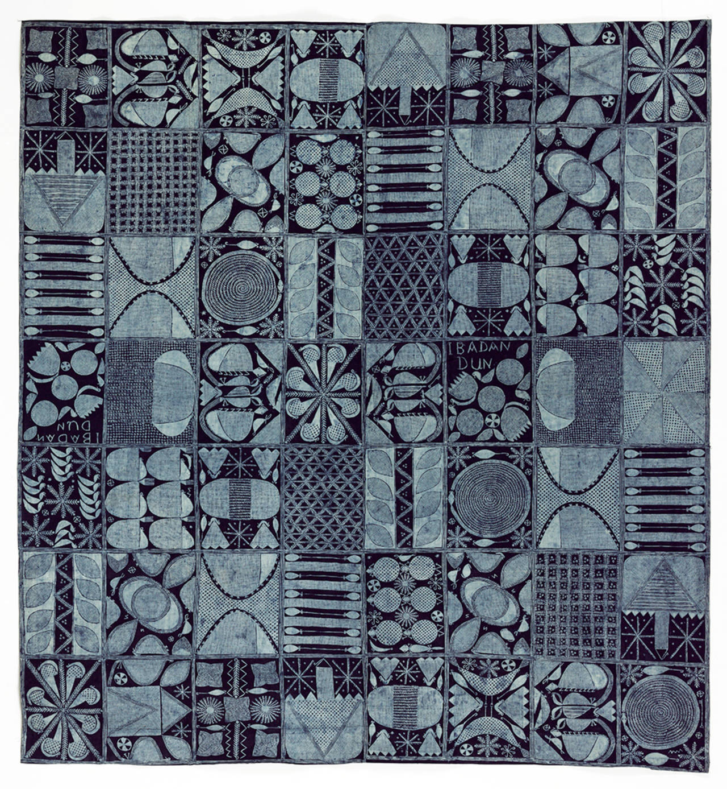

# 第10章 文化、习惯与语境

一枚陶橘色的圆点，可以是活动邀请上的装饰、表单旁的错误提示，也可以是展览目录中的作品编号。颜色本身没有变，读者却会根据文字、形状、位置和使用经历，赋予它不同解释。理解文化中的颜色，首先需要承认：意义不是从色号里自动长出来的。

## 从“某国喜欢什么”退回具体场合

介绍文化配色时，最方便的写法是给每种颜色配上一张国家清单。然而，同一地区的婚礼、运动队、交通标志、商业包装和数字界面，可能采用完全不同的颜色规则。一个人的年龄、职业、宗教、生活经验，也可能比国籍更直接地影响某次理解。

跨国研究确实发现色彩情绪联想既有共性，也会随语言与地理接近程度而变化，但它不能支持“这个国家的人都这样想”的结论。设计时应把研究结果当作需要关注差异的依据，再调查具体受众与使用场景。[资料：Jonauskaite等，2020](https://journals.sagepub.com/doi/10.1177/0956797620948810)

因此，分析案例时尽量把主语说完整：不是“白色意味着什么”，而是“在这场仪式、这件服饰或这一套界面里，白色被怎样使用”。范围越清楚，解释越容易核对，也越少落入文化刻板印象。

*图10-1｜原创教学示意。陶橘分别用于活动邀请、错误输入和展品编号。意义由颜色、文字和位置共同提供，这不是对某个民族或文化群体的固定配色描述。*

## 有些意义来自反复使用

你熟悉某个 App 后，会学会主按钮在哪里、错误通常怎样显示、已完成项目是什么样。这里的色彩理解，部分来自这个产品建立的局部习惯。即使别的产品采用不同颜色，只要规则清楚，用户也可能重新学会。

为「间色」设计预约表单时，如果陶橘已经反复用于活动标签，就要谨慎决定错误提示是否也使用相同陶橘。如果两者距离较远、文字说明清楚，未必构成问题；如果活动标签和错误状态并排出现，仅靠颜色便难以区分。处理方法包括明确标注错误原因、增加图标、把错误提示放到对应字段旁，而不是只换一种更艳的颜色。

W3C关于颜色使用的说明要求，不把颜色作为传递信息或区分元素的唯一视觉手段。这个原则直接帮助我们处理“别人是否会理解这套颜色规则”的问题：即使颜色没有被识别，文字和形状仍应把必要意义留下。[资料：W3C，理解成功准则1.4.1](https://www.w3.org/WAI/WCAG22/Understanding/use-of-color.html)

## 传统颜色要连着工艺和生活看

谈论传统色彩，不宜只从今天的图片中抽出几个色号，再给它们加上“古典”“东方”或“民族”的名称。传统物件上的颜色与染料、基底、工艺、用途和流通有关系；同一个名称也未必对应现代软件中的唯一数值。

V&A介绍尼日利亚约鲁巴地区的àdìrẹ织物时，把靛蓝与防染工艺、棉布、制作者和穿着方式一同说明。蓝白关系在这里是具体物件的材料与图案结构，不能抽象成某个大陆的统一审美。[资料：V&A，Àdìrẹ](https://www.vam.ac.uk/articles/adire-tied-and-dyed-indigo-textiles/)

这也提供了一种观察中国传统色彩的方法：先找到具体文物或工艺对象，记录年代、地区、材料和来源，再讨论颜色。若只有商业色卡而没有历史证据，就把它称为当代整理或设计演绎，不替它补造古代标准。

## 实物细读｜一块靛蓝布，怎样与一座城市相连

*真实案例 R09｜Àdìrẹ eleko 棉布，Ibadan dun 图案，尼日利亚伊巴丹，1960年代，V&A 藏，馆藏号 Circ.588-1965。© Victoria and Albert Museum, London。引用馆方照片作近距离图案评论；不是本书生成图，也不是开放版权素材。来源：[V&A，Àdìrẹ](https://www.vam.ac.uk/articles/adire-tied-and-dyed-indigo-textiles/)，页面更新2024-04-17，核查2026-10-23。*

**先看整块布的格子，再看格子里的图案。** 蓝色提供连续底面，浅色线条与小色面在分格内形成节奏；大小和疏密变化让它没有变成机械重复的蓝白棋盘。颜色、图案与制作方法在同一件实物上共同发生。中部偏右能找到浅色的“IBADAN DUN”字样，几处横排匙形又把格子连成较稳定的节奏。

馆方把 Ibadan dun 解释为约鲁巴语中的“伊巴丹很好”，并指出图案包含市政厅 Mapo Hall 的柱子与勺子的交替。它的地方联系来自名称、具体图案和制作环境。脱离这些信息，只留下“靛蓝很有非洲感”，就把一件有城市身份的物件抹成了空泛印象。

可以分两层记录：**看图能确认的**是蓝白关系、格子、重复与变化；**需要资料才能知道的**是名称、年代、地区和图案所指。把它借到活动海报里时，也分清是在学习分格节奏，还是引用特定图案，避免拿近似蓝色替代文化解释。

## 借鉴时，说明借了什么

文化参考可以很具体：借用某类织物的疏密节奏，学习某件器物的深浅关系，研究一种染色工艺如何形成边缘。不必把整个文化压缩成三种颜色，也不必为了显得有底蕴，把普通配色强行解释成传统象征。

「间色」若举办靛染主题工作坊，可以参考真实染布的色阶与留白，但活动说明应指出对应工艺及参考来源。如果只是选了蓝白作为教学设计，就如实写“蓝白配色示意”。设计意图和文化事实分开，既方便读者理解，也便于后续修改。

涉及宗教、仪式、身份标志等材料时，更应查看原对象的说明，并了解使用边界。视觉上能复制，不等于脱离语境后仍表达原意。这里的重点不是限制创作，而是让引用与解释有依据。

## 练习：为一个颜色写三种说明

选一种你经常使用的颜色，分别把它放在活动邀请、预约状态和展品编号中。每个场景写清楚：颜色用在哪里，读者需要知道什么，还有什么非颜色线索提供帮助。

随后把所有色块临时改成同一种灰。若邀请仍像邀请，错误仍能被发现，编号仍能与作品对应，说明关键信息没有全部压在颜色上。恢复颜色后，再判断它是否加快理解、建立关联或带来合适气氛。

这个练习的答案方向，是学会为色彩意义找到具体载体。文化与习惯值得研究，但它们最终都要落在某件物、某段文字和某次使用中。

## 本章资料

- Jonauskaite等（2020）：[跨国色彩情绪联想研究](https://journals.sagepub.com/doi/10.1177/0956797620948810)。
- W3C：[Understanding SC 1.4.1: Use of Color](https://www.w3.org/WAI/WCAG22/Understanding/use-of-color.html)。
- Victoria and Albert Museum：[Àdìrẹ – 'tied and dyed' indigo textiles](https://www.vam.ac.uk/articles/adire-tied-and-dyed-indigo-textiles/)。
