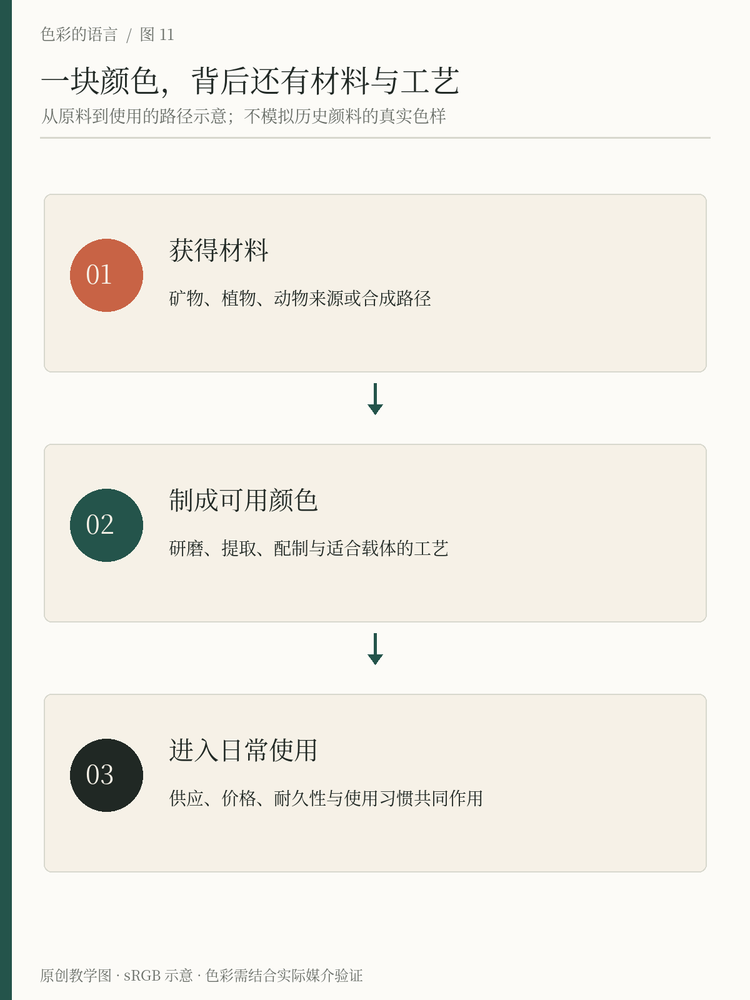
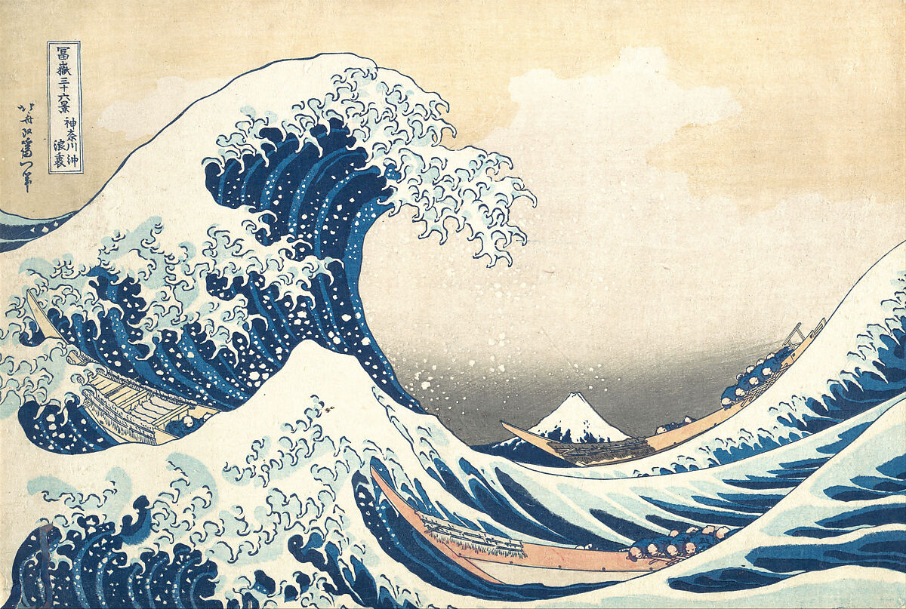

# 第11章 色彩历史与材料变化

在屏幕上把一个图形改成蓝色，通常只需要输入色值。对于历史上的画家、染工和印刷者，问题却包括：蓝色从哪里来，怎样制成，附着在哪种材料上，能否保持，以及谁承担费用。色彩史因此不只是审美变迁，也是材料、技术、贸易和劳动的历史。

## 先区分颜色与着色材料

“蓝色”描述视觉经验，“群青”“靛蓝”还可能指特定着色材料或材料类别。同为蓝色的两件物品，未必由同一种物质着色；同一种着色材料，换了基底、结合方式或制备条件，也未必呈现完全相同的外观。

颜料通常以不溶或难溶的微粒分散于介质中使用，染料则常通过溶液或相应染色过程作用于纤维等基材。实际工艺存在更复杂的形式，例如把染料转为色淀颜料，所以不要只凭最终“涂上去”还是“浸进去”作机械分类。本章用这些概念帮助理解材料任务，不提供化学操作配方。[资料：波士顿美术馆CAMEO材料数据库，颜料](https://cameo.mfa.org/wiki/Pigment)、[染料](https://cameo.mfa.org/wiki/Dye)。

*图11-1｜原创教学图。按“原料—制备—使用”追踪着色材料。图中的颜色是示意，不是历史颜料标准色样，也不替代某种颜料或染料的具体工艺记录。*

## 群青：同一个名字背后也有技术变化

天然群青与青金石有关，获取与制备成本曾推动人们寻找替代工艺。关于合成群青的研究会追溯19世纪的生产探索，并比较原料配比和处理条件对产物颜色的影响。这里最值得学习的并不是“古人没有蓝色”，而是获得某种蓝色的途径、成本和稳定性，会随技术改变。[资料：Hamerton等，2013](https://journals.plos.org/plosone/article?id=10.1371/journal.pone.0050364)

当你看到一幅历史绘画中的蓝色，不能只根据手机照片宣布它使用天然群青。识别材料需要修复档案、分析或可靠的作品研究。数字图像提供观看入口，却不自动提供化学鉴定。把材料名称附到每块颜色上，往往比不写材料更容易出错。

## 靛蓝：颜色通过过程形成

靛蓝织物提供了另一种观察角度。V&A介绍àdìrẹ染布时，说明布料经过染液处理与取出氧化，重复过程可以加深颜色。最终蓝白图案还与防染方式有关，不是先在软件里挑两个颜色再机械填入。[资料：V&A，Àdìrẹ](https://www.vam.ac.uk/articles/adire-tied-and-dyed-indigo-textiles/)

这类案例提醒我们：颜色与图案有时来自同一过程。结扎、遮挡、吸收和染色程度，会让边缘、深浅与材料纹理一起出现。若只吸取其中一块蓝色色号，虽然得到可用灵感，却丢掉了工艺带来的变化。设计引用时可以明确自己研究的是颜色、纹理还是制作过程。

## 实物细读｜《神奈川冲浪里》的蓝色，来自材料与叠印

*真实案例 R10｜葛饰北斋，《神奈川冲浪里》，《富岳三十六景》之一，约1830—1832年，纸本多色木版画。纽约大都会艺术博物馆藏，JP1847；H. O. Havemeyer Collection，1929年遗赠。馆方标注 Public Domain。作品与图像：[馆藏记录](https://www.metmuseum.org/art/collection/search/45434)。材料研究：[Marco Leona，The Great Wave: Anatomy of an Icon](https://www.metmuseum.org/essays/hokusai-great-wave)，2020-04-10。核查2026-10-23。*

**从左侧卷起的大浪往下看：深蓝条带、中间蓝色与浅色浪花，怎样把水面组织起来？** 深浅差把弧形走势连成一个整体；浪花的浅色边缘再切开它。远处的山很小，却借轮廓和周围空处留在画面里。这些是从当前数字图像可以观察的关系。

但材料结论不是看图猜出来的。大都会的光谱与显微研究说明，印工把靛蓝与普鲁士蓝混合用于深色线条，再叠印普鲁士蓝形成深蓝区。这幅画并非只靠“一种新蓝色”完成：材料选择与印刷次序一起影响层次。

这也让“原料—制备—使用”的框架落到实物上。对今天的设计，能迁移的是先安排深浅关系，再考虑实际媒介怎样实现。屏幕上的半透明叠色与木版实物叠印并不等同；也不能把图片里吸出的某个 RGB 数值叫作“1831年的标准普鲁士蓝”。不同印本、老化与摄影还会改变今天的可见外观。

## 合成染料：更多选择，也有新的问题

伦敦科学博物馆把1856年珀金发现苯胺紫放在合成染料发展的历史中介绍：化学技术使更多颜色进入服饰与日常物品，同时也带来褪色、生产与环境等问题。技术进步不等于所有新材料从此都耐久安全，更不意味着此前没有人工制造的颜色。[资料：Science Museum](https://www.sciencemuseum.org.uk/objects-and-stories/chemistry/colourful-chemistry-artificial-dyes)

阅读此类历史时，要区分“首次发现”“开始商业生产”“广泛使用”和“在某地买得到”。这些事件可能相隔很久。某种颜色在一座城市已经可以买到，不意味着另一地区的工匠同样容易获得；材料出现的年代，也不能独自解释所有艺术风格变化。

颜色的普及还涉及供应链、技术转移、生产者的处境与消费需求。书写历史不应只保留一位发现者和一个漂亮色名，把之前的知识积累、原料产地和染工劳动全部藏起来。

## 今天看见的未必就是当年的外观

文物经过光照、空气、湿度和保存条件影响，外观可能发生变化。美国国家美术馆的材料研究也强调环境、老化与处理会改变作品外观。[资料：Berrie，Pigment Alteration and Color Change](https://www.nga.gov/research/publications/facture-vol-7-change/pigment-alteration-and-color-change)

研究一种历史配色时，应区分物件当前状态、修复研究提出的原貌，以及后人的视觉复原。复原图是基于证据的解释，不是穿越时间得到的照片。

数字展示又增加了摄影、显示器和色彩管理等环节。你可以欣赏博物馆公开图像，也可以据此分析大的深浅结构，但不宜把图片中吸取的RGB值标成“某朝代的标准蓝”。如果要建立教学色卡，应写明它是依据数字图像制作的近似演绎，并保留原始出处。

## 练习：给一件彩色物件补上材料履历

选择家里的一件彩色物品，例如牛仔裤、印刷书封、陶瓷杯或塑料收纳盒。画三栏：原料与着色来源、制备或加工、最后使用。已知内容如实写，无法从物件判断的部分标为未知，不用猜测填满表格。

再选择一件博物馆对象，阅读其材料说明，比较哪些内容是视觉观察，哪些来自文字档案或技术分析。答案方向是学会给自己的判断划边界：能看出颜色关系，不等于能识别材料；知道材料名称，也不等于掌握它的全部历史。

到这里，色彩从一组抽象属性重新回到物质世界。下一章将讨论风格与趋势，但不会把变化全归因于流行，也不会把某套颜色视为某个时代的唯一面貌。

## 本章资料

- Museum of Fine Arts Boston，CAMEO：[Pigment](https://cameo.mfa.org/wiki/Pigment)、[Dye](https://cameo.mfa.org/wiki/Dye)。
- Berrie, B. H.：[Pigment Alteration and Color Change](https://www.nga.gov/research/publications/facture-vol-7-change/pigment-alteration-and-color-change)。

- Hamerton, I., Tedaldi, L. & Eastaugh, N.（2013）：[A Systematic Examination of Colour Development in Synthetic Ultramarine According to Historical Methods](https://journals.plos.org/plosone/article?id=10.1371/journal.pone.0050364)。
- Victoria and Albert Museum：[Àdìrẹ – 'tied and dyed' indigo textiles](https://www.vam.ac.uk/articles/adire-tied-and-dyed-indigo-textiles/)。
- Science Museum：[The colourful chemistry of artificial dyes](https://www.sciencemuseum.org.uk/objects-and-stories/chemistry/colourful-chemistry-artificial-dyes)。
