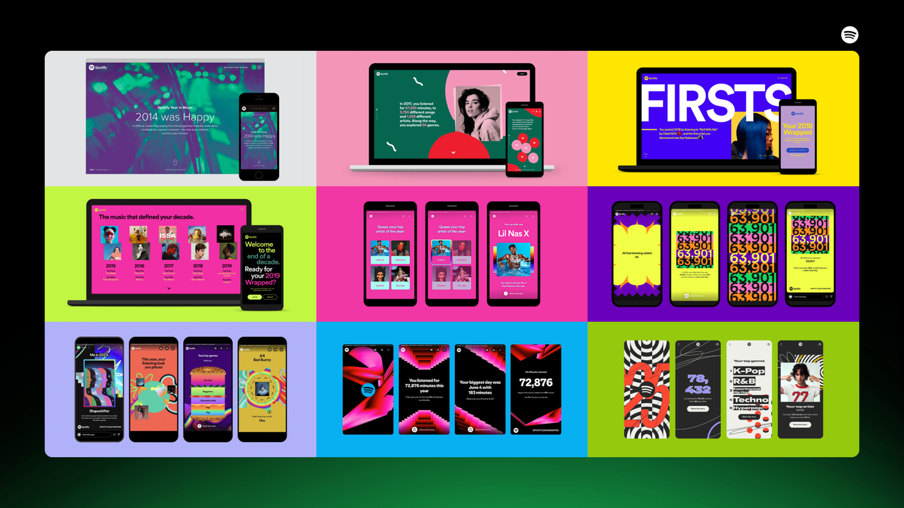

# 第12章 风格、趋势与当代审美

你可能存过一张“复古配色”或“科技配色”色卡。把它用于自己的设计，结果却未必像参考：颜色相近，气质仍不同。因为风格由许多因素共同形成，颜色只是其中一部分。字体、图像、网格、材料、细节和使用场景，也在告诉读者这件设计属于怎样的世界。

## 风格不能压缩成几个色号

如果一张海报的复古感来自旧报纸纹理、紧密排字、印刷套色边缘和特定图像，只提取米白、暗红、黑色，无法保留全部关系。同样，所谓科技感也不必依赖蓝紫渐变：一个克制、清楚、以数据为中心的界面，可能通过另一种方式呈现技术产品的特点。

学习风格时可以把参考拆成五项：颜色范围、明暗组织、面积比例、材料与纹理、颜色承担的任务。这样得到的是一份可以调整的观察记录，而不是一张必须照抄的色卡。记录中的“看起来像什么”是你的解释，作品是谁设计、何时发表则应有出处。

## 案例细读｜Spotify Wrapped：风格来自颜色与图形共同变化

*真实案例 R01｜Spotify Wrapped 历年视觉，引用自 Spotify 官方设计回顾（2026-04-23）。图像版权归 Spotify 及各作品权利人；本书缩放引用，用于设计评论。[原始页面](https://newsroom.spotify.com/2026-04-23/spotify-design-history/)。*

先看这张图里的文字、人物图像和图形如何相互嵌入，再看单个色相。各期并没有把同一个绿色模板换个标题：强色的相邻关系、字形的体量与图像处理共同构成当期视觉。若只提取几个亮色，忽略大字、裁切和重叠，得到的很可能只是一张热闹色卡。

可以把其中一幅缩成手机分享卡的大小，观察哪一层还留得住。大面积色差与短标题先建立识别，细节需要近看。这解释了为什么同一组色放进密集正文时必须降低装饰强度：分享图的观看任务与连续阅读不同。这里的分析是本书对图像的观察，不是对每期设计动机的官方说明。

## 当代案例：观察颜色怎样工作

Starbucks官方的Creative Expression把绿色视为重要识别资产，并以一组绿色扩展表达。值得观察的是“一个识别方向如何容纳变化”，而不是从网页截图里猜一个绿色数值，再把它当作全部品牌体系。[资料：Starbucks，Color](https://creative.starbucks.com/color/)

IBM的Carbon则在默认界面主题中使用大量中性灰，通过明暗组织内容区域，蓝色承担主要操作等任务。官方文档还把颜色角色与主题中的实际值分开。这呈现的是另一种颜色组织方式：可识别的颜色与大量支持阅读、交互的颜色共同运作。[资料：Carbon，Color overview](https://www.carbondesignsystem.com/building-blocks/foundations/color/overview)

两者都不能简化为“绿色自然、蓝色专业”。这类解释把设计组织、行业应用和长期使用形成的识别关系，缩成了色名的性格。真正可迁移的经验，是先找到颜色的职责，再看它在不同画面中如何保持或变化。

这里选择的是有公开官方说明的当代系统案例，不代表它们是最新潮或唯一优秀的答案。阅读时应查看来源页面及其更新情况，把案例当作可分析的对象，而不是追随品牌权威。

## 趋势是观察样本，不是全世界的结论

当你在社交平台反复看到某套颜色，首先能确认的是：你的信息流里出现了这些案例。它们可能来自同一行业、同一地区、同一批创作者，也可能因推荐机制被放大。只凭十几张收藏，不能判断整个设计行业已经转向。

研究趋势可以先限定范围，例如“近几年某类独立杂志的封面”“本地新开咖啡店的包装”“某平台的音乐活动海报”。记录发布日期、来源、用途及共同特征，再比较反例。这样可以描述一个有限样本中的变化，而不急于宣布一种颜色过时。

所谓年度色还涉及发布机构自己的选题、判断与商业服务。它可以成为观察窗口和创作题目，但不能替代你的任务书。一个需要持续使用五年的导视系统，通常不能仅因某个年度主题而整体改色。

## 为「间色」建立可变化的风格

「间色」的墨绿、暖纸、陶橘与深墨，可以支持多种活动。阅读会海报让暖纸占大面积，标题稳定；摄影展可以让作品图像占据主体，颜色退到小标题与编号；饮品工作坊则允许陶橘色面更活跃。系列关系来自共同规则，活动差异来自有意分配的变化。

这比为每场活动换一整套“流行色”更容易积累识别，也比禁止所有变化更能容纳内容。稳定部分可以是颜色角色、标题位置或信息顺序；变化部分可以是图片、点缀面积和主题色。哪些必须稳定，应由项目需要决定，而非为了制度本身。

借鉴外部风格时，可先只借一个关系。例如学习某海报如何用少量亮色切开深色背景，而不同时复制它的字体、文案、构图与图像。限制变量，既更容易看清自己学到了什么，也更容易产生适合本项目的结果。

## 练习：制作一张会解释的参考板

选六个有明确出处的真实案例，至少来自两个不同媒介。不要一开始就按“高级”归类，先分别记录背景明度、主要色彩关系、强调色位置，以及作品中最不能被颜色替代的因素。

然后挑出两个颜色相近、风格却不同的案例，写三句话解释差异。最后为自己的项目提出一个可执行决定，例如“背景保持低彩度，让活动照片决定当期变化”，并说明它解决什么问题。

答案方向是从样式收藏走向结构理解。你不必在每次设计前先判断自己属于哪种美学，也不必追完所有趋势；能够说清参考如何工作，就已经比只记住几个风格名称更接近实际设计。

## 本章资料

- Starbucks Creative Expression：[Color](https://creative.starbucks.com/color/)，官方颜色表达说明。
- IBM Carbon Design System：[Color overview](https://www.carbondesignsystem.com/building-blocks/foundations/color/overview)，官方颜色、主题与角色说明；本次核查日期为2026年10月23日。
- 本章「间色」与趋势观察方法均为原创教学示例，不代表对当年行业流行程度的统计结论。
