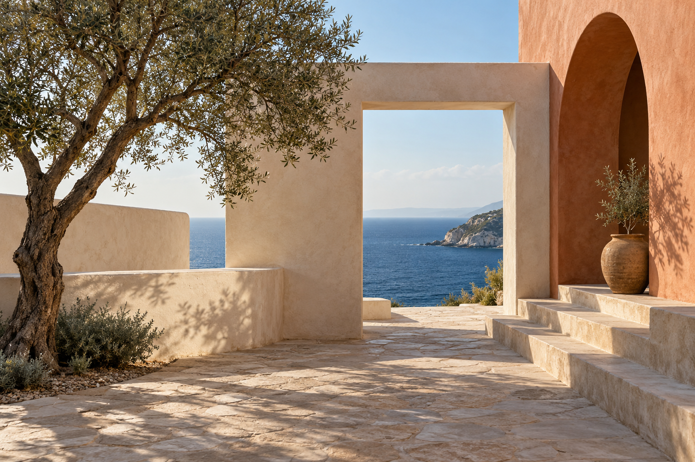
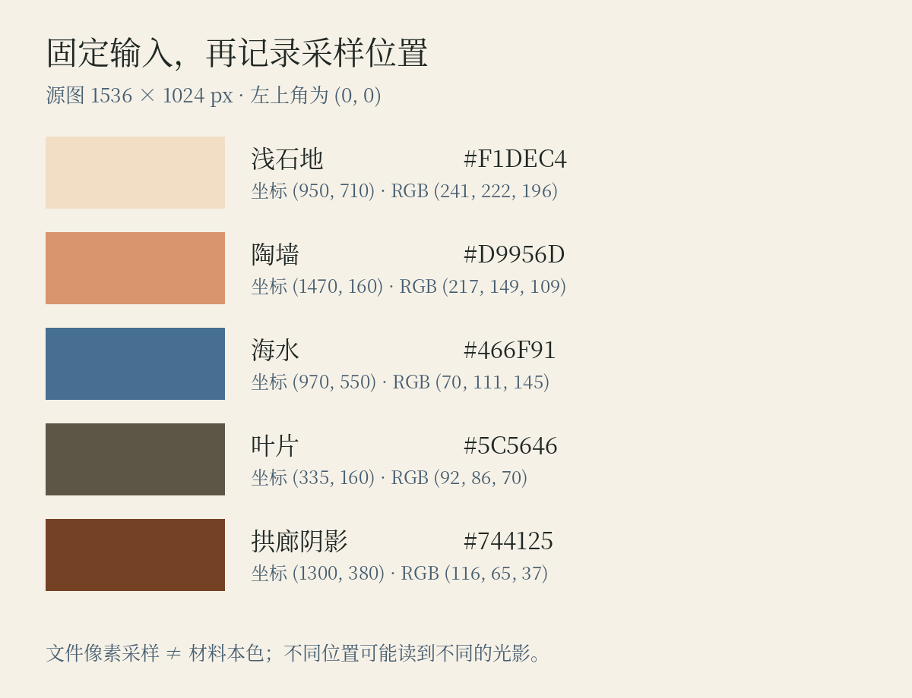

# 第13章 从自然、摄影和作品中取色

走进一间旧书店，木架、纸页、绿植和午后的光已经组成一幅画面。你很喜欢这组颜色，拍下来，吸出五个色号，再放到海报上，却未必得到原来的感觉。照片里有空间、纹理、阴影和物体之间的关系；色卡只保留少量颜色。取色因此是一次有目的的翻译，需要决定保留什么，以及舍弃什么。

## 先找关系，再找色号

本书的原创文化空间「间色」兼有阅读、饮品和小型展览。为它寻找颜色时，可以拍一组自己有权使用的现场照片：桌上的书、陶杯、植物、墙面。先不用吸管，写出三句话，例如「大部分面积很明亮」「深色集中在书架与叶片」「陶杯提供一点暖色」。这些关系比某一个像素更接近照片给人的整体印象。

下一步才寻找候选色。背景提供大面积的底色，阴影提供深色，主体提供识别色，小物件可能提供强调色。这不是规定每张照片都必须提取四种颜色，而是在提醒你：四个用途各不相同，不能只挑四个最鲜艳的地方。

## 从一张具体图片开始：海边建筑的取色记录

*图13-1｜AI 教学示意，虚构建筑场景。下面的采样针对本书所用PNG文件，不表示真实建筑材料的颜色。*

先看连续的大面积：浅墙与石地提供明亮环境，陶色拱廊形成暖色主体，开口中的海蓝带来另一种方向，树与阴影提供深色。取色时不必把每一种都用到同样大的面积；先记住这组分工，再决定要取哪些区域。

*图13-2｜程序读取原PNG的固定坐标，显示样本位置与实际sRGB色号。所有值都可用仓库脚本复算；单点样本只代表该像素，不是自动求得的材料本色或官方标准色。*

这一步故意保留记录，使结果可以检查。如果你在自己的屏幕上重新吸同一张PNG的相同坐标，软件没有额外转换时应能读到对应文件值；若改吸聊天缩略图、网页截图或另一个压缩版本，就不再是同一个输入。取色方法必须连同文件版本一起保存。

接着做设计判断。海蓝可以成为识别色，也可以只是很小的一处变化；深色阴影不一定足以承担小字，需要另选深墨并计算对比；浅墙的颜色也可能因为铺满页面而与照片里的感受不同。把采样结果放进一张真实内容的卡片，检查标题、日期和入口，再决定保留、合并或补充哪些颜色。取色记录提供起点，应用检验决定最终方案。

## 一次取色的完整做法

先固定输入图片。不要在滤镜版本、聊天截图和原片之间来回采样，否则你无法判断变化来自设计还是图片本身。照片能作为灵感，但不能仅凭照片确定真实物体的标准色；拍摄与显示条件仍会影响它。

然后取一组候选色。每个区域可以多点取样，避开反光边缘、压缩噪点和很小的异常像素，选出能代表该区域的颜色。自动工具可以加速这一步：Adobe 的官方介绍展示了从图像提取颜色主题，并移动取样位置进行调整的方式。它提供候选结果，最后仍需由人决定用途。参见 [Adobe：Adobe Capture in InDesign](https://blog.adobe.com/en/publish/2021/10/26/adobe-capture-in-indesign)。

接着压缩差异。如果五个候选色中有三个都是接近的暖灰，先问它们是否各有用途。相近颜色可以保留为背景层次，也可以合并。另一方面，如果全部候选色都处在中等明度，通常还需要补充足够深的文字色与足够浅的背景色。补充并不等于背叛灵感；原图没有小字号活动说明，它不必替你的版面解决这个问题。

最后做一张真实内容的小样。间色先试一张包含活动标题、日期、说明和预约入口的信息卡：暖纸 `#F6F1E7` 作底，深墨 `#202824` 作正文，墨绿 `#24544B` 作识别，陶橘 `#C86345` 只作小面积点缀。这里的色号是本书设定的教学方案，不声称来自某张真实照片。只有放入内容后，才看得出四种颜色是否够用。

## 取作品的颜色，还是学习作品的方法

从绘画、电影画面、杂志和品牌网站取色时，要区分两种任务。第一种是分析：保留作者、作品、年代、出处，以及你分析的具体版本。第二种是创作：学习对方如何分配深浅、主次和冷暖，再重新组织自己的画面。取到相同色号，不意味着继承了原作的构图，也不意味着可以复制它的图像与标识。

有时最值得学习的是「某种颜色出现在哪里」。一幅画可能把暖色集中在人物附近，把冷灰留给环境；一个网站可能让产品照片负责丰富色彩，导航保持克制。把这些规则写下来，比收集一长列无出处的色卡更容易迁移。

参考板也应有边界。每张图旁边标注你借鉴的项目：面积、材质、氛围、对比或节奏。三张方向明确的图，往往比二十张仅凭「好看」收集的图更便于讨论。当两张图互相冲突时，需要回到任务：间色的活动信息是否清楚，空间是否让人愿意停留，系列是否还能辨认为同一个项目。

## 把取色记录变成可修改的决定

给每种颜色记录三个信息：色值、用途、限制。例如「陶橘：用于活动小标，不直接承担长段小字」。再记下方案是在什么图片、什么背景和什么目标下形成的。以后换成夜间活动或深色界面，就知道哪些规则可以延续，哪些需要重新验证。

试着用自己的一张生活照片做练习：提取四到六个颜色，先制作等面积色卡，再制作一张活动卡。不要以两者是否同样漂亮作为唯一判断。观察活动卡中有没有需要新增的深色、哪一种颜色面积显著缩小、哪一种颜色虽然存在却没有实际工作。

如果你的答案是「我保留了照片里的绿与陶色，但增加了正文深色，并减少了陶色面积」，说明你已经开始将灵感转成设计。取色的成功，不在于每个像素忠实复现，而在于原来的关系能否在新任务中成立。

## 取色也需要编辑

不要因为参考照片里出现了某种颜色，就认为最终方案必须保留它。一小片蓝色天空可能只是拍摄时的偶然背景；若活动卡没有适合的用途，可以删去。反过来，原图中并不显眼的纸页色，可能非常适合承载长段文字，于是在设计中获得更大面积。取色结果应接受任务检验，也应该允许被改写。保存原始候选与应用版本，能让你以后清楚分辨：哪些颜色来自观察，哪些是为阅读与操作补充的设计决定。

## 本章资料

- Adobe，*Adobe Capture in InDesign*，2021：图像提取颜色主题与调整取样位置。[原文](https://blog.adobe.com/en/publish/2021/10/26/adobe-capture-in-indesign)
- Adobe Color，*Extract Theme*：图片提取色彩主题的工具入口；界面可能更新。[工具](https://color.adobe.com/create/image)
