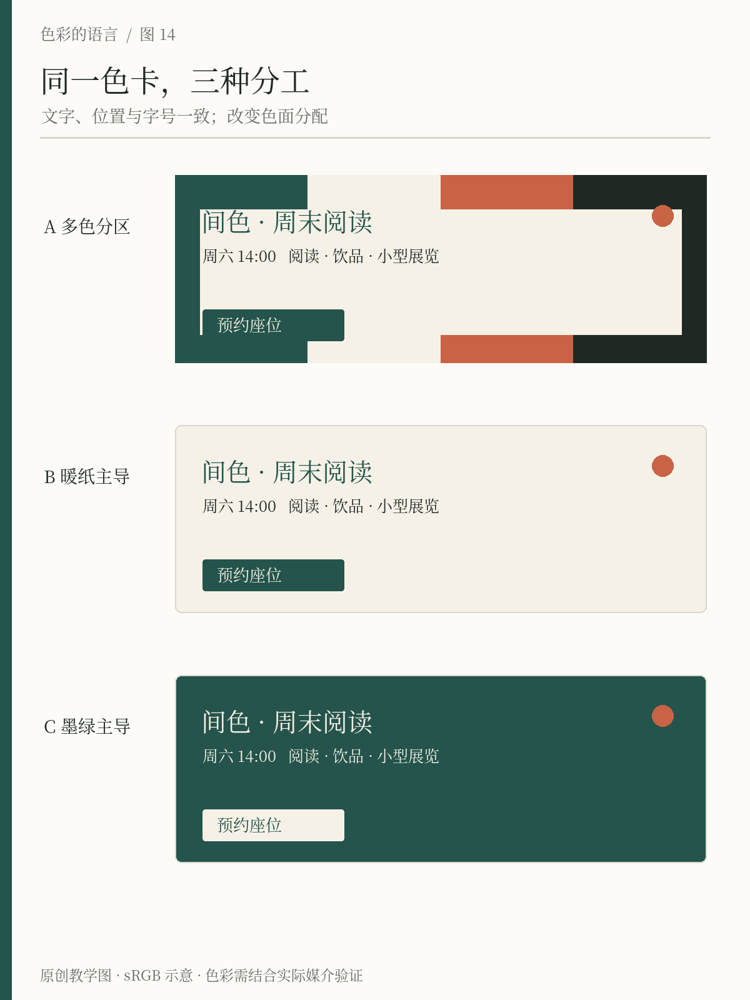
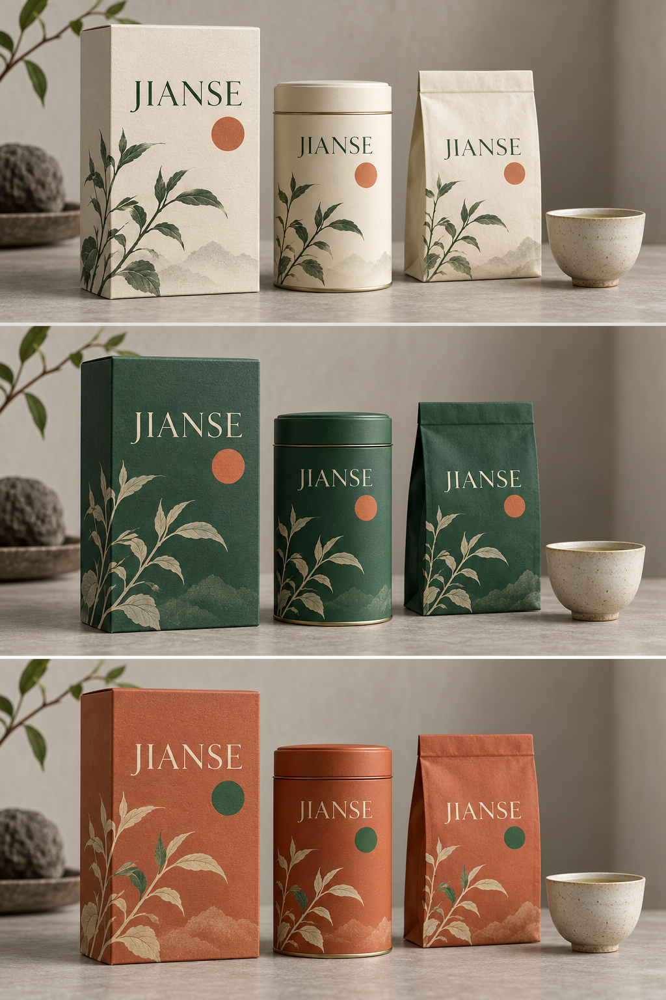

# 第14章 从色卡到完整画面

五个并排色块很容易显得协调：每个颜色面积相同、边界整齐、没有文字和照片打断。真正的设计却有大背景、小标题、细线、照片与留白。颜色的任务从「并排展示」变成「组织内容」，原先的平衡也就随之改变。

从色卡到画面，最重要的一步是为颜色分配位置和工作。我们仍使用间色的暖纸、墨绿、陶橘和深墨，不急着增加第五种颜色，先观察四种颜色怎样承担一张活动海报。

## 先做内容骨架

把海报暂时画成黑、白、灰：标题最大，活动说明次之，日期和地点能被迅速找到，预约入口有稳定的位置。这个骨架解决的是阅读顺序。Adobe 的基础设计说明把对比视为区分元素与形成重点的方法；颜色只是其中一项，大小、形状和位置也能制造差别。参见 [Adobe：Understanding the Basic Principles of Graphic Design](https://www.adobe.com/learn/express/web/graphic-design-basics)。

如果在灰度状态下就没有主次，把五个元素染成五种颜色通常只会增加选择。你可能暂时更容易找到它们，却仍然不知道该先看哪一个。先确定「本周夜读」是主信息，日期地点是支持信息，底部的空间名称负责署名，再让颜色配合这个次序。

*图14 原创对照：同一组颜色可以形成不同的主导关系。多色分区是一种构成选择；暖纸主导与墨绿主导则呈现另外两种阅读氛围。比较时先看背景、文字与点缀分别承担了什么。*

## 决定谁成为环境

背景占据的面积通常远大于文字。暖纸成为背景时，它建立一片明亮、连续的阅读区域；墨绿成为背景时，整幅画面首先呈现深色场。两种方案都可以成立，但它们对其他颜色提出不同要求。

暖纸底上，深墨可承担正文，墨绿可承担标题与识别。墨绿底上，正文通常需要换成合适的浅色，图像和细线也要重新检查。不能只按一个「反色」按钮就假定任务已经完成。屏幕中的对比、字体粗细、图像暗部，以及打印后的表现，都需要回到最终尺寸查看。

因此应先制作两个主导方案：一个浅底，一个深底。对同一组内容，分别完成整张画面。不要只把背景换掉，其他元素原样留下，再据此认定某一种颜色不合适。比较的对象应是两个各自完成基本适配的方案。

## 面积比例是一种结果

「六成主色、三成辅助色、一成强调色」能帮助初学者记住大中小关系，但不宜把它当成精确配方。文字的面积难以与背景直接等量衡量；一条很细的高对比边线，也可能比一大块浅灰更显眼。不同媒介与内容会改变它们的权重。

间色的海报可以让暖纸承担大面积环境，墨绿建立标题和边线，陶橘只出现于日期标记。到了展览开幕邀请，陶橘可以扩大为一个主题区域。改变面积并不必然破坏一致性，前提是颜色的角色仍然能被识别，关键文字仍可读。

实践中，比计算所有像素的占比更有用的是问：第一眼出现的颜色是哪一种？第二个视觉重心在哪里？有没有一种本来只是辅助的颜色，因为面积太大或出现太频繁而抢走主导权？这些问题能直接指向修改动作。

## 为图片留下自己的颜色

一张海报如果包含摄影作品，图片本身已经带来大量颜色。此时色卡不再是封闭系统。把品牌色大面积铺满四周，可能与照片争夺注意；把照片强行统一成双色，也可能损失作品原有信息。

可以先使用中性背景与清楚的文字结构，只让品牌色出现于署名、分隔或小标。再根据图片决定是否增加有色边框或底板。照片有强烈暖色时，不必为「呼应」而把整张海报继续染暖；让周边退后，常常更有利于主体被看见。这是需要看具体画面验证的设计判断，不能只靠色轮计算。

## 做小样，比讨论形容词更快

用同一版式制作三张小样：多色分区、暖纸主导、墨绿主导。保持文字内容、元素位置与字体不变，只调整颜色分配。先缩小到手机列表中的大小看整体，再放大到实际阅读尺寸看细节。

请一位没有参与设计的人看三秒，随后说出活动是什么、何时举行、怎样参与。如果三张都好看，但其中一张更容易回答这些问题，它就更接近当前任务。若海报承担的是远距离展示，还需要把实际尺寸与观看距离加入测试；手机缩略图不能替代现场观察。

最后写一句选择理由，例如「采用暖纸底，因为本系列有较长说明，且照片需要保持原色；墨绿负责识别，陶橘仅用于日期」。这句话比「这个方案更高级」更便于后续协作，也为下一张海报留下可复用的规则。

## 保留变化记录

为三个方案分别写下一条最明显的优点和代价。例如浅底便于承载说明，但在一排深色活动图中可能不够显眼；深底形成整体色场，但需要重新选择图像与细线。这里的答案与展示环境有关，没有脱离用途的冠军。保留这些记录，下一次遇到类似任务时，就能从条件出发选择，而不必重新争论自己究竟喜欢浅色还是深色。

## 看得见的应用：让三种颜色轮流成为包装主体

*图14-2｜AI 教学示意，虚构品牌 JIANSE。上、中、下依次为暖纸、墨绿、陶橘主导。生成图只展示近似外观，不作为精确色值、印刷工艺或材料性能的证明。*

三版保留方盒、圆罐、纸袋、杯子与植物插画的相近组合。暖纸版让大面积留白与细植物线条先被看到；墨绿版把几件包装合成较集中的深色块，浅色字与插画随之凸显；陶橘版扩大原本的小点缀，让整组包装产生更强的暖色存在感。颜色集合相近，包装在货架上占据的视觉重量已经不同。

注意文字与插画也随底色调整：深底上需要足够清楚的浅色名称，不能只把奶油色纸盒直接染绿、继续留下原来的绿字。橘色圆点在深绿版上醒目，到了橘底版则改为绿色点，保留“局部标记”的作用。这是角色适配，而非机械地轮换色号。

三版还有共同限制。植物插画很细，缩到真实货架距离时可能消失；圆罐的弧面会让两侧偏暗，文字位置必须留出余量；纸袋折痕也会打断图案。下一步应制作展开图和实际大小打印样，核查名称、品类与必要说明。我们可以借生成图判断整体方向，再用可测量的稿件落实细节。

## 本章资料

- Adobe，*Understanding the Basic Principles of Graphic Design*：对比、重点与视觉层级的入门说明。[原文](https://www.adobe.com/learn/express/web/graphic-design-basics)
- 本章间色方案、面积比较与练习为原创教学方法，不代表固定比例标准。
