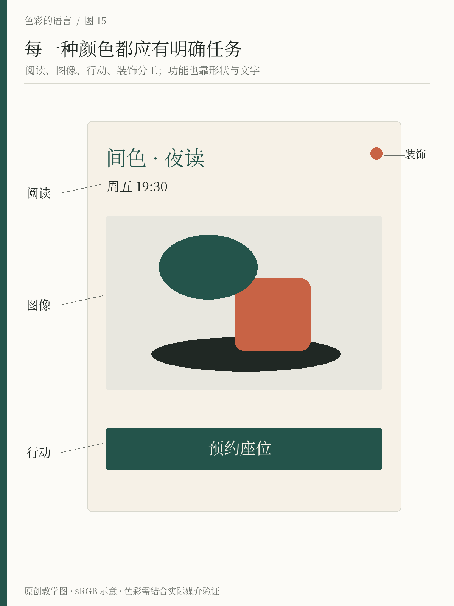

# 第15章 为文字、图形与图像分配颜色

颜色进入版面以后，首先碰到的不是另一种颜色，而是不同类型的内容。同一种墨绿，用于大标题、细小正文、按钮底板和照片滤镜，实际效果与要求都不同。把它们统称为「使用品牌色」，会掩盖这些差别。

设计时可以先列出内容清单：哪些需要连续阅读，哪些负责识别，哪些允许用户操作，哪些只是装饰。再给每一类内容安排颜色。角色越清楚，后续修改越容易，也更能发现一个颜色被迫兼任了多少工作。

## 文字首先需要被读到

间色的一张夜读活动卡包括标题、介绍、日期和预约说明。标题可以使用墨绿建立识别，长段介绍使用深墨，背景使用暖纸。浅一档的颜色可以用于次要信息，但「次要」意味着阅读顺序靠后，并不意味着可以难以辨认。

对于网页中的普通文字，WCAG 2.2 的 AA 级最低对比要求通常为 4.5∶1；符合标准所定义的大号文字可用 3∶1。标准对标识、纯装饰和非活动控件等有特定例外，不能把例外扩展到日期或说明文字。计算是底线，实际阅读还受字重、字号与环境影响。参见 [W3C：Contrast (Minimum)](https://www.w3.org/WAI/WCAG22/Understanding/contrast-minimum.html)。

这也解释了为什么一张漂亮的色卡不能直接决定正文色。一个颜色可以适合大面积图形，却不适合暖纸背景上的小字。陶橘在间色方案中先承担小标和装饰，并不自动成为「所有重要文字的颜色」。如果确实需要橘色文字，应选择适合该背景、经过验证的版本，而不是盲目复用同一个色值。

*图15 原创教学示例：深墨支持阅读，墨绿建立识别并构成预约按钮，陶橘作为小面积装饰。按钮同时具有形状和文字，行动含义不只依赖颜色。*

## 图形有时是信息，有时是装饰

一条线可以分隔两组内容，一个圆点可以标记当前步骤，一片色块也可以只为版面增加节奏。三者外形可能接近，责任却不同。如果去掉圆点后用户不知道当前进度，它承担了信息；如果去掉边线后内容仍清楚，边线可能只是辅助组织。

对承担信息的图形，要检查它与相邻区域是否容易区分，以及是否还有文字或形状帮助理解。W3C 的非文本对比说明针对识别控件、状态及理解图形所必需的视觉部分，规定了适用条件下的最低对比要求，并非要求每条装饰线都达到相同指标。参见 [W3C：Non-text Contrast](https://www.w3.org/WAI/WCAG22/Understanding/non-text-contrast.html)。

在间色的活动卡中，小陶橘圆点可以只是系列装饰。若把同样的圆点用来表示「已满」，就必须补上文字或其他清楚的编码。否则同一个符号一会儿没有意思，一会儿承担重要意思，读者无从确定该怎样解释。

## 行动需要稳定的外观

预约按钮、文字链接和不可点击的标签不应只因颜色相同就被画得一样。按钮应有清楚的边界与行动文案，链接可以通过下划线等方式帮助识别，标签则避免制造可点击的错觉。颜色提供一致性，形状与位置解释用途。

GOV.UK 的设计系统按文字、链接、焦点、错误等用途组织功能颜色，并强调只在相应语境中使用对应变量。这是一个有用的真实例子：颜色名可以描述外观，角色名则描述工作；它们并不等同。参见 [GOV.UK Design System：Colour](https://design-system.service.gov.uk/styles/colour/)。

间色可以约定墨绿按钮代表主要行动，但不能因此把墨绿同时当作所有成功状态、推荐标签和当前选中项的唯一标记。到了复杂界面，用户需要区分「可以点击」「已经完成」与「正在查看」。更完整的角色系统将在第21章展开，本章先把这种区分落实到单张画面。

## 图片不需要与所有品牌色一致

图像带来的颜色可能比整个文字区域更丰富。对一幅展览作品，忠实呈现原作往往比统一滤镜更重要。可以通过固定留白、标题位置与署名颜色建立系列关系，而不修改每幅作品的色彩。

如果背景复杂，优先调整文字所处的位置或增加稳定的底板。不要只凭照片上某一处较暗，就判断白字始终可读；图片裁切、响应式布局或下一张轮播图，都可能改变文字背后的颜色。渐变遮罩可以作为手段，但应检查它覆盖后的实际效果，不能把遮罩的存在当作验证通过。

## 用角色清单找出冗余

现在把活动卡复制一份，为每一处颜色写标签：阅读、识别、行动、状态、图像或装饰。若同一块内容难以归类，就先解释它希望读者做什么。一个既不像按钮又不像信息的彩色胶囊，可能需要先改结构，而不只是改颜色。

练习时尝试去掉所有装饰色，再逐项放回。若预约入口因此更清楚，说明此前的装饰可能过强；若拿掉某种颜色后信息消失，就要为它补上另一种可感知的线索。最终的目标是让颜色各司其职，而不是让每一项内容都拥有自己的专属色。

一份简单的交付说明也能减少误用。不要只交出四个色号，而应附上一张带真实文字的示例，说明正文、背景、按钮和装饰分别怎么用。如果某个颜色只能用于大面积图形，就把限制直接写出。这样接手者复制的是一套经过检查的组合，而不是凭印象把漂亮颜色轮流涂到每个元素上。颜色一旦有了工作描述，团队的讨论就会更具体。

## 看得见的应用：一本文化刊物怎样容纳强色摄影

*图15-2｜AI 教学示意，虚构刊物 INTERVAL。摄影、版式与印刷质感均为生成的概念方案，不是真实出版物或可直接印刷的完稿。*

先沿封面、左页、右页移动视线。钴蓝承担大标题，把多个载体连在一起；米白纸面提供连续的阅读区域；照片中的陶红建筑是内容主体，并没有被强行改成品牌蓝。少量红色页码和期号负责索引，作用和大幅照片不同。

这张图的配色并不只有“蓝加橘”。字形的宽窄、标题的尺度、正文的行长、照片的占比都在改变颜色的重量。大标题的蓝色像一块有方向的图形，右页照片的红色则依靠真实空间的明暗获得深度。如果把它们替换成等面积的蓝橘色块，读者感受到的节奏不会相同。

可以试着做一次反向修改：若把正文也全部染蓝，或把期号放大成另一个红色标题，会怎样？前者可能降低长文的阅读舒适度，后者可能制造新的竞争中心。修改时先保留一组主要阅读重心，再决定要不要增加颜色。图中细小英文只用于表现排版密度，正式成稿仍需逐字校对、检查字号与印刷对比。

## 本章资料

- W3C，WCAG 2.2 Understanding，*Contrast (Minimum)*。[原文](https://www.w3.org/WAI/WCAG22/Understanding/contrast-minimum.html)
- W3C，WCAG 2.2 Understanding，*Non-text Contrast*。[原文](https://www.w3.org/WAI/WCAG22/Understanding/non-text-contrast.html)
- GOV.UK Design System，*Colour*：功能颜色及其使用语境。[原文](https://design-system.service.gov.uk/styles/colour/)
