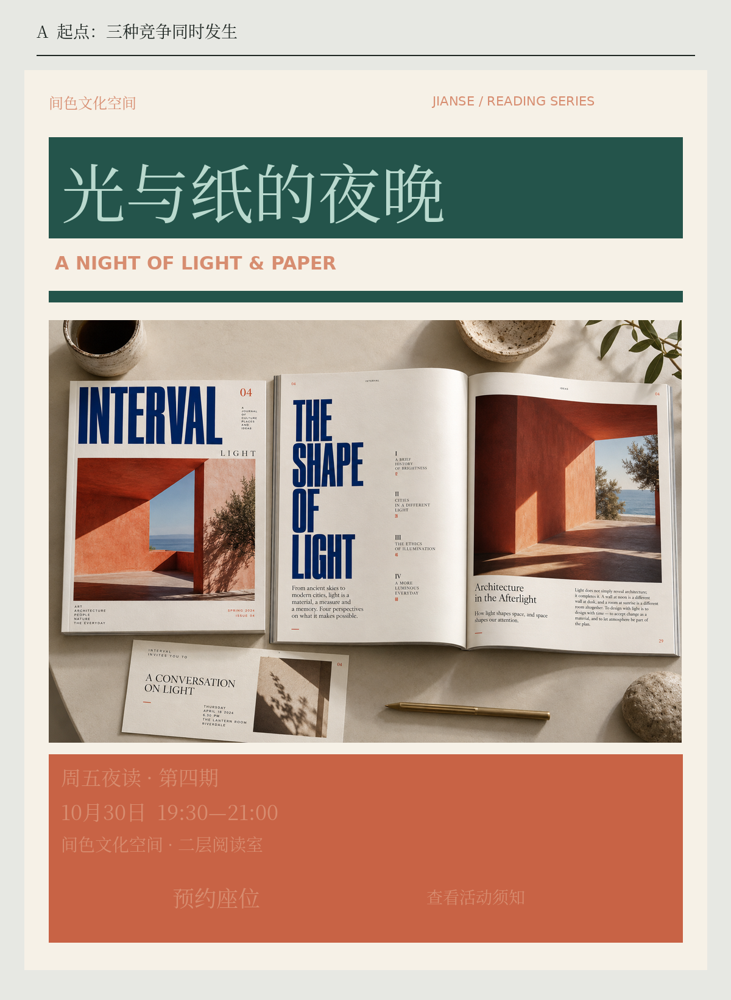
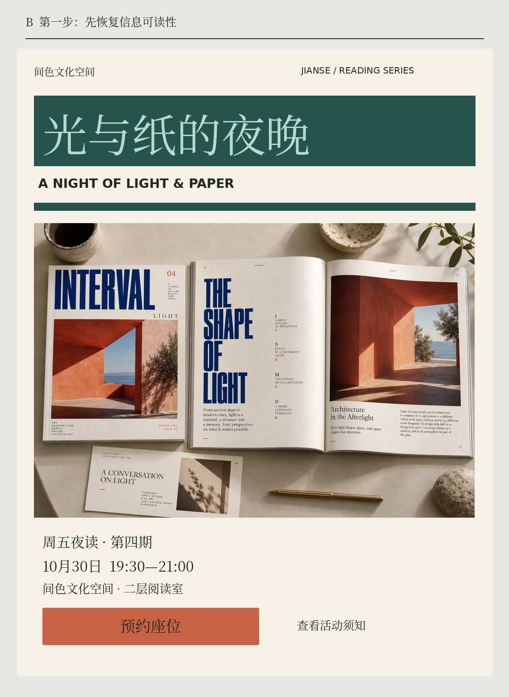
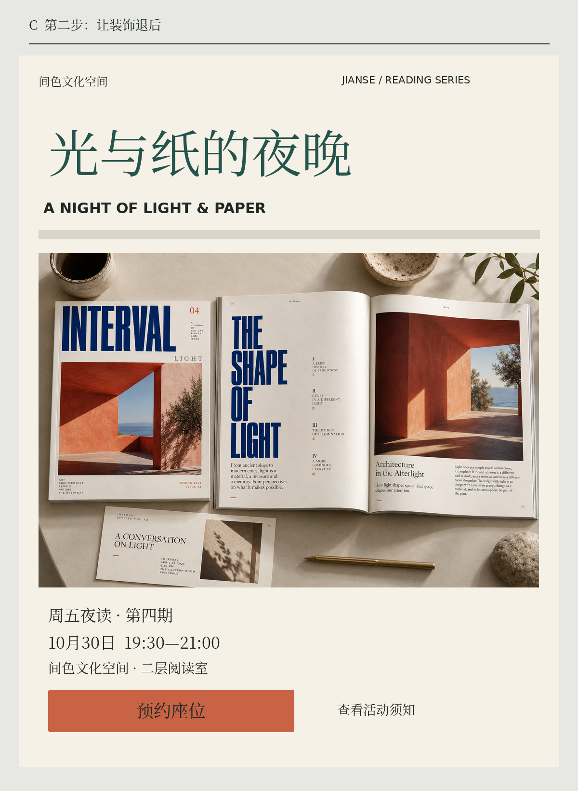
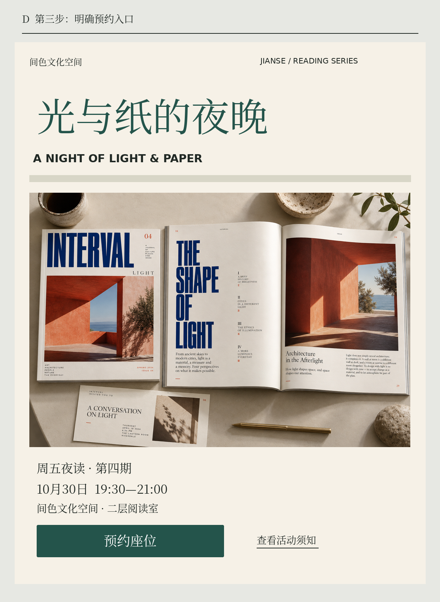

# 第16章 诊断与修正失败的配色

当一张海报让人觉得「乱」，最容易发生的事是重新寻找色卡。换过蓝色、紫色和橘色，画面仍然很乱，于是又增加一种中性色。问题可能始终没有触及：重要文字难读，所有元素都在争夺注意，装饰与行动入口使用相同的强调方式。

修正配色时，先把形容词换成可观察的问题。不要只写「不够舒服」，而要写「日期在背景上不易读」「标题与装饰同样突出」「预约按钮看起来像普通标签」。每一个问题都应对应一个可测试的修改动作。

## 把设计暂时冻结

我们拿间色的夜读海报做一次连续修正。固定标题、日期、预约入口等主要文字的位置与字号，也保持主要色块的轮廓。前三步只调整颜色分工，最后允许补充链接下划线这一识别线索。这样能够看出哪些改进来自颜色，而不是借助放大标题、移动元素或更换字体产生的效果。

图中的起始海报故意安排了几处问题：有色背景覆盖信息区域，部分文字和背景过于接近，大面积墨绿图块与标题竞争，预约入口缺少稳定的视觉分工。这是一张为说明方法构造的失败示意，不代表鲜艳配色本身错误。表演海报与展览视觉完全可以有强烈冲突，前提是冲突服务于任务，必要信息仍能被理解。

*图16｜连续修正的快速总览。右侧为下文四张完整应用图的缩略图，保留内容与骨架，分别定位损失、恢复阅读、减少竞争、明确入口；左侧只标出每次改动。细小信息请查看下文完整图，而不从缩略图判定文字对比。*

## 第一步：先恢复阅读

先找最不能丢失的信息：活动名称、日期、地点与参与方式。把它们背后的信息区统一成暖纸，正文调整为深墨。此时暂时不处理所有装饰，避免一次改动过多，无法判断哪个动作有效。

实际网页可以测量文字与背景的对比值，但要测最终组合。半透明文字叠在照片上，得到的不是面板里标注的纯色色值；渐变和图片也不只有一个背景值。W3C 对对比的解释强调文字与实际背景之间的关系，并说明阈值不可通过四舍五入凑足。参见 [W3C：Contrast (Minimum)](https://www.w3.org/WAI/WCAG22/Understanding/contrast-minimum.html)。

印刷海报则还应在接近最终大小的样张上检查。网络标准能帮助建立对比意识，但不能代替纸张、油墨、观看距离和现场照明的验证。如果日期依然看不清，就需要在下一轮允许调整字号或结构；本次冻结版式只是一种诊断手段，不是要求所有问题都用颜色解决。

### 完整应用：先只修必须读到的信息

*图16-2A｜程序精确排印＋AI虚构书刊摄影。标题、摄影、信息区和入口已有完整内容；起点故意让信息区使用接近的橙色文字与橙色底面，构造可定位的错误。*

先找出这张图的实际损失：活动标题可以认出，摄影也相当清晰，但时间、地点与预约文字落在相近的橙色里。读者并不是缺少欣赏照片的机会，而是缺少完成参与任务的可靠信息。深绿标题底、深绿横线与橙色信息块又分别建立了强边界，缩小看时容易把三个区域都当成重点。它们都是可以指出位置的问题，不需要猜测“橙色是不是让人焦虑”。

保留摄影还有一个用处：它说明成熟的素材并不会自动补救信息组织。照片中已有蓝、陶橙、暖纸和阴影，外部设计再增加强色块，会与图像一起形成实际的视觉负担。本例没有把照片重新染成品牌色，因为那会同时改动内容和配色，难以判断改善究竟来自哪里。观察失败版时，先用三秒寻找开始时间，再记录卡住的具体位置；不要先给它贴“丑”或“高级”的总标签。还可以把海报转交给不了解活动的读者，请他复述“是什么、何时、怎样参加”。如果只记住摄影里的建筑，却不能说出开始时间，就知道精美图像并没有完成活动信息的传递。这个现象需要通过下一版验证。

*图16-2B｜主要文字、摄影位置、标题底面与装饰横线不动；信息区恢复暖纸底和深墨字，先解决阅读任务。*

这一版最值得看的不是标题，而是原来消失在橙底上的“19:30—21:00”和“二层阅读室”。它们重新出现，来自信息区背景与正文配对的改变，并不来自字数减少或字号增大。摄影依旧占据同样面积，说明我们可以保留作品的丰富性，同时给必要信息一个稳定的阅读底面。

此时还不急着宣布完成。深绿标题底与粗横线仍然很重，橙色入口与周围内容的优先级也没有完全分开。它们留在图中，是为了让下一步的问题仍可见：先修了阅读，整体主次仍值得调整。对真实项目而言，如果这一版已经让目标读者顺利找到时间，可以保留这个中间结果作为记录；之后即使审美方向改变，也知道哪组修改解决了什么，而不会把所有改善笼统归功于“换了颜色”。同样不要用“颜色少了所以更好”描述这一步：照片仍然包含许多颜色，标题与装饰也没有取消。真正改变的是必要信息所在底面的稳定性。为每一版保留一条任务记录，比只保存一个最终成品更能帮助日后排查相似问题。

## 第二步：减少互相竞争的重点

阅读恢复后，再处理主次。保留墨绿标题的识别，把标题背后的深色底面退回暖纸，把粗横线调整为暖灰。前面的基础图还演示了少量陶橘标记的用法；关键是限制强调区域，而不是必须留下某一种装饰。这样并没有新增颜色，而是减少同时出现的强信号。

检查方法很简单：眯眼看缩略图，或者暂时模糊画面，观察是否仍有好几个同等强烈的区域。如果有，逐一问它们是否同样重要。一个只是填满空白的色块，不应比活动名称更醒目。反过来，如果海报意在传达多场并列活动，就可能需要保留多个相当的重心，不能机械强求只剩一个。

不要把「减少颜色」误解成只许黑白灰。有时数量没变，只调整一两种颜色的明度、彩度与面积，画面就能清楚许多。诊断的对象是竞争关系，不是颜色数量本身。

### 完整应用：把环境退后，让标题承担识别

*图16-2C｜骨架、摄影、内容与字号不变；标题底退回暖纸，墨绿转为标题文字，粗横线退为暖灰。入口尚保留橙色，留到下一步判断。*

比较B与C，变化最大的不是颜色数量，而是大面积深绿的面积和位置。B里深绿首先形成一整块标题背景，C里它收缩到文字本身，标题仍能借字号被认出，周围却得到更多呼吸空间。照片成为主要图像区域，标题负责命名，细则负责说明，三种工作不再都依靠大色块争取注意。

暖灰横线仍在同一位置，说明“退后”不一定要删除。它保留分区关系，却不再像一个第二标题。照片本身的橙红建筑和蓝色排印也没有被抽掉；我们减少的是外围不必要的竞争，而不是把所有东西都做成黑白。若活动任务本来要求强烈宣传，这一步可以有不同结果，但应让信息测试决定保留什么，而不是默认所有强色块都错。

现在再看底部橙色区域：它已有按钮轮廓和“预约座位”的动词，具备基本操作线索。下一步不是宣布橙色按钮错误，而是判断它与全站主操作规则是否一致，以及旁边的文字入口是否足够明确。连续修正的价值正在这里：每一步有可比较的目标，避免一次同时换色、换图、换字体，最后只知道“好像舒服了”，却无法复用修改方法。若实际观看距离要求标题保留深色底，也可以不采用C；但应重新寻找装饰退后的办法，守住阅读目标。

## 第三步：把行动与装饰分开

最后处理预约入口。让原有按钮区域使用稳定的墨绿底和可读浅字，写明确的行动文案；如果还有文字链接，就增加下划线等线索。在完整海报里，装饰线继续退后，不再兼任行动信号；需要保留陶橘小标时，也应让它与预约职责分开。

再遮住颜色，只观察形状和文字，读者是否知道哪里可以预约？W3C 的「颜色使用」要求强调，颜色不能成为传达信息、提示操作或区分元素的唯一视觉手段。对本例的直接启示是：让「预约座位」既具有行动文案，也有按钮外观。参见 [W3C：Use of Color](https://www.w3.org/WAI/WCAG22/Understanding/use-of-color.html)。

### 完整应用：让预约入口同时具备颜色和形状

*图16-2D｜预约区域改为墨绿底、白字；“查看活动须知”增加下划线。按钮轮廓、文本内容和位置延续前一版，颜色之外新增的是链接识别线索。*

D没有继续把照片或标题做得更鲜艳，而是为参与任务明确最后一步。深绿底把“预约座位”组织成一个独立的操作面，白色文字说明动作；旁边的活动须知保留文字入口的轻量形式，并加下划线。两者通过底面、下划线与用途进行区分，读者可以先预约，也能找到规则说明。C中的橙色按钮不因换成墨绿才突然变得可操作；这次换色的理由是与间色的主操作角色保持一致，新增下划线则专门帮助识别旁边的文字链接。

需要小心的是，这仍是一张静态教学海报，不是一个真正可点的表单。按钮样式用来讨论线上活动页或电子海报中的入口辨识；纸面海报若用于线下张贴，还必须补上实际参与途径，例如可读网址或经过验证的二维码。不能因为图里画出了按钮，就认定所有媒介都已经可以完成预约。

重新把A与D上下相对，尝试不读本节解说就找时间、地点和入口。你应当能够指出三组独立变化：信息底面使细则读得出；强调面积使阅读次序更稳定；按钮与下划线使参与方式更可辨认。至于是否值得增加字号、移动入口或缩小摄影，要在解冻布局后继续测试。颜色修正提供的是清楚的下一步，而不是保证任何场合都适用的固定模板。

## 验证修改是否真的有效

把起始版和修正版交给没有看过过程的人，让对方完成同一个任务：「找出周五夜读的开始时间，并指出怎样预约。」记录犹豫的地方，不要先解释你的设计意图。若你一边讲解一边请人判断，对方可能理解的是你的说明，而不是画面。

这次练习可以按三轮完成：第一轮只修信息可读性，第二轮只修视觉主次，第三轮只修行动辨认。每轮保留一个版本，并写下修改理由。如果某一步没有产生预期效果，就回退重新尝试，避免不断叠加补丁。

完成后再开放版式调整。颜色已经分工清楚，但文字仍挤在角落，说明问题属于布局；按钮明确但文案不知所云，说明需要改内容。好的诊断让你知道下一步该动什么，也让你知道何时应该停止继续换色。

修改记录还应区分观察与解释。「读者没有找到日期」是观察；「因为陶色太多」只是待验证的解释。你可以先减少陶色，也可以固定日期背景，再比较哪一步改善了表现。这样能避免把自己的偏好包装成原因。即使最后保留了起始方案中的某些强烈色块，也应知道它们为何值得留下，以及为它们付出了怎样的阅读代价。

## 本章资料

- W3C，WCAG 2.2 Understanding，*Contrast (Minimum)*。[原文](https://www.w3.org/WAI/WCAG22/Understanding/contrast-minimum.html)
- W3C，WCAG 2.2 Understanding，*Use of Color*。[原文](https://www.w3.org/WAI/WCAG22/Understanding/use-of-color.html)
- 本章四阶段修正流程为原创教学示例；它不是无障碍合规认证流程。
