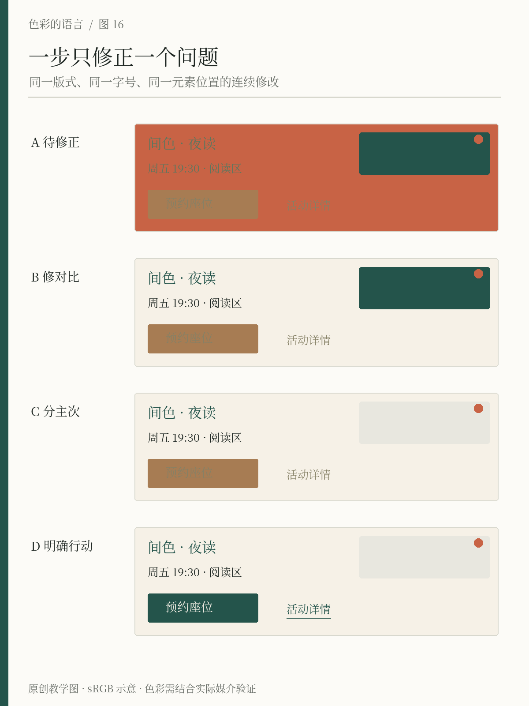

# 第16章 诊断与修正失败的配色

当一张海报让人觉得「乱」，最容易发生的事是重新寻找色卡。换过蓝色、紫色和橘色，画面仍然很乱，于是又增加一种中性色。问题可能始终没有触及：重要文字难读，所有元素都在争夺注意，装饰与行动入口使用相同的强调方式。

修正配色时，先把形容词换成可观察的问题。不要只写「不够舒服」，而要写「日期在背景上不易读」「标题与装饰同样突出」「预约按钮看起来像普通标签」。每一个问题都应对应一个可测试的修改动作。

## 把设计暂时冻结

我们拿间色的夜读海报做一次连续修正。固定标题、日期、预约入口等主要文字的位置与字号，也保持主要色块的轮廓。前三步只调整颜色分工，最后允许补充链接下划线这一识别线索。这样能够看出哪些改进来自颜色，而不是借助放大标题、移动元素或更换字体产生的效果。

图中的起始海报故意安排了几处问题：有色背景覆盖信息区域，部分文字和背景过于接近，大面积墨绿图块与标题竞争，预约入口缺少稳定的视觉分工。这是一张为说明方法构造的失败示意，不代表鲜艳配色本身错误。表演海报与展览视觉完全可以有强烈冲突，前提是冲突服务于任务，必要信息仍能被理解。

*图16 原创连续修正：先稳定信息区的背景与文字，再减少竞争性的强调，最后明确预约入口。四个版本保持主要内容、位置与字号一致；最后一版额外给文字入口加下划线，说明颜色之外的识别线索。*

## 第一步：先恢复阅读

先找最不能丢失的信息：活动名称、日期、地点与参与方式。把它们背后的信息区统一成暖纸，正文调整为深墨。此时暂时不处理所有装饰，避免一次改动过多，无法判断哪个动作有效。

实际网页可以测量文字与背景的对比值，但要测最终组合。半透明文字叠在照片上，得到的不是面板里标注的纯色色值；渐变和图片也不只有一个背景值。W3C 对对比的解释强调文字与实际背景之间的关系，并说明阈值不可通过四舍五入凑足。参见 [W3C：Contrast (Minimum)](https://www.w3.org/WAI/WCAG22/Understanding/contrast-minimum.html)。

印刷海报则还应在接近最终大小的样张上检查。网络标准能帮助建立对比意识，但不能代替纸张、油墨、观看距离和现场照明的验证。如果日期依然看不清，就需要在下一轮允许调整字号或结构；本次冻结版式只是一种诊断手段，不是要求所有问题都用颜色解决。

## 第二步：减少互相竞争的重点

阅读恢复后，再处理主次。让标题保留墨绿识别，将非必要的大面积墨绿图块退为暖灰，只保留小面积陶橘标记。这样并没有新增颜色，而是减少同时出现的强信号。

检查方法很简单：眯眼看缩略图，或者暂时模糊画面，观察是否仍有好几个同等强烈的区域。如果有，逐一问它们是否同样重要。一个只是填满空白的色块，不应比活动名称更醒目。反过来，如果海报意在传达多场并列活动，就可能需要保留多个相当的重心，不能机械强求只剩一个。

不要把「减少颜色」误解成只许黑白灰。有时数量没变，只调整一两种颜色的明度、彩度与面积，画面就能清楚许多。诊断的对象是竞争关系，不是颜色数量本身。

## 第三步：把行动与装饰分开

最后处理预约入口。让原有按钮区域使用稳定的墨绿底和可读浅字，写明确的行动文案；如果还有文字链接，就增加下划线等线索。陶橘小标继续承担装饰，不再兼任唯一的行动信号。

再遮住颜色，只观察形状和文字，读者是否知道哪里可以预约？W3C 的「颜色使用」要求强调，颜色不能成为传达信息、提示操作或区分元素的唯一视觉手段。对本例的直接启示是：让「预约座位」既具有行动文案，也有按钮外观。参见 [W3C：Use of Color](https://www.w3.org/WAI/WCAG22/Understanding/use-of-color.html)。

## 验证修改是否真的有效

把起始版和修正版交给没有看过过程的人，让对方完成同一个任务：「找出周五夜读的开始时间，并指出怎样预约。」记录犹豫的地方，不要先解释你的设计意图。若你一边讲解一边请人判断，对方可能理解的是你的说明，而不是画面。

这次练习可以按三轮完成：第一轮只修信息可读性，第二轮只修视觉主次，第三轮只修行动辨认。每轮保留一个版本，并写下修改理由。如果某一步没有产生预期效果，就回退重新尝试，避免不断叠加补丁。

完成后再开放版式调整。颜色已经分工清楚，但文字仍挤在角落，说明问题属于布局；按钮明确但文案不知所云，说明需要改内容。好的诊断让你知道下一步该动什么，也让你知道何时应该停止继续换色。

修改记录还应区分观察与解释。「读者没有找到日期」是观察；「因为陶色太多」只是待验证的解释。你可以先减少陶色，也可以固定日期背景，再比较哪一步改善了表现。这样能避免把自己的偏好包装成原因。即使最后保留了起始方案中的某些强烈色块，也应知道它们为何值得留下，以及为它们付出了怎样的阅读代价。

## 本章资料

- W3C，WCAG 2.2 Understanding，*Contrast (Minimum)*。[原文](https://www.w3.org/WAI/WCAG22/Understanding/contrast-minimum.html)
- W3C，WCAG 2.2 Understanding，*Use of Color*。[原文](https://www.w3.org/WAI/WCAG22/Understanding/use-of-color.html)
- 本章四阶段修正流程为原创教学示例；它不是无障碍合规认证流程。
