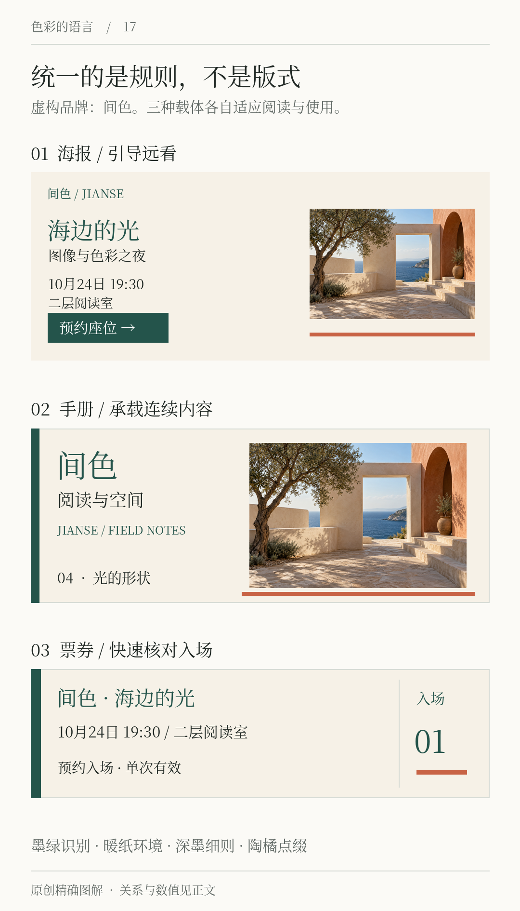

# 第17章 品牌、海报与出版

品牌颜色的力量，来自一次次在相似语境中被看见。消费者可能先认识杯子，再认识招牌，后来看到一张活动海报，仍能把它们联系起来。颜色参与这种联系，但它通常与标识、字体、布局、图像风格共同工作。

因此，品牌配色不是找到一种别人没用过的颜色，而是建立一套能够持续使用的关系。它需要容纳不同内容，也需要在屏幕、纸张、包装和环境中保留足够的辨识度。设计系统关心这些关系怎样维护，本章先观察它们怎样出现在作品里。

## 真实案例：颜色可以稳定，表达可以变化

Spotify 在2026年4月的官方设计回顾中，将鲜明绿色描述为品牌区别于当时科技视觉环境的一项主动选择，同时说明具体绿色曾经变化；访谈也提到深色产品背景、字体和可变表达共同构成辨识度。这里值得学习的不是「绿色天然代表创新」，而是品牌如何解释自己的选择，并让它与长期使用形成联系。参见 [Spotify：The Look Behind the Sound](https://newsroom.spotify.com/2026-04-23/spotify-design-history/)。

它面向合作开发者的规范还区分标识颜色与背景的使用情境。这说明一个品牌颜色不是可以任意铺在所有东西上的通行证；标识如何出现、何时用单色版本，都属于系统规则。参见 [Spotify：Design & Branding Guidelines](https://developer.spotify.com/documentation/design)。本书不复刻其官方标识或将第三方网站的色号当作品牌标准，实际使用应查当时有效的官方资产。

另一个不同方向的案例是 IBM。其官方色彩说明以蓝色为核心，允许更广泛的色族，并让灰、黑、白和核心蓝色承担主要环境。观察这套规则，可以理解品牌一致性并不要求作品永远只有一种颜色。参见 [IBM Design Language：Color](https://www.ibm.com/design/language/color/)。

## 海报需要识别，也需要具体内容

间色每月有不同活动。若所有海报只是把标题替换，长期看可能缺乏内容区别；若每次换一套颜色，又可能像来自不同机构。可以固定一层，开放一层：空间署名、基本文字颜色与识别位置保持稳定，主题图形、图片和局部强调允许随内容变化。

例如夜读海报以暖纸为底，墨绿承担标题和署名，陶橘只标记活动信息。摄影展海报让作品占主导，品牌色退到署名；节庆活动则可以增加陶橘面积，但继续保留墨绿与暖纸之间的识别关系。这里的开放程度应根据实际内容决定，不能预先要求每张海报都必须露出等量品牌色。

*图17｜原创精确排印＋AI虚构建筑图像。海报、阅读手册、票券各自调整照片比例与信息层级，同时延续暖纸环境、墨绿识别、深墨细则和陶橘点缀。图中为虚构物料，按钮样式表示电子媒介入口，印刷海报仍需提供实际参与路径。*

## 出版物需要连续阅读的节奏

一本阅读手册的封面可以强烈，内页却要面对数十页连续文字。封面把墨绿铺满，并不意味着每个正文页也必须如此。书籍可以通过章标题、页码、图注规则和章节引导页建立色彩联系，让正文保留稳定的阅读环境。

颜色还可以组织信息。正文、引用、练习与资料栏如果各有外观，读者更容易辨认它们的用途。但类别不宜无限增加：五种旁注各配一种颜色，可能让读者不断返回图例。先判断内容是否真的需要分成五类，再决定是否值得分色。

系列出版物可以让每期拥有主题色，同时固定书脊位置、标题结构或中性色环境。这样即使某一期颜色变化较大，系列联系仍由其他稳定线索支撑。若把颜色当成唯一识别方式，一次单色印刷或封面照片变化就可能打断联系。

## 跨载体保持关系，而非强求完全相同

纸杯有弧度，手册用纸有底色，手机屏幕会发光。一个数字色值不能完整描述这些条件。品牌规范应说明媒介中的实现方式与允许变化，必要时制作实物样张；具体色彩管理将在第23章介绍。

本阶段可以准备一页应用说明：浅底时标题与正文怎样使用，深底时文字怎样替换，主题图像怎样进入，强调色有哪些用途。再选择三个差异明显的载体同时试做。只看一张海报，无法知道规则是否真的可扩展。

对间色而言，最有价值的验证组合是活动海报、阅读手册封面与小尺寸票券。海报测试远近层级，手册测试连续阅读和系列关系，票券测试小面积中哪些线索值得保留。如果票券上必须删去大部分装饰，品牌是否仍能辨认？如果不能，就要重新梳理识别核心。

## 做一次去标识观察

把三个物料中的品牌名称暂时遮住，观察剩余部分是否仍有联系。这个练习不是要求任何人都能仅凭颜色猜出品牌，而是检查你的作品是否依赖同一个大标识来掩盖其他部分的不一致。

再请别人指出共通之处。若对方只说「都有绿色」，继续问绿色出现的位置、背景关系和图像气质是否一致。若这些关系清楚，就可以整理成规则；若只是在不同地方随意涂绿，还需要回到具体应用修改。品牌色在这里成为可持续的语言，而不只是一个登记在文档里的色号。

## 看见实际应用｜Spotify 的深色产品，与 Penguin 的实体书脊

*真实案例 R02｜Spotify 移动端设计回顾，官方资料发布于2026-04-23。图像版权归 Spotify 及相关内容权利人。[出处](https://newsroom.spotify.com/2026-04-23/spotify-design-history/)。图中为回顾材料，不代表所有设备当前界面。*

与第12章的 Wrapped 放在一起看，差别很清楚：活动表达可以让强色占满画面，日常产品还要容纳持续变化的封面、图片与文字。观察深色区域如何形成连续底面，以及彩色内容如何成为其中的局部。可学习的是“让内容有地方出现”，而不是要求所有音乐产品都采用黑底绿按钮。宽幅回顾图适合观察演进，具体控件仍应打开大图查看。

*真实案例 R03｜Penguin 实体书脊照片，来自出版社的历史介绍页；图像版权归 Penguin Random House 及摄影权利人。页面未为本图单列拍摄日期，核查于2026-10-23。[图片出处](https://www.penguin.co.uk/about/history)；[出版社对系列设计发展的说明](https://www.penguin.co.uk/discover/articles/penguin-classics-modern-essentials-must-read-books)。*

这张照片把颜色从屏幕搬回货架。橙色连续出现，书名和作者在窄小书脊上形成阅读节奏；纸张与印刷的微小差异仍然可见。系列联系依靠颜色、标记、排字位置一起维持，并不需要每一本书像同一块无纹理色板。出版社对1961年系列发展的回顾也说明，橙色当代书目与新系列可以通过设计区分。

试着遮住照片中的小标记，再比较书脊的颜色与文字秩序。这个观察能帮助判断什么值得稳定保留。它也提醒间色的手册：封面、书脊和内页承担不同任务，应分别分配品牌色面积，而不是把同一块深绿等量铺在每一处。

## 本章资料

- Spotify，*The Look Behind the Sound*，2026-04-23：品牌设计回顾与官方访谈。[原文](https://newsroom.spotify.com/2026-04-23/spotify-design-history/)
- Spotify for Developers，*Design & Branding Guidelines*：面向合作集成的标识与颜色使用规范。[原文](https://developer.spotify.com/documentation/design)
- IBM Design Language，*Color*：核心蓝色、中性色与扩展色族。[原文](https://www.ibm.com/design/language/color/)
