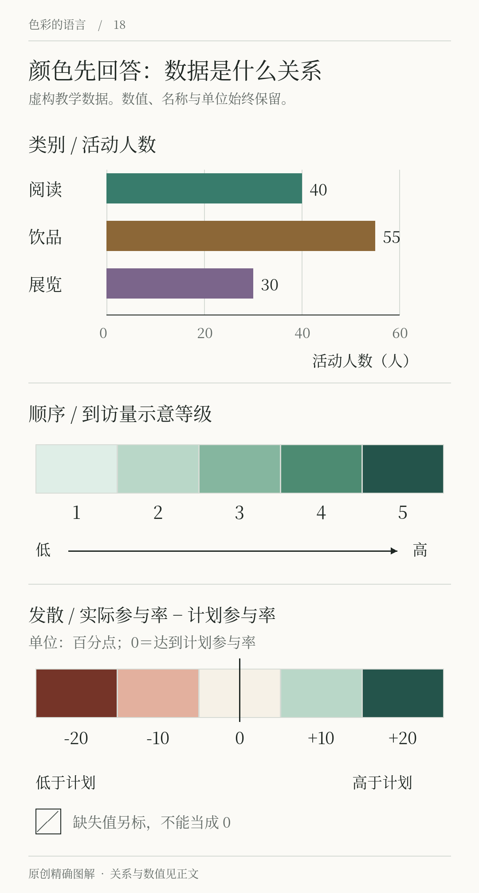

# 第18章 网页、App与数据图表

网页中的颜色不仅被观看，还会参与操作。用户要找到预约入口，知道表单是否填写成功，判断哪个选项已经选中。图表中的颜色则参与另一种任务：区分活动类型，表达人数多少，或显示相对目标的增减。前者关心交互状态，后者关心数据关系，不能只用一套漂亮色卡同时解决。

## 界面颜色先服务于任务

间色的预约页可以保留暖纸背景、深墨正文和墨绿主要按钮。接下来要把流程走完：没有选日期时怎样提示，提交中显示什么，成功后怎样确认，场次已满时如何解释。如果只设计默认页面，就尚未完成界面配色。

错误不能只是把输入框变红。应在相关位置写出「请选择日期」之类的说明，并通过边界、图标或其他线索帮助定位。选中项同样可以带勾号或清楚的形状变化，避免要求所有人都能辨认某一种色相。W3C 的颜色使用要求明确指出，信息与操作提示不能只依赖颜色。参见 [W3C：Use of Color](https://www.w3.org/WAI/WCAG22/Understanding/use-of-color.html)。

焦点与悬停也不是同一件事。鼠标停留的位置、键盘当前操作的位置，以及已经选中的项目，可能同时存在。配色方案需要让这些状态可区分，不能把所有状态都简化成「变深一点」。GOV.UK 的功能颜色把焦点、链接、错误和成功等用途分别定义，可作为观察实际角色分工的入口，应用时仍应遵循所用系统的完整组件规则。[GOV.UK：Colour](https://design-system.service.gov.uk/styles/colour/)

## 图表先决定颜色代表什么

间色准备一份月度活动报告。阅读、饮品体验与展览是三种类别，彼此没有天然的高低关系；某一天到访人数是有顺序的数量；实际参与率相比计划参与率的差值，则围绕零形成两个方向。这三类关系需要不同的颜色组织。

| 数据关系 | 颜色任务 | 间色示例 |
|---|---|---|
| 分类 | 区分不同对象，不暗示等级 | 阅读、饮品体验、展览 |
| 顺序 | 帮助读出从低到高的变化 | 各时段到访量 |
| 发散 | 显示围绕有意义中心的两向变化 | 实际参与率与计划参与率的差值 |

NASA 的色彩教学按数据关系讨论色阶选择，指出顺序、发散与定性数据需要不同组织方式。这里的「发散」必须有可解释的中心，不能为了用上两种喜欢的颜色，随意把一组正数切成两半。参见 [NASA：Different Data, Different Colors](https://science.nasa.gov/blogs/earth-matters/2013/08/12/subtleties-of-color-part-3-of-6/)。

*图18 虚构教学数据：分类数字为人数，顺序色阶的1—5为示意等级；发散数值为实际参与率减计划参与率，单位为百分点，0表示达到计划参与率。类别名、数值和文字提示保留在图中，颜色只承担其中一部分信息。*

## 分类不需要每根柱子一种颜色

如果图表只比较三种活动的到访人数，横向条形的位置与长度已经表达类别和数量。可以把所有条形画成同一颜色，只突出你要讨论的一项。只有需要在多张图之间持续追踪活动类型时，固定分类色才更有价值。

一旦使用分类色，同一类别在不同图中应尽量保持对应，并直接标注名称，减少读者在图与图例之间来回查找。类别过多时，继续增加相近色未必有效，可以拆分图表、筛选重点或使用小多图。Carbon 的官方数据可视化规范为分类与顺序色组提供了不同方案，正反映了它们承担的任务不同。[Carbon：Color palettes](https://www.carbondesignsystem.com/building-blocks/data-visualization/color-palettes)

## 顺序色阶要有可理解的方向

人数从低到高，可以用浅到深的变化表达。配色时要看连续的整体，而不是只确认两端颜色好看。若中间某一级突然更亮，读者可能把它看成一条分界；若相邻级差异太小，细微变化又可能消失。

不应默认彩虹总比单色有信息。多种色相可能制造并不存在的阶段感；对需要读数的热图，清楚的图例、适当分级与直接数值同样重要。连续数据可以使用连续色阶，也可以为具体任务分组，但分组边界应写明，不能让渐变掩盖数据如何处理。

发散色阶则应标出中心的含义，例如「0个百分点，达到计划参与率」。两侧使用不同色族，并通过远离中心的程度表达变化。缺失数据另设标记，不能悄悄用中间色代替，否则「没有记录」会被误读为「刚好达到目标」。

## 验证信息能否脱离颜色存在

完成报告后，把颜色暂时去掉，检查还能否知道每根条形对应什么、每个数值代表什么。灰度检查可以暴露一些问题，却不能模拟所有色觉差异，也不能替代真实使用测试。最终还要查看实际尺寸、屏幕背景和文字标签，并提供必要的文字说明或数据表。

练习时，用同一组虚构数据做三张图：一张所有柱形同色，一张只强调一项，一张每类固定颜色。写出每张图最适合回答的问题。如果你发现「只强调一项」最适合讨论某次活动，「固定分类色」更适合跨月份追踪，说明你已经在根据阅读任务选择颜色，而不是根据颜色数量选择图表。

还要在同一份报告中固定比较条件。如果一月和二月的热图分别自动缩放色阶，同样的深绿可能代表不同人数。读者若以为两图使用同一标准，就会得出错误判断。跨图比较时尽量使用共同范围；若必须各自缩放，应把图例与范围写得显眼。颜色的稳定不仅关乎品牌，也关乎数值解释是否一致。

## 真实修订过程｜Duolingo 怎样在强色、柔色和清晰度之间取舍

*真实案例 R04-A｜Duolingo 的 Punchy 探索：大面积强色页头。以下三张图均来自 Leah Lee 的官方设计回顾，2026-02-04，版权归 Duolingo；探索方案不等于最终上线版本。[完整案例](https://blog.duolingo.com/core-tabs-redesign/)。*

*R04-B｜同一轮设计研究中的 Soft 探索。强色与柔色两种方向上下展开，便于比较；它们还改变了布局细节，不能把全部效果都归因于彩度。*

看第一组，页头的粉、蓝、橙把不同栏目区分得很快；再看第二组，颜色更柔和，但卡片与页面底色的区分也更轻。这里没有“一律越鲜艳越清楚”或“一律越柔和越成熟”的答案。还要问：标题占了多少高度，任务进度从哪里开始，页面有没有让用户先看装饰、后找任务。

*R04-C｜个人资料页面改版前后对照，图中 Before / After 为官方标注。*

官方回顾把问题放在一致性、用途、简洁与清晰之间。对照这组画面，可以追踪彩色区域、按钮、边界与留白一起怎样支持信息组织。把它用于自己的预约页时，先写明最重要的操作，再判断颜色帮助了它，还是把目光引到了不需要点击的装饰上。

## 本章资料

- W3C，WCAG 2.2 Understanding，*Use of Color*。[原文](https://www.w3.org/WAI/WCAG22/Understanding/use-of-color.html)
- GOV.UK Design System，*Colour*。[原文](https://design-system.service.gov.uk/styles/colour/)
- NASA，*Different Data, Different Colors*，2013。[原文](https://science.nasa.gov/blogs/earth-matters/2013/08/12/subtleties-of-color-part-3-of-6/)
- Carbon Design System，*Color palettes*。[原文](https://www.carbondesignsystem.com/building-blocks/data-visualization/color-palettes)
