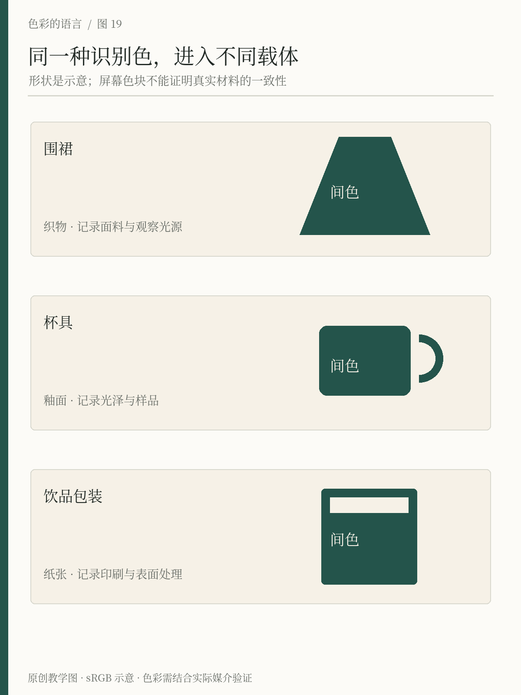
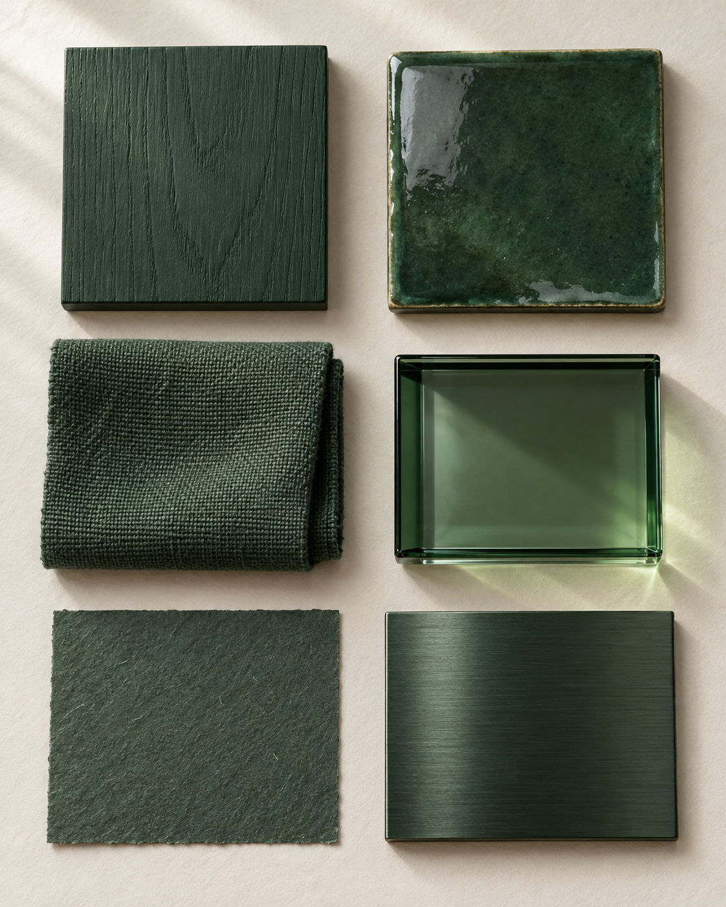

# 第19章 服饰、产品与包装

把屏幕上的墨绿交给服装厂、陶瓷厂和印刷厂，得到的通常不是三块可以无条件互换的绿色。颜色附着在材料上：布料有织纹与褶皱，釉面有高光，包装纸有底色。要让它们看起来属于同一个品牌，需要管理的是一组有条件的外观关系。

## 先看载体，再决定颜色

服饰首先是一种穿在身体上的形状。外套占据大面积，围巾靠近面部，鞋袜处在身体下端；同一种陶橘出现在不同位置，影响的视觉重心不同。讨论穿搭时，可以先描述“哪里亮、哪里暗、哪里最吸引注意”，再讨论某个颜色是否适合某个人。肤色、发色、环境光、妆容和个人偏好都可能参与判断，不能凭一张经过自动白平衡的照片，把人固定归入某种绝对适用的色彩类型。

产品的颜色还会参与结构识别。杯身与杯盖可以同色，形成一个整体；也可以通过明度差，让开口、把手与可拆部件更容易看见。颜色能够强调操作位置，但“可按压”不能仅靠一片颜色暗示，形状、标记和说明也要发挥作用。先问使用者需要看见什么，再为表面安排颜色。

包装则同时处在两个距离中。远处要在货架或照片缩略图中被辨认，近处要读清品名、规格和使用信息。一只盒子正面很漂亮，不等于折到侧面的文字依然可读。设计时要把展开图折成纸样，观察边、角和接缝怎样改变颜色块的完整性。

*图19：间色的三个载体共用墨绿与暖纸的关系。图中形状和颜色用于说明角色分配，不是不同材质之间的实物色差测量；实物仍需分别打样。*

*材料情境图：AI生成的教学示意，帮助观察纹理、透明与高光如何参与颜色外观；不是实物摄影、材料鉴定或不同材料同色匹配的证据。*

## 同一个名字，不等于同一个物理结果

Pantone 的材料使用说明明确区分面向图形印刷与面向时尚家居的体系，并提醒读者：一个为印刷开发的颜色，染到织物上可能出现不同效果，两个体系也不一定有直接对应项。因此，选择实物标准时应优先考虑主要材料，再寻找其他材料上的合适匹配，而不是把一个编号当作所有表面的万能配方。[来源：Pantone，Uses and Best Practices](https://www.pantone.com/uk/en-gb/articles/uses-and-best-practices/pantone-graphics-and-294-new-colors)

实际沟通可以分两层。第一层说清设计意图，例如“围裙与杯身都应呈现偏深、低彩度的绿色，暖纸标签应清楚可读”。第二层指定生产条件，例如布料成分、织法、染色样、陶瓷釉样、纸张和表面处理。设计意图负责维持关系，生产条件负责让结果可比较。

如果两个样品在一盏灯下接近，换一盏灯就分开，不一定是有人调错了色。这种一组颜色在某种照明下匹配、在另一种照明下不再匹配的现象，称为同色异谱现象在照明变化下的表现。X-Rite 用汽车的漆面、塑料与织物解释了跨材料匹配为什么要检查多种照明。[来源：X-Rite，What Is Metamerism?](https://www.xrite.com/blog/what-is-metamerism)

## 给间色做三件物品

现在为间色做围裙、外带杯和饮品包装，不增加新颜色，先安排职责。

围裙用墨绿形成稳定的大色面，小尺寸标记用暖纸色的线或布标。这里的优先项是标记在褶皱与穿着距离下能否辨认，而不是布标是否与网页背景逐像素一致。

外带杯用浅色杯身承载品名，墨绿用于识别带。饮品分类可以增加陶橘标记，但旁边保留“茶”“咖啡”等文字。杯身转动后仍应能找到基本信息。若用牛皮纸杯，纸本身已参与配色，不能把屏幕上的暖纸背景当作一定能够直接印出的结果。

包装正面留出品名区，侧面安排规格与说明。陶橘只用作局部强调时，可以同时保留辨识度与信息层级；若它占据整个盒面，就要重新评估文字、图片和货架环境，不能机械沿用原来的字色。

三件物品可以不完全同色，但必须说清哪些关系要稳定：标记的位置、深浅秩序、核心色的出现方式、文字与底色的可读性。这样的统一比“所有物体必须一个色号”更接近真实生产。

## 低成本样品检查

不用购买专业仪器，也可以先做一次有效的观察。准备一块布、一张纸和一只杯，把设计打印或临时贴附到它们上面。在窗边散射日光、室内工作灯和实际使用环境中分别观察，记录三个问题：最先看见的是什么；文字在哪个方向或距离开始难读；哪些材料之间的差异最明显。

如果只在某种光下出现差异，优先检查照明与材料组合；如果所有环境都难读，先改明度结构和字号；如果单件好看、放在一起失去联系，检查核心色是否承担了相近角色。手机照片便于留下位置与结构记录，但自动曝光和白平衡会改变颜色，不能把照片当作最终验色依据。

生产放大前，保留签字确认的样品及其条件：日期、材料、工艺和观察环境。以后出现争议，就能回到共同认可的参照，而不是各自打开一块屏幕争论哪种绿才对。对兴趣读者而言，这一步的价值是养成具体描述的习惯；对实际项目而言，它让审美判断变成可以沟通的工作。

## 本章资料

- Pantone：[Pantone Graphics and 294 New Colors—Uses and Best Practices](https://www.pantone.com/uk/en-gb/articles/uses-and-best-practices/pantone-graphics-and-294-new-colors)，关于跨体系、跨材料匹配的边界。
- X-Rite：[What Is Metamerism?](https://www.xrite.com/blog/what-is-metamerism)，关于照明变化下的样品匹配。
- 本章间色物品分工、观察表与检查顺序为原创教学方案。
