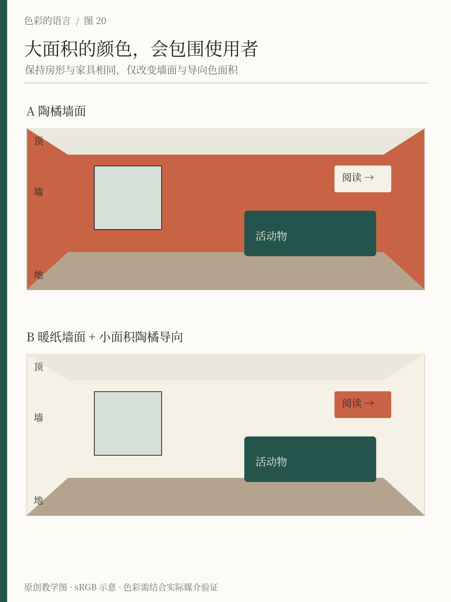
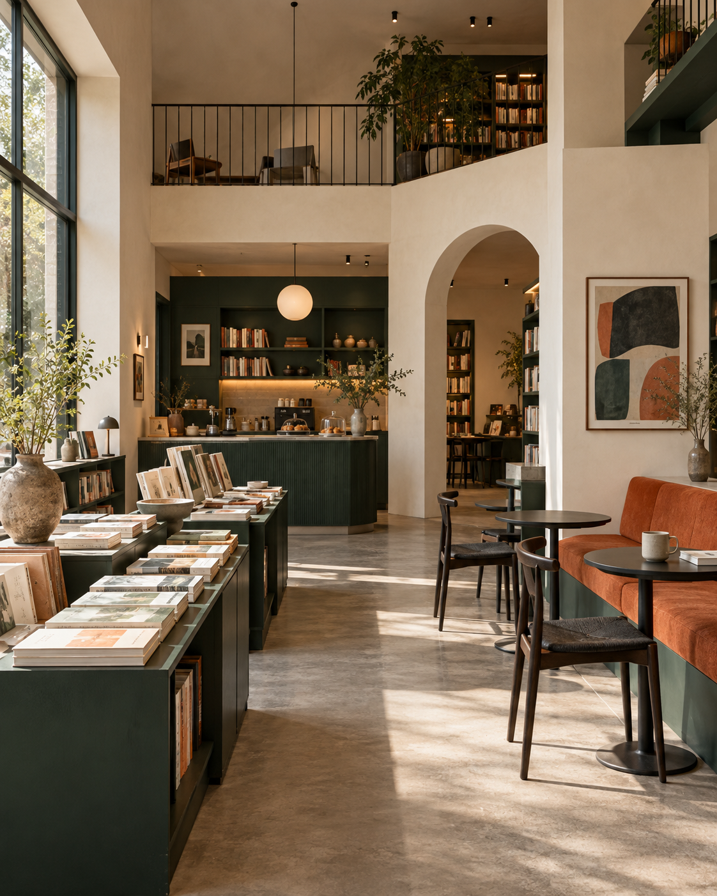

# 第20章 室内、建筑与环境

一张色卡在手里只有几厘米，刷到墙上却可能占满视野。空间中的颜色还会包围人，随着站位、时间、天气和灯光改变。空间配色的起点是现场，而不是从网上挑出三张好看的房间照片。

## 把房间拆成几类颜色

进入一个房间，先区分不容易改变的部分与可以调整的部分。地板、窗框、门、固定橱柜和已有石材往往是约束；墙漆、软装、灯具和陈列则有不同的调整成本。忽略一块面积很大的暖色木地板，却从零设计一套冷白配色，后续容易不断为“怎么总有点不对”补救。

接着按视野分层。顶面与高处墙面形成外围背景，墙和柜体组织主要色面，地面承接家具和人，书籍、植物、衣服与食物则成为不断变化的颜色。一个文化空间里摆满书之后，照片中那套空房间配色已经不再完整；书脊和人本身会成为视觉内容。

本书的观察法是先记录“固定背景、活动内容、识别标记”三类。固定背景不必没有个性，但应考虑长期使用；活动内容需要一定容纳度；识别标记则要在真实距离中容易找到。这三类与网页中的背景、内容、操作有相似之处，但空间里还多了照明、反射、体量与行走路径。

*图20：保持房间结构与家具位置一致，比较全墙强调色与局部强调色。图示用于解释面积和导向关系，不预测具体涂料在现场的外观。*

## 先在真实光线里看样

自然光会随时间改变，夜间又可能主要依赖人工照明。Benjamin Moore 的官方色彩手册用相同空间在不同照明下的变化提醒读者，颜色应在实际光照中检查。[来源：Benjamin Moore，Lighting and Paint Colors](https://www.benjaminmoore.com/-/media/sites/benjaminmoore/images/color-card-pdf-landing-page/color-handbook_use.pdf)

实际选漆可以先用较大的可移动样板，放在目标墙附近，与地板、窗框和家具一起看。一天内至少在主要使用时段观察，而不是只在阳光最好的一刻确认。样板还能移到房间不同方位，帮助区分“这个颜色本身不合适”与“这个位置的光线让它不合适”。具体施工和成膜条件应按材料说明进行；小色卡与实际刷涂不能视为完全等价。

光源的色温描述光的色度特征，并不能单独保证物品显色效果。两盏看起来同样偏暖的灯，照在书封、织物和食物上仍可能产生不同表现。关于照明显色的研究说明，相同色度可以对应不同光谱分布，所以不能只读一个色温数值就结束灯光选择。[来源：Houser等，Tutorial: Color Rendering and Its Applications in Lighting](https://www.tandfonline.com/doi/full/10.1080/15502724.2014.989802)

对间色而言，阅读区需要看清纸张与文字，饮品区要观察杯具和食物，展览区还要尊重作品本身。三者未必需要完全相同的照明安排。先检查任务，再讨论氛围，会比一句“全部用暖光更舒服”更具体。

## 颜色如何参与空间分区

把阅读区和饮品区刷成不同颜色，可以帮助建立区域印象，但不能替代清楚的路径和标识。如果两区之间有台阶，台阶边缘的辨认与安全需要单独处理，不能只靠整个区域的色相不同。导向信息应同时依靠文字、箭头、位置与足够的视觉区分，不能让来访者必须先学会一套颜色密码。

间色可以让大部分墙面保持暖纸色，墨绿用于固定柜体和入口识别，陶橘用于局部活动告示与方向提示。但这是一个待现场验证的初始方案。若入口本身很暗，深绿字落在暗背景上就可能失去作用；若展览作品已有大量强色，额外的陶橘墙面可能与作品争抢注意。

同样的方案也不能直接缩放到建筑外部。立面受到日照、天气、远观尺度、周边建筑和材料耐久性的共同影响。室内屏幕渲染漂亮，只能支持初步沟通，不能替代现场样段与实际观察。涉及法规、公共安全或专业照明指标时，要依项目所在地和适用规范确认，本书的视觉方法不作为工程验收值。

*空间情境图：AI生成的原创教学示意，不是实拍。绿柜、暖墙与陶橘局部帮助观察大色面和活动内容的关系；图中颜色不作为真实涂料、照明或精确色号的证明。*

## 一次房间观察练习

选一个你熟悉的房间，画一个非常简略的立面，标出墙、地、窗、门和最大件家具。先不挑新颜色，写下每部分的现有明暗、色相倾向和反光程度。然后给房间设一个具体任务，例如“晚上坐在这里连续阅读半小时”。

提出两种改法：一种只调整小面积物件与灯的位置，另一种允许重做一面墙。比较哪一种更能解决任务。若问题是台灯在纸上产生眩光，改变墙色可能绕开了原因；若问题是展板与背景混在一起，调整展板背衬可能比重刷整个空间有效。

最后站到门外，再走到桌边，检查同一信息在远近两个尺度是否清楚。观察的重点不是给房间打美丑分，而是建立“使用任务—光照—材料—颜色—位置”之间的联系。只有找到真正改变体验的变量，配色才会成为设计工具。

## 本章资料

- Benjamin Moore：[Lighting and Paint Colors](https://www.benjaminmoore.com/-/media/sites/benjaminmoore/images/color-card-pdf-landing-page/color-handbook_use.pdf)，官方色彩手册中的光照比较。
- Kevin Houser、Michele Mossman、Kevin Smet、Lorne Whitehead：[Tutorial: Color Rendering and Its Applications in Lighting](https://www.tandfonline.com/doi/full/10.1080/15502724.2014.989802)，照明显色与光谱关系。
- 本章空间分层、间色分区和观察练习为原创教学方法。
