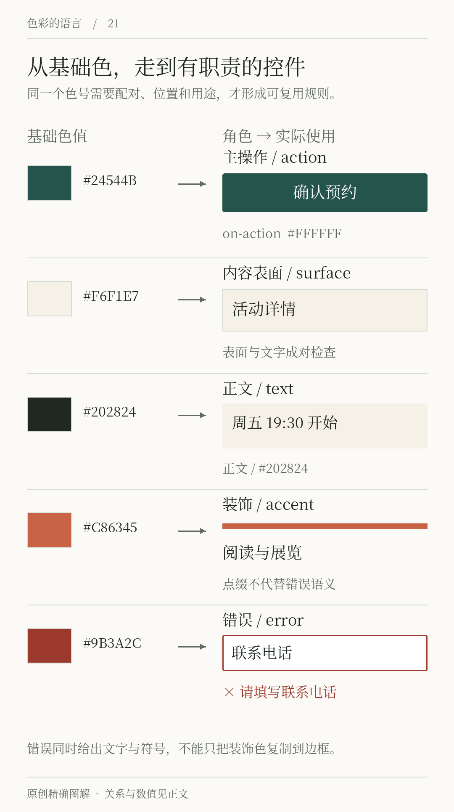
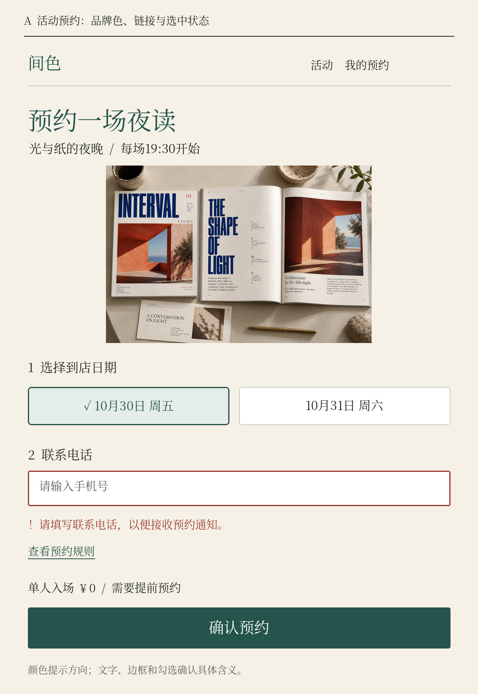
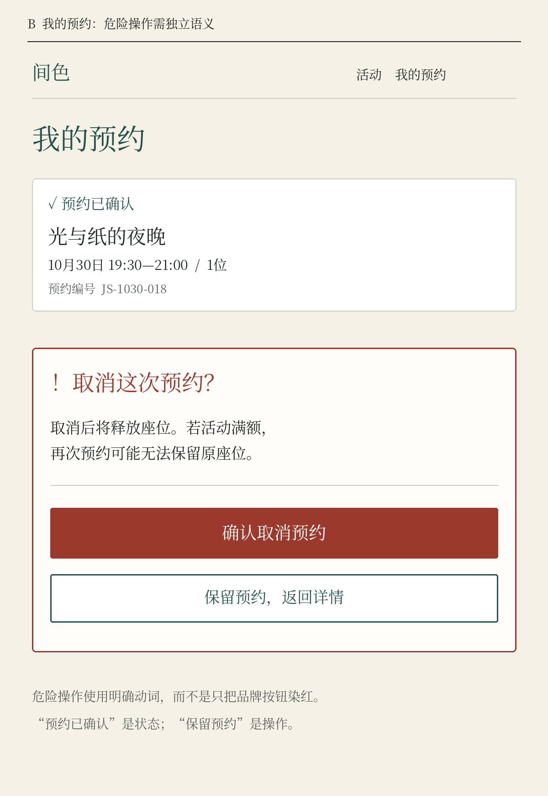

# 第21章 主色、辅助色与语义角色

当一个项目只有一张海报时，设计者可以逐处决定颜色；当它有菜单、活动页、预约表单和导向牌时，每次临时决定就会逐渐出现分歧。同一种绿有时代表按钮，有时代表完成，有时只是装饰。色彩系统要解决的，是让使用规则可以重复，而不仅是让色卡可以复制。

## 从“这个颜色叫什么”转向“它负责什么”

“墨绿”描述外观，“主操作色”描述职责。前者适合在选色时比较，后者适合在应用时决策。一个项目可以保留自己的颜色名称，同时给它增加角色：墨绿是原始色值，主操作是语义角色，预约按钮则是具体应用。

可以把它理解为三层。基础层收纳可用的颜色，语义层说明用途，应用层规定某个部件如何组合这些用途。并非每个小项目都需要复杂工具，纸面上一张对应表也能表达这三层关系。关键是更换基础色时，不必靠人回忆几十个地方究竟为什么用了它。

GOV.UK Design System 把功能颜色与一般网页色板区分开，功能颜色按目的与使用情境提供；它还提醒使用者在对应语境中调用功能变量，而不是复制某个十六进制数值。这体现了颜色系统中“用途先于字面色号”的思路。[来源：GOV.UK Design System，Colour](https://design-system.service.gov.uk/styles/colour/)

*图21 原创精确映射图。左列保留基础色值，右列放进实际按钮、内容表面、正文、装饰线与错误字段。主按钮额外规定白色 on-action；错误使用独立深陶 #9B3A2C，并配合“×”和字段说明，陶橘装饰色不会自动成为错误角色。*

按每一行从左向右看：色值只是资源，箭头后的控件给出使用条件。墨绿按钮必须同时定义白色文字，暖纸表面必须和正文配对；装饰横线即使足够醒目，也没有表达“输入失败”的任务。图中错误颜色与实际预约页使用同一组职责，便于检查规则是否真正进入页面。

## 给间色建立最小角色表

先写用途，再填颜色，能避免为用完色卡而创造多余角色。下表是间色的浅色主题初稿，不是所有品牌都应采用的命名规范。

| 角色 | 初始颜色 | 用法与边界 |
| --- | --- | --- |
| 背景 surface | 暖纸 #F6F1E7 | 主要阅读底面 |
| 正文 text | 深墨 #202824 | 正文、价格和重要说明 |
| 主操作 action | 墨绿 #24544B | 预约、确认等主要操作 |
| 主操作上文字 on-action | 白 #FFFFFF | 与墨绿按钮成对使用 |
| 装饰 accent | 陶橘 #C86345 | 图形、分隔、活动亮点 |
| 错误 error | 深陶 #9B3A2C | 配合错误文字与符号使用 |

颜色成对出现，是因为前景需要依附背景才能判断。单独规定“按钮用墨绿”，却没有规定按钮上的文字，系统仍然缺了一半。同样，正文角色也应说明它在哪些背景上可以使用；如果活动海报换成照片背景，原来通过的搭配不能自动继承。

陶橘是一个很好的例子。它可以在暖纸上充当较粗的装饰图形，却不适合作为同一背景上的普通小字。角色不是给颜色贴上永远有效的许可证，而是把允许的使用条件写清楚。第24章会用具体对比度计算验证这些组合。

## 让错误和成功拥有明确语境

品牌常用绿，不意味着每个绿色按钮都表示成功。主操作说的是“下一步可以做什么”，成功说的是“刚才的事情已经完成”。两者可以在外观上相近，但文案、位置和图标必须帮助人理解不同含义。

Material 的官方实现把品牌强调色角色与错误、表面、轮廓等角色分开，并为多种背景配置相应的前景色。这说明真实系统需要的不只是主色、辅色两格，而是一组彼此配对的职责。[来源：Material Components Android，Color Theming](https://github.com/material-components/material-components-android/blob/master/docs/theming/Color.md)

在间色的预约表单里，可以保留墨绿主按钮；当日期未选择时，在日期字段附近显示“请选择到店日期”，并给出可辨认的错误标记。不要只把边框变成红色，让人猜是哪一步出了问题。W3C 对颜色使用的解释强调，传达信息时应提供颜色之外的可见线索，例如文字或形状。[来源：W3C，Understanding Use of Color](https://www.w3.org/WAI/WCAG22/Understanding/use-of-color.html)

## 在完整预约页面里检验角色

*图21-2A｜原创静态界面，程序精确排印；图像区域为AI虚构书刊摄影。暖纸与深墨承担阅读，墨绿承担主操作与识别，浅绿底、深绿边框和勾选共同表示选中，深陶色配合文字指出字段错误。*

先沿真实任务阅读这张页面：确认活动、选择日期、填写电话、查看规则，再提交预约。颜色是在这条任务线上分工，而不是把色卡轮流填满控件。顶部“间色”与“确认预约”都使用墨绿，但一个是身份识别，一个是动作；它们的位置、形状与措辞让读者知道区别，因此没有必要仅为避开同色就再发明一种绿色。

选中日期则给了另一种检验：它不只变成浅绿，还增加深绿边框和勾选。即使把画面暂时转成灰度，文字和勾选仍能告诉你哪个日期已选。电话字段的问题也不只靠红框表达，下面写清“请填写联系电话”。这句话把问题和需要做的事放在字段附近，比在页顶出现一个没有指向的红点更容易理解。

“查看预约规则”与按钮都可以引导操作，却没有被画成同等分量的按钮：规则用下划线表示链接，预约用完整底面表示主要步骤。这个选择服务于当前页面的优先级，不是要求所有链接永远使用同一种绿色。若变成正文中夹杂的链接，还需检查与周围文字的区分。色彩角色最终需要连同字形、边框、位置和文案一起验证，单列六个HEX值并不能完成这一工作。

*图21-2B｜同一系统的后续页面。“预约已确认”是带勾选的结果状态；“确认取消预约”是深陶底危险操作；“保留预约”以带边框的替代操作出现，避免把颜色当成唯一判断。*

这一页故意把两种常被混用的意义放在同一上下文中。上方“预约已确认”说明系统已经发生的结果，它没有按钮底面，不要求你再按一次才能生效。下方“确认取消预约”才是即将改变状态的操作，深陶色告诉你需要留意，明确动词与后果说明则告诉你究竟会发生什么。只换成红色“确认”两个字，反而会让人不确定是在确认保留还是确认取消。

“保留预约，返回详情”保留墨绿边框，既说明替代路径，也避免与深陶主操作混成同一种后果。这里展示的是颜色如何帮助分类，不是要让危险操作一定比安全选择更大、更诱导点击；真实服务还需要根据任务风险、用户意图与交互规范决定顺序和默认焦点。静态图不能替代键盘访问、焦点、读屏或误触测试。

对这套系统做一次最小迁移测试：如果品牌主色改成深蓝，哪些地方该跟着变？身份标识、一般主操作可能变化，错误与取消的深陶角色却不能因为“全站换主色”而被无差别替换。先有职责，才知道哪些值可以一起改、哪些必须独立维护；这正是角色表比装饰色卡更有用的地方。

## 新角色什么时候值得增加

如果每出现一张新海报就增加一个颜色名称，系统会变成杂物箱。增加角色之前，先判断它是否表达了长期重复的区别。例如活动分类可能确实需要可扩展的标签组；一次性的节庆插画颜色，则未必需要升级成全站功能颜色。

还要区分“看起来不同”与“意义不同”。正文和次要文字可以有层级差异，但次要文字仍要能读。危险操作与一般主操作有不同后果，通常值得单独表达。相反，若两种绿色的用途说不清，合并它们可能比再写一段解释更有效。

做一个小练习：截取同一服务的三个页面，圈出所有绿色，给每处写一个动词或状态词。如果你写出了“预约、保存、完成、可用、装饰”五种含义，就检查读者依靠什么区分它们。答案不一定是再发明五种绿；也可能是把状态写清楚，让不同类型的信息出现在稳定位置。

例如，把一张原本只显示“绿色”的完成提示改成“预约已确认”，加上勾选图标，并与预约详情放在稳定位置。再把绿色预约按钮写成“确认预约”，保留按钮形状。两者即使共用一部分绿色，读者仍能通过文案、形状和位置判断一个是结果，一个是操作。这比仅把其中一个改成稍浅的绿更容易解释，也更容易在其他页面复用。

完成角色表后，让一位没有参与设计的人依表制作一张新卡片。若他仍要反复问“这里该用哪个绿”，就检查规则是否遗漏了背景、状态或优先级；若他能依据规则说明选择原因，表格才开始发挥作用。

一个可用的色彩系统，应该帮助设计者少做无意义的重复选择，也帮助使用者少猜。颜色表只是入口，职责、配对与边界才是可以长期复用的内容。

## 本章资料

- GOV.UK Design System：[Colour](https://design-system.service.gov.uk/styles/colour/)，功能颜色与网页色板。
- Material Components Android：[Color Theming](https://github.com/material-components/material-components-android/blob/master/docs/theming/Color.md)，品牌、错误、表面及相应前景角色。
- W3C：[Understanding SC 1.4.1: Use of Color](https://www.w3.org/WAI/WCAG22/Understanding/use-of-color.html)，颜色之外的可见信息线索。
- 间色角色表与命名为本书原创示例。
