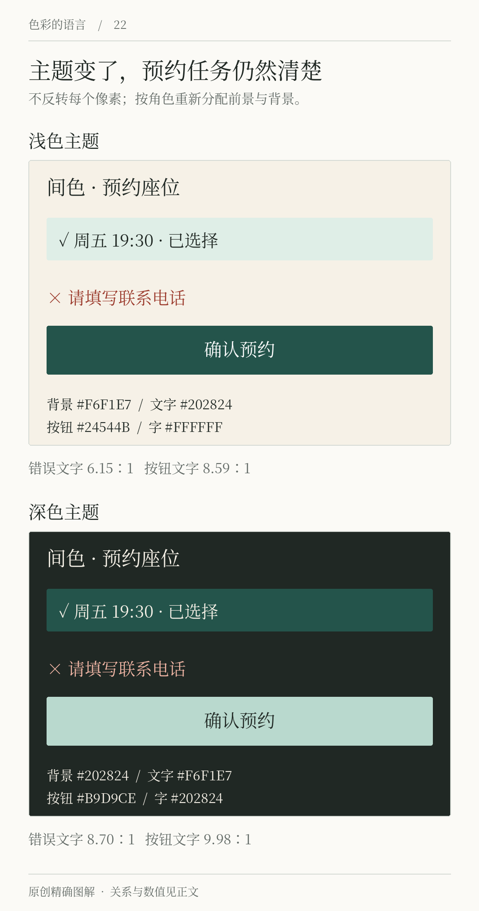
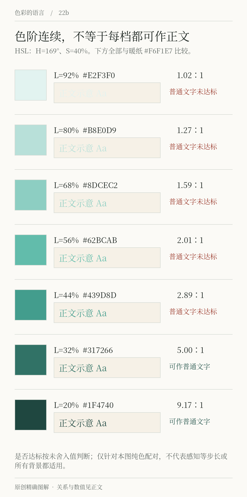

# 第22章 色阶、深浅主题与状态

选中一块绿色后，设计软件可以很快生成几十块深浅不同的绿色。困难在于，它们是否足以支持真实页面：最浅的一档能否作为底面，中间的一档适不适合轮廓，较深的一档能否承载小字。色阶是提供选择的工具，角色分配和实际验证才能让这些选择成为系统。

## 让色阶服务具体用途

先列出你需要的场景：浅色提示背景、可辨认的边框、链接、实心按钮，以及深色主题里的强调文字。再看需要几档颜色。一个简单预约页面可能只需其中几档，没有必要为了显得专业而填满从50到950的每个格子。

数字命名通常用来表示顺序，但不同系统的数值规则并不相同，不能把某个系统的“500”当作跨系统固定明度。更可靠的文档会同时给出实际值、用途和允许的配对。使用者看到“action”时应知道它负责主操作，看到某个色阶编号时则知道它只是原始资源。

在调色工具中，HSL 的亮度参数操作方便，却不能保证不同色相在相同参数下看起来一样亮。OKLCH 把颜色写成明度、彩度和色相，可以帮助更有方向地调整色阶；它也不意味着所有颜色都能在目标屏幕上显示，或色阶生成后不必检查。W3C 的 CSS Color 4 候选推荐草案收录了这些颜色表示和色域处理内容，适合作为查阅入口。[来源：W3C，CSS Color Module Level 4](https://www.w3.org/TR/css-color-4/)

一个实用顺序是先调整明度关系，再控制彩度，最后检查色相是否出现不想要的偏移。若某档超出目标色域，不能只期待软件自动处理后仍完全保持原来的关系。应查看实际输出，并记录交付使用的是哪一种颜色空间。

*图22：浅深主题保持操作与信息的意义，重新分配背景和前景。选中状态有勾选，错误状态有文字；主题变化不能让状态线索消失。*

*图22补图：这条HSL明暗序列由明确参数生成，但不表示感知上的等步长。每一档与暖纸背景单独计算对比度；排成连续色阶，不等于每一档都能用作普通文字。*

## 深色主题需要重新安排关系

直接反转一张页面，往往会同时反转本来不应改变的内容：照片、人脸、品牌图形、阴影与状态。深色主题更适合从角色重新分配，而不是把每个像素换成相反颜色。

间色的浅色主题以暖纸为底，深墨为正文，墨绿按钮上放白字。深色主题可以以深墨为底，正文改成浅色，主按钮改用浅绿 #B9D9CE，并在按钮上使用深墨字。改变的是色值和明暗位置，保留的是“主操作仍然最容易找到”的关系。图中错误文字也按主题重新映射：浅主题使用深陶 #9B3A2C，深主题使用浅陶 #F2B7A6；它们与各自背景的对比度约为6.15∶1和8.70∶1，错误含义继续由文字说明。

Material 官方实现为浅色与深色主题配置不同的基础色阶与前景角色，提供了这种按用途重新映射的实际例子。它是一套具体设计方案，而不是所有深色界面必须照抄的规律。[来源：Material Components Android，Color Theming](https://github.com/material-components/material-components-android/blob/master/docs/theming/Color.md)

重新分配后，需要检查正文、次要文字、边框、链接、图表、照片上的标注和弹出面板。浅色主题里的轻阴影，在深背景中可能不再足以表达层级；可以考虑表面明度差或边界，但不能让每一层都同样醒目。深色模式也不是对每个人、每种环境都更舒服；应提供清楚的选项，并围绕实际阅读条件测试。

## 状态不是再加一层透明黑

按钮会有默认、悬停、按下、键盘焦点、禁用等状态。它们解决不同问题：悬停提示指针所在位置，焦点提示键盘当前操作目标，禁用说明当前不可执行。触屏没有持续的鼠标悬停，因此重要信息不能只藏在悬停状态里。

给按钮覆盖半透明黑色确实可能使它变暗，但最终颜色取决于底色和透明度。若把同一覆盖层移到深色主题，效果可能不足，甚至降低文字对比。应检查合成后的颜色对，而不是只检查覆盖层本身。

状态也不能仅依靠色相变化。间色的可选时段在选中后增加勾选与边界；输入错误在字段附近给出文字；键盘焦点有稳定可见的轮廓。W3C 的非文本对比解释指出，用来辨认控件或状态的必要视觉信息，一般需要与相邻颜色达到3∶1；这不表示一个按钮的悬停色必须与其默认色达到3∶1，因为二者并非总是相邻呈现。[来源：W3C，Understanding Non-text Contrast](https://www.w3.org/WAI/WCAG22/Understanding/non-text-contrast.html)

## 做一张主题检查卡

不用先画十个页面。把一个标题、一段正文、一个链接、一个输入框、一对按钮、一个选中选项和一条错误提示放在同一张卡上。为这张卡分别制作浅深主题，然后以实际字号查看，使用键盘移动焦点，检查文字和背景的具体配对。

间色示例中，白字与墨绿按钮的对比度约为8.59∶1；深墨字与浅绿按钮约为9.98∶1。这些是按 WCAG 的 sRGB 相对亮度公式计算的结果，不是对所有阅读条件的舒适度评分。计算通过之后，还要检查字体粗细、字距、信息密度与实际设备。若使用透明效果或照片背景，应重新计算有效背景，不能沿用纯色版本的结果。

当这张检查卡工作稳定后，再放进真实页面。真实内容经常比示例长，会换行，也会出现无法预料的图片与数据。主题设计的完成条件是这些变化仍然可用，而不是色阶看起来排列得很整齐。

## 真实系统｜Carbon 的完整仪表盘，怎样从浅色走向深色

*真实案例 R07-A｜Carbon White 主题仪表盘，IBM Carbon 官方文档示例。图像版权归 IBM，文档核查于2026-10-23。[来源：Color overview](https://www.carbondesignsystem.com/building-blocks/foundations/color/overview)。这是官方系统示例，不是本书虚构的上线产品截图。*

*R07-B｜同一文档中的 Gray 90 主题仪表盘。两图各自完整展开，便于核对面板、文字、操作与数据的层次。*

先沿着顶部导航、侧栏、内容面板向下看，再比较蓝色操作与数据标记。Carbon 以中性色组织大面积环境，颜色并未平均铺给每一块内容。官方的主题规则还区分浅色与深色中的分层方式：颜色角色保持意义，具体表面颜色随主题映射。

因此，制作间色深色页面时，应拿完整画面逐区检查。只展示一枚深色按钮，无法证明表格、弹层与次要文字都能成立；只把白底改黑，也无法重建背景与面板的相对层次。图里的数据和标签用于展示系统布局，不作为本书的数据研究结论。

## 另一个方向｜Firefox 让主题变化容纳个性

*真实案例 R08｜Firefox 界面外观与摄影背景，Mozilla 官方设计发布材料，2026-09-29，版权归 Mozilla 及相关权利人。[来源：More modern. More flexible. Still Firefox.](https://blog.mozilla.org/en/firefox/new-firefox-design-is-here/)。记录该发布时的界面，不保证与读者设备当前版本一致。*

和 Carbon 对照看，浏览器主题允许更明显的个性表达，而任务型仪表盘需要让大量内容稳定呈现。这不是两种颜色风格的优劣排序。应观察工具栏、当前标签与内容区能否保持区分，再看装饰颜色是否与网页内容争抢注意。主题系统的目标是在允许变化时仍然找得到操作，而不是让每个像素永远使用相同颜色。

## 本章资料

- W3C：[CSS Color Module Level 4](https://www.w3.org/TR/css-color-4/)，颜色表示、转换与色域；该文档为持续更新的候选推荐草案。
- Material Components Android：[Color Theming](https://github.com/material-components/material-components-android/blob/master/docs/theming/Color.md)，浅深主题角色映射。
- W3C：[Understanding SC 1.4.11: Non-text Contrast](https://www.w3.org/WAI/WCAG22/Understanding/non-text-contrast.html)，必要视觉线索及状态对比。
- 本章主题颜色与对比度为本书原创方案和计算结果。
