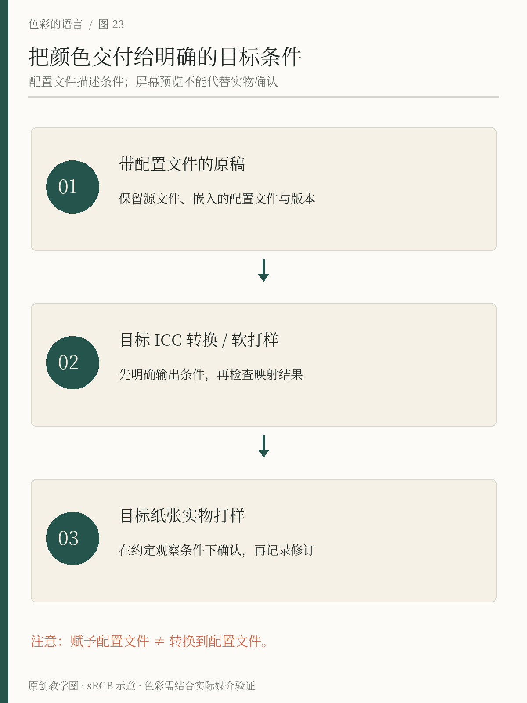
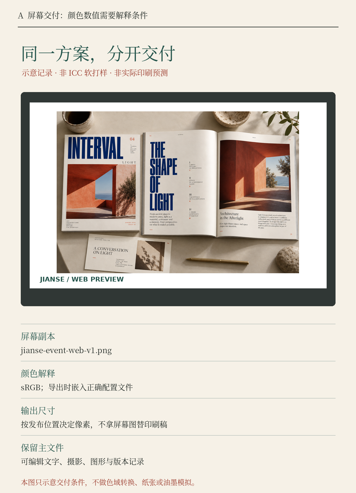
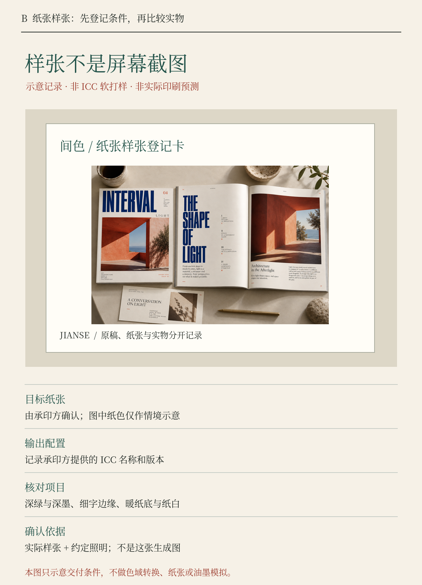

# 第23章 色域、印刷与颜色交付

把文件发出去以后，颜色才开始进入更复杂的环境。它可能被浏览器显示、被社交平台压缩，也可能被印到不同纸张上。颜色交付的目的，是尽量让接收方理解文件中的数值，并知道怎样针对目标媒介处理它，而不是承诺每块屏幕与每张纸都拥有绝对相同的外观。

## 数值需要解释条件

RGB 描述红、绿、蓝通道，CMYK 描述印刷中青、品红、黄、黑等通道。但仅有三个或四个数值，还不足以交代完整外观。相同 RGB 数值放在不同 RGB 色彩空间中，可能代表不同颜色；同一组 CMYK 数值在不同纸张、油墨和印刷条件下，也不能保证一样。

网页中的六位 HEX 颜色通常依照 CSS 的 sRGB 规则解释，例如间色的 #24544B。它便于记录和交换，却不是离开设备、背景和观察环境仍能保证外观不变的物理承诺。Display P3 可以表示某些 sRGB 无法表示的颜色，但并不是给所有颜色自动增加鲜艳度。HDR 又涉及亮度范围和显示能力，不能与广色域简单画等号。对本书的普通图解，明确采用 sRGB 并控制配对关系，比盲目扩大范围更有用。[来源：W3C，CSS Color Module Level 4](https://www.w3.org/TR/css-color-4/)

色域就是某个设备或颜色编码能够表示或重现的颜色范围。目标范围容纳不下原来的颜色时，需要映射与取舍。可能优先保留某些颜色，也可能调整整体关系。这里没有一个对所有图片都最佳的按钮，尤其当品牌色与摄影内容同时出现时，需要分别检查。

*图23：保留原稿，按目标条件转换和预览，最后用实际输出检查。赋予配置文件与转换颜色是不同操作，软打样也不能代替实物样张。*

## ICC 配置文件让转换有据可依

ICC 配置文件可以描述一种颜色编码或设备的颜色特性，帮助颜色管理系统进行解释和转换。它不是美化滤镜，也不能自动修好原来已经偏色的照片。ICC 的说明把颜色管理与颜色校正区分开，并强调源文件、显示与目标输出的配置关系。[来源：ICC，Frequently Asked Questions](https://www.color.org/faqs/)

软件里的“赋予配置文件”与“转换为配置文件”尤其容易混淆。赋予通常保留数值，改变软件如何解释这些数值；转换则根据源与目标条件重新计算数值，以尽量实现选定的重现目标。对一张配置正确的照片，随意换个配置标签可能明显改变外观。收到未知来源的文件时，不应靠反复赋予配置直到“看着顺眼”，再把结果当作可靠原稿。

可以保留一份带正确配置的主文件，再为不同用途导出副本。ICC 的 RGB 工作流程白皮书展示了从同一主文件派生不同输出的做法，并提醒软打样能够辅助预览，但不必然达到屏幕与纸张的精确外观一致。[来源：ICC，RGB Color Managed Workflow Example](https://www.color.org/ICC_white_paper_23_RGB_Workflow.pdf)

## 印刷前先问目标条件

“转成CMYK就能印”遗漏了最关键的问题：转向什么印刷条件。先向实际承印方确认纸张、工艺、目标配置文件、文件格式、出血与黑色文字处理等要求。不要为了省事，把全书使用的屏幕色号统一换成网上某张RGB/CMYK对照表。

专色可以提供另一种生产选择，但也不是不受材料影响的绝对颜色。Pantone 的官方说明指出，纸张、油墨基料与颜料等自然变化会影响印刷结果。[来源：Pantone，Normal Printing Process Color Variances](https://support.pantone.com/en/normal-printing-process-color-variances-explained)

给间色印菜单时，先做目标纸张上的样张，检查深绿是否还能区分于深墨、浅背景是否偏离预期、细字是否清楚。若菜单纸本来就是暖色，空白纸面本身可能承担背景角色，不一定需要再印一层暖纸色。作决定时要比较真实样张，而不是用一张有强烈环境光的手机照片验收。

## 用一张交付记录，分清屏幕副本与纸面样张

*图23-2A｜程序绘制的交付情境，摄影为AI虚构书刊。整张图以sRGB编码并嵌入sRGB ICC；图中显示器是示意框，不代表某一真实设备的校准结果，也没有执行跨色域转换。*

把这张记录当作文件交接单，而不是一张“颜色变准”的效果图。屏幕副本的文件名包含用途和版本，颜色解释写明sRGB，尺寸则按发布位置决定。它们解决的是接收方如何识别文件，不是宣称照片在所有屏幕上都会一样。上方摄影仍是同一张原图，我们没有偷偷增加彩度，再把更鲜艳的一张命名为“广色域”。

图里最容易被忽略的一行是“保留主文件”。如果只剩一张包含文字、摄影与图形的压平截图，日后要换日期、调整纸面细字或为不同尺寸重新排版，都会更被动。主文件保留编辑关系，屏幕副本服务于具体发布位置，两者不应互相替代。交付条件因此包括版本、用途、像素尺寸和颜色解释，而不只有一个绿色色号。

实际检查时，先核对文件属性与导出设置，再在预期设备上看字体、暗部和鲜艳区域。即使一张PNG带有正确的sRGB配置，也不能反过来证明显示器已经校准，更不能从本书的一张图里推断实际纸张会怎样。这个边界不是阻碍实践，而是告诉你缺少哪一步证据：记录能够解释数值，设备验证能够检查显示，两者负责不同的问题。

*图23-2B｜纸张底面、边框和登记卡均为情境示意，不是纸白、油墨或网点的物理模拟；摄影未转换为CMYK。没有指定承印条件，因此不提供虚构的CMYK值或“印刷后必然变灰”的结论。*

这张图把问题从“屏幕上像不像纸”转向“真正打样时要记什么”。先向承印方确认纸张与工艺，再记录对方要求的输出配置名称和版本。比较深绿与深墨能否区分、细字边缘是否完整、暖纸底是否与实际纸白形成预期关系。这些项目来自设计任务，不能靠把整个画面统一调暗来替代。

图中的纸面看起来比显示器情境更暖，只是为了让读者辨认“这是样张登记卡”；它不是经过测量的纸色。两张示意图也不是源色域与目标色域的转换前后对照。要做可信的软打样，需要明确源配置、目标输出配置、转换与预览条件；要确认成品，还需要实际样张及约定的照明。缺少这些输入时，诚实的做法是保留待确认条件，不用一张生成的纸张照片假装完成验收。

拿到样张后，应把确认日期、纸张批次、输出条件与具体修改一起记回项目，再决定是否改原稿或只改某个输出副本。如果暖纸已经由纸张承担，减少背景油墨可能是一种方案；如果关键深绿失去区分，则需和承印方核对实际条件。具体选择要以样张为依据，这张图提供的是观察顺序和记录位置。

## 透明与渐变也会改变结果

半透明颜色不是一个与背景无关的固定色块。陶橘以一定透明度叠到暖纸上，与叠到墨绿上，最终像素不同；因此要检查合成后的颜色。若透明面板下方是滚动的照片，最不利背景也必须进入检查范围，不能只在一张浅色图片上验证。

渐变的中间颜色还取决于插值采用的颜色空间和色相路径。两个端点相同，不保证所有软件生成的中间段都相同。制作重要渐变时，记录使用的方法，并检查最终导出文件，避免在编辑器中看见一种效果，交付后却出现明显不同的过渡。W3C 的 CSS Color 4 候选推荐草案将颜色插值与合成作为需要明确处理的内容，而不是只规定几个端点数值。[来源：W3C，CSS Color Module Level 4](https://www.w3.org/TR/css-color-4/)

本章不要求读者研究所有算法。需要形成的习惯是：背景、透明度、插值、目标色域和配置文件都可能影响最终外观。只记录一个HEX值，对某些设计已经足够，对另一些设计则信息不足。

## 做一次交付前检查

选一张包含照片、纯色色块、渐变与文字的小海报，保留可编辑原稿，再导出屏幕版和一个按承印方要求准备的印刷版。记录两版各自的颜色空间、配置文件、尺寸和用途，文件名中明确版本。

观察两版中的深色细节、鲜艳颜色和浅色文字。如果变化主要集中在高彩度区域，优先检查目标色域与转换；如果所有颜色整体偏移，检查配置文件解释、显示与环境；如果只有纸面结果不同，继续检查纸张和实际印刷条件。这个判断顺序能减少盲目回到原稿“把饱和度加一点”的操作。

合格交付应当让别人知道你希望保留什么，以及用什么条件判断。必要时附上确认过的样张和说明。颜色管理无法消除所有差异，却能让差异有原因、有记录，也有修正路径。

## 本章资料

- W3C：[CSS Color Module Level 4](https://www.w3.org/TR/css-color-4/)，sRGB、Display P3、插值与色域；持续更新的候选推荐草案。
- ICC：[Frequently Asked Questions](https://www.color.org/faqs/)，颜色管理术语与配置文件。
- ICC：[White Paper 23: RGB Color Managed Workflow Example](https://www.color.org/ICC_white_paper_23_RGB_Workflow.pdf)，主文件、多目标输出与软打样边界。
- Pantone：[Normal Printing Process Color Variances—Explained](https://support.pantone.com/en/normal-printing-process-color-variances-explained)，印刷材料与过程差异。
