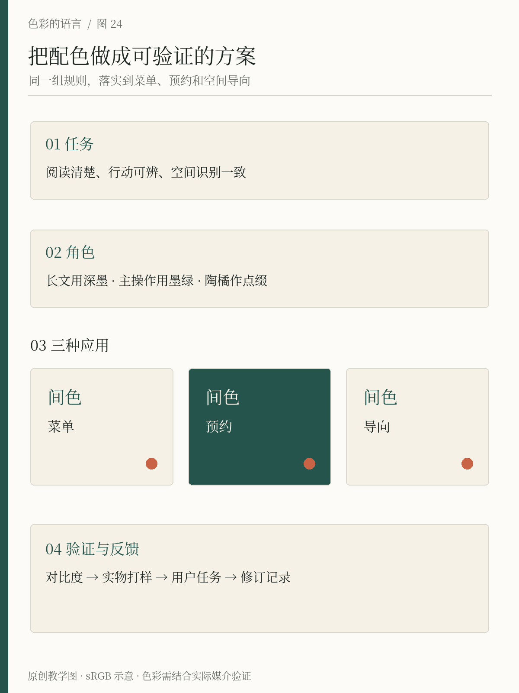

# 第24章 从设计任务到完整色彩方案

最后，我们把前面分散的决定合在一起，为原创文化空间间色整理一份可以应用、可以检查的色彩方案。它包含阅读、饮品与小型展览，既有纸面菜单和现场导向，也有活动预约界面。这里不追求给出唯一漂亮的答案，而是让每一步都有理由，下一位接手者也能继续使用。

## 把任务写成可以观察的行为

先把“有文化气质、温暖、有辨识度”改写得更具体：来访者能在入口找到店名，能在菜单上先看见品名与价格，能在手机上找到活动时间并完成预约，预约失败时知道怎样修改。气质仍然重要，但它应与这些行为一起工作。

同样要记录约束。空间已有木色地面与部分书架；菜单使用浅暖纸张；网站包含不同来源的活动照片；团队需要自己更新内容。这意味着颜色系统要容纳天然材料和变化的图片，不能假定每一张新照片都能重新调色，也不能要求每次更新都重新发明一种活动主题。

设计目标可以写成一句工作说明：“以浅暖背景承载阅读，以深色维持信息清楚，以墨绿建立识别和主要操作，以陶橘提示局部活动亮点。”它描述的是关系，后续某个色值调整时，仍可保持这条主线。

*图24：任务、颜色职责、菜单/预约/导向三种应用与验证形成闭环。反馈回到具体角色或配对，不必每次推翻整套颜色。*

## 选择基础色，并说明使用限制

间色使用墨绿 #24544B、暖纸 #F6F1E7、陶橘 #C86345 与深墨 #202824。先把这四个值视为 sRGB 设计初稿，再分配角色。暖纸承担主要底面，深墨承担长文与价格，墨绿承担主要操作与识别，陶橘承担局部强调。

这一步最容易出现的错误，是让陶橘同时负责小字、背景、错误与按钮，只因为它已经在色卡中。每一种用途都需要单独检查。若错误提示确实需要深暖色，就增加独立的错误角色，例如深陶 #9B3A2C，并在文档中说明用途，不把它混进“任意装饰红”。

对比度应检查实际相邻的前景与背景。下表按 WCAG 使用的 sRGB 相对亮度方法计算，显示值保留两位小数；是否达到阈值依据未舍入数值判断。普通文字的最低目标是4.5∶1，大字的最低目标为3∶1；字号判定、标志及其他例外应参照规范定义，不能把“看起来挺大”当成条件。[来源：W3C，Understanding Contrast (Minimum)](https://www.w3.org/WAI/WCAG22/Understanding/contrast-minimum.html)

| 前景 / 背景 | 计算对比度 | 本方案决定 |
| --- | --- | --- |
| 深墨 #202824 / 暖纸 #F6F1E7 | 13.42∶1 | 正文与重要说明可用 |
| 墨绿 #24544B / 暖纸 #F6F1E7 | 7.63∶1 | 标题、链接等文字可用 |
| 白 #FFFFFF / 墨绿 #24544B | 8.59∶1 | 实心主按钮文字可用 |
| 陶橘 #C86345 / 暖纸 #F6F1E7 | 3.50∶1 | 不作为普通小字 |
| 深陶 #9B3A2C / 暖纸 #F6F1E7 | 6.15∶1 | 错误文字可用，另配明确文案 |
| 深墨 #202824 / 浅绿 #B9D9CE | 9.98∶1 | 深色主题浅绿按钮上的文字可用 |
| 浅陶 #F2B7A6 / 深墨 #202824 | 8.70∶1 | 深色主题错误文字可用，仍配文案 |

这张表验证的是列出的纯色组合，不包括透明叠层、照片背景或所有字号的主观舒适度。印刷菜单也不能拿屏幕对比度数值当作最终纸面质量证明，还需看实际样张。

## 三种应用，各有重点

菜单优先保证长时间阅读。暖纸底、深墨正文，墨绿用于栏目标题，陶橘用于少量分类标记。价格与品名通过位置和排版建立关系，不能只靠同一种颜色分组。饮品照片即使有变化，也不应把文字压到复杂背景上。纸张本身有暖色时，先比较留白纸面与印背景的样张，再决定是否需要整面铺色。

预约界面优先保证操作顺序。活动信息与可选时段用清楚的层级呈现，主按钮使用墨绿与白字；选中时段增加勾选和边界；失败时在对应字段旁写清原因。颜色让人更快发现线索，文字与形状让意义不依赖颜色辨认。这与 W3C 对颜色使用的要求一致，但一个页面只做对这一点，并不代表已经符合整套无障碍规范。[来源：W3C，Understanding Use of Color](https://www.w3.org/WAI/WCAG22/Understanding/use-of-color.html)

现场导向优先保证距离与路径。入口、楼层与活动区使用一致的字形、箭头和命名。陶橘可以提醒活动入口，但即使访客不区分它与其他颜色，文字和方向也应使路径清楚。先在现场放置临时全尺寸样张，分别从入口、转角和目的地观察，再确认材料与安装位置。

同一颜色的面积因此不同：菜单中陶橘很小，活动海报中可以更明显，空间里则可能集中在局部家具与告示。品牌联系来自稳定的关系与反复出现的关键线索，不要求每个载体严格使用同一面积比例。

## 验证要能发现具体问题

把试验任务交给没有参与设计的人：“找一杯不含咖啡的饮品并读出价格”“找到周末活动并预约”“从门口走到展览区”。观察犹豫发生在哪里，先不要解释颜色的含义。若被试找不到价格，可能需要改信息位置；若看不清日期，可能需要改字号或对比；若误认按钮已经选中，就检查状态表达。

验证不应只问“好不好看”。可以分别询问哪里最先吸引注意、什么地方读起来费力、哪个元素像能操作、哪条错误提示让人不知所措。这些回答能指向修正对象，比给整页一个审美分数更有用。

然后检查跨媒介：手机与桌面是否都能阅读，浅深主题是否都保留状态，菜单样张和现场照明是否改变颜色关系。第23章介绍的配置文件与打样流程用于帮助管理输出，不代替现场观察。[来源：ICC，RGB Color Managed Workflow Example](https://www.color.org/ICC_white_paper_23_RGB_Workflow.pdf)

## 留下一份别人能用的规范

最终文件至少交代基础颜色、语义角色、允许配对、文字和图形边界、浅深主题、状态示例，以及纸面与实物的确认方法。把一张正确菜单、一张预约卡和一组导向示例放进去，通常比十页抽象形容词更容易被团队沿用。

同时保留反例：陶橘小字落在暖纸底上、透明文字压在照片上、错误只有红边框、深主题中仍用深绿小字。反例旁只需说明失败原因和替代方法。规范的作用是帮助做决定，不是让后来者背诵禁令。

最后给方案版本与日期。若承印方换纸、场地换灯、界面加入新状态，就回到受影响的部分检查。学习色彩最终形成的是一种工作习惯：先观察条件，明确任务，安排关系，再拿实际结果验证。它可以从一张小卡片开始，也能够逐步支撑一个完整设计系统。

## 完整方案实景：从四个色号走到一组文化空间物料

*图24-2｜AI 教学示意，虚构的间色 JIANSE 阅读空间。画面中的海报、书、折页、杯具和手袋均为概念应用，未表示已完成实物制作。*

从左上角海报开始看：暖纸承担信息背景，墨绿承担名称，陶橘把活动日期标出来，摄影保留自身的植物色和阴影。再移到右侧手袋，墨绿扩大为主体，浅字重新承担识别。左下角书册也使用深绿封面，但纸张边缘与书脊厚度让它和布袋产生不同的视觉重量。同一系统的统一来自颜色角色和排印习惯的延续，不要求每件物料具有相同比例。

杯子最容易暴露系统的实际约束。曲面、接缝和握持都会遮挡信息，因此名称与小图案需要在较窄的正面区域仍能辨认；把海报缩到杯面，并不能自动得到合格杯子。折页则需要考虑展开、合上时各自能读到什么。图里显示的统一气质只是第一轮方向检查，后续仍要落实平面文件与样品。

用本章的交付方法审查这组图：先列每件物料必须传达的信息，再标出颜色角色；分别检查远看海报、拿起折页、握住杯子、背起袋子这几个场景。若一套色彩在所有场景里都只有装饰作用，却没有帮助识别、阅读或分组，就需要回到任务重做分配。

## 本章资料

- W3C：[Understanding SC 1.4.3: Contrast (Minimum)](https://www.w3.org/WAI/WCAG22/Understanding/contrast-minimum.html)，文字对比度目标与适用条件。
- W3C：[Understanding SC 1.4.1: Use of Color](https://www.w3.org/WAI/WCAG22/Understanding/use-of-color.html)，意义不只依赖颜色。
- ICC：[White Paper 23: RGB Color Managed Workflow Example](https://www.color.org/ICC_white_paper_23_RGB_Workflow.pdf)，多目标输出与打样。
- 间色为本书原创虚构项目；方案、表格和任务为教学设计，对比度为本书按标准公式计算的结果。
